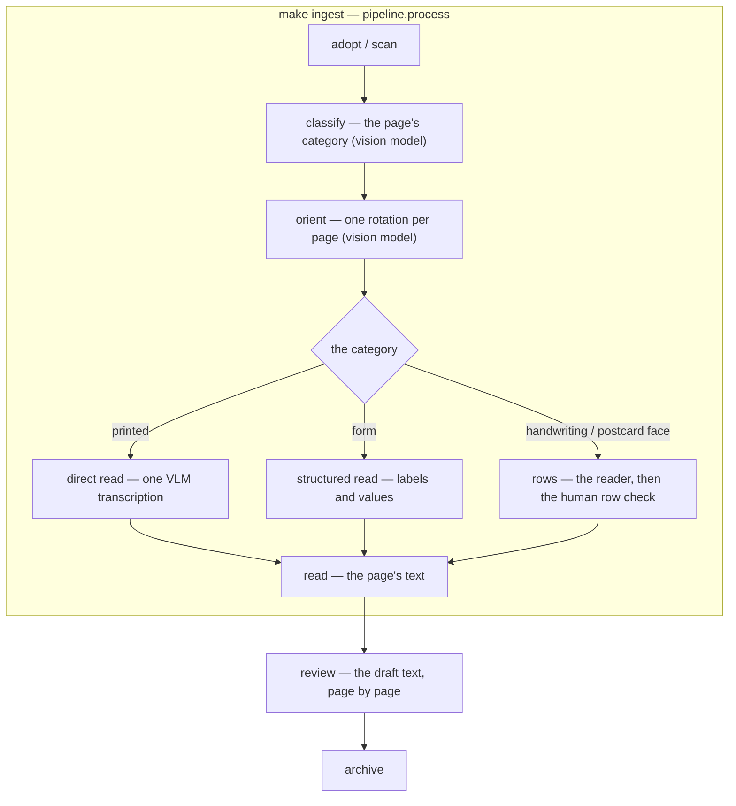
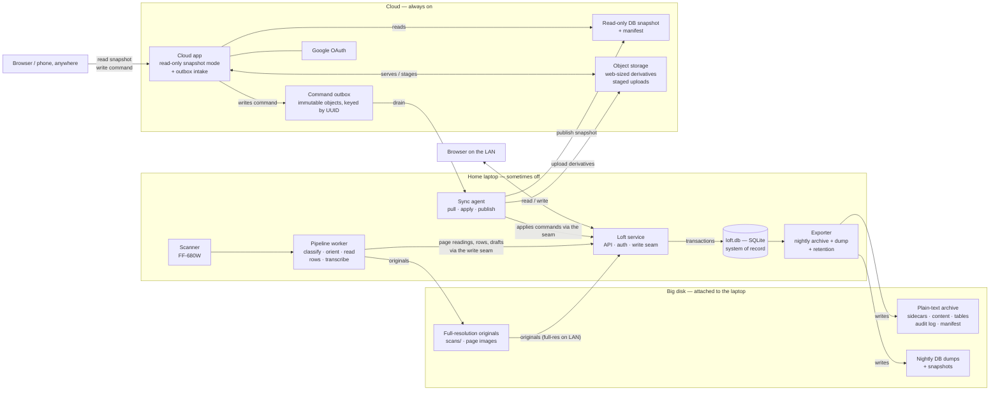
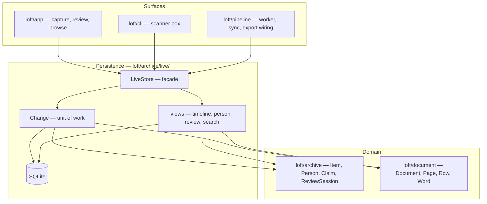

# Family History Album — Tech Spec & Architecture

- **Status:** v0.3 — **for review** · §16 Import flow added (PLAN/PLAN.md Phase 1 draft) · §17 the live system added (database of record + remote sync, proposed) · §18 the schema and on-disk form added (proposed)
- **Companion:** `PRD/PRD.md` v0.5
- **After approval:** prototype with fake content (`tools/fake-data`), per §13.

---

## 0. What this document decides

It makes the architectural calls the PRD left open, with rationale. Section 12 lists the decisions that need *your* confirmation. It deliberately does **not** re-argue the PRD — it implements it.

---

## 1. Principles (inherited)

- **P1 — Folder-first.** The archive is a folder; the app is a lens over it.
- **P2 — Boring stack.** Vanilla HTML/CSS/JS, no framework, no build step, no database in the browser. Files + `fetch`; the live store is SQLite on the laptop (§17).
- **P3 — Generational durability (PRD §18).** Open formats, sidecar metadata, a README written for a reader in 2060, 3-2-1 backups across households, the app disposable by design.
- **P4 — Propose/confirm.** ML/OCR never assert; everything enters as `proposed` until a human confirms.
- **P5 — Privacy by default.** No accounts, no analytics, no third-party CDNs for family content. Single exception: street-view imagery (§6).
- **P6 — Performance at scale.** 10,000 items / 50,000 images; incremental loading; ≤ 100 KB initial payload.

---

## 2. Stack

- **Vanilla ES modules** — no framework, no build step, no `package.json` runtime dependency. The app is a set of `.js`/`.css`/`.html` files that work forever. (Vanilla means no framework or build step — not no classes: `class` is ES2015 and allowed; see docs/coding-standards.md.)
- **Hash-based routing** (`#/timeline`, `#/item/letter-1963-05-14-01`, `#/themes/t-the-boats`) — works on any static host, no server rewrite rules.
- **PWA:** `manifest.webmanifest` + `sw.js` — installable ("Add to Home Screen"), offline shell + cached archive content (§9).
- **Tools** (`tools/`, optional at runtime): Node **or** Python — one choice, made in §12. Used for thumbnails, index rebuild, archive checks, CSV export, fake-data generation.
- **Serving:** a free static host (Cloudflare/Netlify/GitHub Pages) serves the app **plus a published projection** — metadata, thumbnails, stories; no full-res by default (§5). **Google Drive is the archive's home**, accessed through its official API — the phone stores nothing and nothing is hosted in the house. Performance: Google/static CDN for browsing; Drive API for review reads.
- **Why this stack:** durability (files outlive any framework — P3), the payload budget (P6), hostability anywhere, and the entire surface is ~10 screens.

---

## 3. Archive layout (the canonical data)

```
archive/
  README.md              # for a reader in 2060 — what this is, who these people are, how to open it
  people.json            # identity table: the cast (ids, names, years, bios) + relationships
  places.json            # identity table: places (names, optional coords, street-view refs)
  themes.json            # identity table: themes/stories (definitions + ordered items)
  assets/
    <id>/
      item.json          # sidecar — metadata only (the truth); item-2.json, … supersede it
      story.txt          # primary content: the narrator's own words (stories)
      transcription.txt  # primary content: a letter/document's transcription draft
      page-01.jpg        # primary content: originals, open formats only
      thumbs/            # derived thumbnails (pipeline output)
```

- **Sidecar-first (P3.4) — what it means:** each item folder holds its content (scans, the story text, the transcription draft) *plus* a small JSON file sitting alongside them (a *sidecar* — the term comes from photography's XMP files) with that item's metadata. There is no single database blob: `index.json` and `transcripts.json` are derived summaries, regenerable from the sidecars. One corrupt file loses one item, never the archive — and merging a cousin's archive later is just merging sidecar folders.
- **Primary vs derived (requirement).** *Primary data* — scans, photos, story text, testimonies, anything a user provides or states directly through the UI — lives in the archive as content files plus sidecars, in a form a reader in 2060 can open. *Derived data* — descriptions, identified people/places/themes/pronouns, the links between documents and people/places, relationships, the index and transcripts — is computed by one shared engine (`tools/projection.py`) from the primary data **only**, and is never hand-edited: not in the projection, and never the only copy. The engine runs in the batch publish path, in scan import, and in the site-capture save path — one implementation, three entry points, no duplication.
- **Append-only (requirement):** no file in the archive is ever edited or deleted — a change is a new file that supersedes the old one, and the old file stays forever. **One documented exception:** the proposed-queue reject path (`reject_proposed_person`/`reject_proposed_place`) deletes the *proposed* record file via the store's single `delete` — a proposed record is a transient review work item that has never been published, not an artifact; everything that has ever shipped stays append-only. A sidecar's first version is `item.json`; a supersession is a new self-contained file `item-2.json`, `item-3.json`, … (the full metadata again, plus `supersedes: "<previous file>"`). Primary content files version with their sidecar (v1 → `story.txt`, v2 → `story-2.txt`). Publish/rebuild tooling resolves the highest version; deletion is a supersession with `status: "deleted"`. The identity tables (`people.json`, `places.json`, `themes.json`) follow the same rule when written. The derived files (`index.json`, `transcripts.json`, `app/data/*`, thumbs) are regenerable caches — they are rebuilt, never treated as canonical, and hand-editing them is a bug (a test fails the committed projection against publish). All writes go through one append-only store (`tools/store.py`); tests inject a fake filesystem that fails on any write to an existing file. The identity tables live in the archive — never only in the derived projection — and the projection is regenerated from them.
- **Database vs project content.** The database is the archive: items, sidecars, people, places, themes, relationships, testimonies — everything the app renders. Project content — code, docs (PRD, TECHSPEC, PLAN, PRECEDENT), the private interview records, tests — records decisions and process; a fact becomes database content only as an attributed item (sidecar, testimony, person record), never by living in a doc. Interview transcripts enter the database as dated, attributed, verbatim story items (`told_by` the narrator, `source` the session, one item per session) — the project keeps its own working records under whatever names, but the archive never holds a doc called INTERVIEW.md. The same rule applies to code: real content never lives in a tool — `tools/demo_data.py` is the fictional demo generator (docs/coding-standards.md), and a test guards that the real family's names never appear in it.
- **The object model lives in one module:** `tools/records.py` defines Person, Place, Org, Relationship, Item and every closed vocabulary (relationship kinds, date precisions, item types/statuses); `archive.save_item` validates sidecars against the Item record at the write seam — a developer reads the model in one place, and the archive and the model can never drift.
- **The indexing posture (superseded by §17):** no server database — the folder is the store, and every derived layer (index, transcripts, hashes, search, future embeddings) regenerates from the sidecars. The derived layers upgrade as needed (pre-built search index, queue as a derived view); SQLite-as-*cache* (never the store — regenerable, so it preserves the invariant, but costs tooling) is the revisitable knob past ~100k items or if SQL queries are genuinely needed. **`edits.jsonl`** — an append-only, plain-text audit log (timestamp, item, field, old → new, who) for every write; the one truth file that is a log, not a cache, and the answer to the no-history gap (corrections currently overwrite silently).
- **IDs are stable forever:** `letter-1963-05-14-01`, `photo-1972-06-01`. Never renamed, never reused.

---

## 4. Data model (JSON)

**Item** (core fields):

```json
{
  "id": "letter-1963-05-14-01",
  "type": "letter",
  "title": "A week in the flat",
  "date": "1963-05-14",
  "date_precision": "exact",
  "people":  [{"id": "p-mum", "status": "confirmed"}],
  "places":  [{"id": "pl-aldgate-kensington", "status": "confirmed"}],
  "themes":  [{"id": "t-the-flat-search", "status": "proposed"}],
  "source": "Box 3 — Letters 1963",
  "description": "",
  "provenance": "",
  "sensitive": false,
  "status": "catalogued",
  "assets": [{"kind": "page", "file": "page-01.jpg", "caption": ""}],
  "created": "2026-08-02"
}
```

- **Primary content is files, not fields.** A story item's text is `story.txt` in its folder, a letter/document's transcription is `transcription.txt` — referenced by the sidecar's `assets` (`{"kind": "story"|"transcription", "file": …}`), versioned with the sidecar. The sidecar JSON never carries the text; the projection's items embed it again at publish (the projection is derived, so embedding is fine there).
- **References carry a status** — `confirmed` | `proposed`. That is the ML seam (P4): models write `proposed`; humans flip to `confirmed` with one tap. No schema change when OCR/labeling arrive.
- **Dates:** ISO + `date_precision` (`exact | month | year | approx`). Approx renders at range start with a subtle marker; filters treat it honestly.
- **Person:** `{"id","name","years","relation","bio","photo"}` — thin bios are honest (PRD §4); never padded.
- **Person IDs are name-based** (p-alex, p-nora, p-owen) — first-name-only for the main characters where unambiguous; on a name clash the ID qualifies with the surname (p-harper-hale). IDs never change once catalogued.
- **Place:** `{"id","name","aliases","note","lat","lng"}` — `aliases` are the short forms the reader hyperlinks ("Dunmoor" → Dunmoor Primary School); the same alias seam as people (§16.4).
- **Relationships — RESOLVED (user):** `people.json` (the archive's people identity table) carries typed edges `{"a", "b", "kind", "label_a", "label_b"}` (`spouse | parent | sibling | inlaw | teacher`) — `label_a` is what B is to A. Person pages show a "Related" block; the family tree view (`#/tree`) renders generations from the edges. **Labels are gender-neutral by design** (`child`, not `son` — the model never assumes gender; the family's own gendered words live in the free-text `relation`/bio where the family itself used them). No runtime library; `tools/export-gedcom` remains future work for interop. **Relationships are derived, regenerable content:** the family structure is stated in the primary data (the interview answers: "Mum was Nora… Dad is Owen Hale. Mum's mum was Fern… Dad's sister is Miriam… His aunt is Wilma Hale", "Wilma is Miles's sister", "Harper… married Owen's brother Dale", "Owen's parents Miles and Vera") plus the letters, and the shared engine must be able to regenerate the edges from those artifacts (with the propose/confirm seam for what inference cannot prove). The archive is the only home of the table, and `tests/test_publish.py` fails if the projection ever drifts from it again.
- **Bios are derived, source-attributed text** — rebuilt when evidence changes (new letters, testimonies); disputed facts are omitted from generated text, never adjudicated (§16.9).
- **Aliases require attribution** — a form attested in an artifact's text ("mamie" in the 1977 letter, "Lex" in the 1990 one, "BF" — the reviewer's own word) or in a stored verbatim comment. Agent-invented forms ("Daddy", "Auntie", "Mummy") are not aliases. The canonical name always matches; actual names are not listed as aliases (§16.4).
- **`pronouns` (optional)** — only where the archive evidences them, never guessed: the person's own statement is the gold standard (Alex: they/them — the narrator's own words), then attested text by others (Nora/Owen via the narrator's interviews, Harper via the 1977 letter's "She's brought the three kids"). No attestation → no field. Rendered on the person page next to "Known as".
- **`dob` (optional, future seam)** — ISO date, discovered politely in interviews. Birth dates disambiguate presence by date: Eli is not at the Isle of Seagate because he was born after the trips stopped — an inferred presence the 1977-style attribution rule alone cannot catch (user).
- **A dated, attributed comment (testimony) is a story item**: `date` + `told_by` (the speaker) + verbatim text + `source` (WhatsApp, letter, recording) + `people[]` links to its subjects (PRD §19, G7) + `comment_on` (the artifact it responds to — reverse-looked-up and rendered as that item's "Responses"). Testimonies have no scans.
- **Theme/story:** `{"id","title","subtitle","items":[{"id","note"}]}` — the door, plus the arranged evidence in order. The app renders the arrangement; it never interprets (PRD §10).

- **Event items:** `type: "event"` with a closed `kind`
  (`birth | marriage | death | other`) — an attested happening (a concert a
  letter mentions) that flows through the item pipeline (timeline, filters,
  search). Person life events — a person's `dob` is a birth, `dod` a death,
  a dated spouse edge a marriage — are **derived at render time**, never
  stored as items (the identity tables stay the single source of truth).
- **Relationship dates:** a spouse edge may carry
  `date: {date, precision}` — the marriage date, the derive's input.
- **Clarification / reflection flags:** story items may carry
  `clarification: true` (an identity fact; must name people/items refs) or
  `reflection: true` (perspective; no events' date — dated by its told day;
  must name people/places refs), never both. The `published()` seam (data.js)
  excludes both from every discovery surface; they render only in their
  blocks on the pages they attest/mention (see PRD/MEMORIES.md).
- **Evidence flag:** a found record — a web capture, a
  directory page — is `evidence: true` (non-story types only; must name
  people/places/items refs). It is not a family happening: the `published()`
  seam excludes it from the timeline, and it renders on the pages it attests
  (the plaque capture lives on the Lark Inn's page). The recognition
  principle: the timeline shows only things someone in the family would
  recognise as having happened to the family at that time.
- **Sources:** a web-page document carries
  `sources: [{url, title?, accessed}]` (validated: http(s) url + access
  date) — rendered as hyperlinks on the item page. A web capture is dated by
  its **access day** (Rule K: the item is our capture).
- **Place coordinate precision:** `precision ∈ {"", exact,
  street, town, county, region, country, continent}` — the coarsest level the
  stored point honestly represents; the map draws an uncertainty ring for
  anything coarser than a pin. The import flow's geocoding proposes the
  precision (IMPORT-PRD Rule P).
- **Person↔place links require attestation:** a person is at a
  place only when the item's place ref names them in its per-place `people`
  list — co-mention in an item is not presence (the 2001 email's 91 people
  and 8 places link nobody). The map's person filter, the person page's
  Places row and the place page's People row all read through this one rule.
- **Person↔person links, same test:** a person page's People
  row shows the attested relationship edges only — co-mentioned names never
  render (the recognition principle: a person reading their own page would
  recognise everyone on it). Derived life events only place on the spine
  from point precisions (exact/month/year/approx) — "died after 1917" is not
  a 1917 happening; the fact stays on the person page.
- **Involvement dates:** a long-lived document (a family record,
  a guest book, a logbook) involves different entities at different times.
  **Any ref may carry an involvement date** (`date: {date, precision}`, the
  dated-fact shape, validated at the write seam): when that entry/signature/
  annotation was made — written by the import flow from the entries' own
  content, confirmed by the reviewer. **Placement rule:** on a person's page,
  a person-filtered timeline, and a place page, the item is placed by the
  ref's involvement date; without one, the derived floor — an involvement
  can't predate the item, nor (for a person) their birth, so `max(item.date,
  person.dob)` puts the Kendall–Pryce record in the 1940s on Nora's page
  (her birth entry), never the 1860s. The dob floor is exact for
  birth-linked records and a lower bound elsewhere — the attested date is the
  general mechanism, the derivation a convenience. The item's own date stays
  Rule K (first attestation); only the per-entity placement shifts.
- **The timeline spine:** entries (items + derived life
  events) pack into **count-sized, year-aligned periods** (~20 entries),
  rendered newest-first, each titled with its range plus a **theme hook**
  when one theme covers ≥2 items and a fifth of the period's items; a period
  never splits a year, and a year alone over the target is its own period.
  Counts are honest: "N periods, M items · K events".
- **Archive-quality evals (tests/):** the drift guard
  (projection ≡ publish) is joined by guards the system runs every gate:
  letter/document descriptions are specific and correspondence-distinct
  (test_descriptions), place notes never carry process jargon
  (test_place_notes), no catalogued story is dated by its told day without
  the narrator's words (test_story_dates), and **everything catalogued is
  visible somewhere** — timeline items' dates parse, fragments name existing
  targets (test_completeness).
- **Render once per page:** an item never appears twice on the
  same page. The Memories/Responses blocks own the stories; an artifact list
  beside them excludes stories (`artifacts()` in connections.js — the place
  page's "N items from X" counts artifacts only), and the memories block
  takes `exclude` (ids already rendered) so a curated arrangement or a
  Nearby list can never re-show them. A new page that lists items next to a
  stories block must use one of the two seams — the block is the shared
  component, the rule is enforced there, not per page.

---

## 5. Capture & curation (review mode)

Capture: `<input type="file" capture>` or MediaDevices; auto-sequence naming (`letter-1963-05-14-01.jpg`); envelope first, per the PRD ritual. Curation: 3 fields + story line; `draft` → `catalogued`; edit metadata; **never delete** (PRD §3). **Streamlined capture sessions (phone-first):** enter once, photograph many items back-to-back; the app **suggests date+7 for weekly letters**; title/story accept **speech-to-text** (Android Web Speech API); people/places tagged later in batch.

**The phone is a thin client; Drive is the archive's home (user constraints: work from the phone, store nothing heavy on it, host nothing in the house).** The app talks to Google Drive through its official API — Google sign-in (Google Identity Services, PKCE, no server) against a **dedicated family *Loft archive* account**; the app lists, reads, writes, and uploads the archive folder. Captures upload immediately; nothing of the archive accumulates on the phone beyond browser cache. No FSA, no synced folder, no local copy — and nothing runs inside the house.

**Write path:** OAuth (archive account) → Drive API `files.create/update` for sidecars and images, `media` upload for captures, thumbnail URLs served from Google's CDN for browsing. Desktop Chrome does the bulk box-digitization the same way — same client, bigger screen.

**Bulk scanning (sheet-fed + slide/photo scanners — user):** scanner output lands on a laptop; `tools/import` (Python) uploads to Drive with auto-naming; the reviewer tags on the phone. The phone camera is the ad-hoc path only; scanner output is the quality path (300 DPI).

**What lives where (the two surfaces):**

| Surface | Contents | Runtime |
|---|---|---|
| **The archive (Google Drive)** | full-res scans, sidecars, transcriptions, derived files (index, future embeddings) — the family's dedicated account | Drive API via Google sign-in; full-res read only when authenticated |
| **The site** (browsable) | app + published projection: metadata, thumbnails, stories, transcriptions | static CDN — fast, **family-only behind F6 accounts** (PRD §11; no public surface at all until they land), no full-res |

**Where curated data lives:** primary content (transcription, story text, scans) sits in each item's folder as **files** (`story.txt`, `transcription.txt`, `page-01.jpg`); captions and links sit in the **sidecar** (`assets/<id>/item.json`, plain JSON) inside the archive. Derived data — the search index, and future **embeddings** — are regenerable files (`index.json`, later `embeddings.json`), never the only copy. `loft publish` (Python, laptop step) regenerates the projection from the archive for the static host; free-tier file-count caps bound it to thumbnails + metadata — which is also the privacy posture: **the intimate full-res layer is never public** (480px letter thumbnails aren't readable documents).

**Durability is export-driven:** Drive holds the live archive; the **annual full export** (folder download + CSV, `tools/export-csv`) to external media and the brother is the load-bearing 3-2-1 ritual (PRD §18.6). Files stay plain and open; if Google ever changes terms, the folder downloads whole.

**Performance, answered directly:** browsing rides the static projection (fast); review reads ride the Drive API with Google's thumbnail pipeline; the phone stores nothing. The one honest dependency: the reviewer path requires Google identity — accepted consciously, mitigated by the export ritual and the 2060 README (§18).

---

## 6. Maps & street view

- **Places door, v1:** curated place cards (the period, the artifacts from that era, dates) plus a **map view built on Leaflet + OpenStreetMap raster tiles** — free, no API key, standard attribution (user-approved). The prototype ships this; the non-tile dot view is the offline / tile-failure fallback — cards and text always remain.
- **Street-view cards** (PRD §10, Should): public imagery, not family content — Google Maps embed iframes (no key) or static images; degrade gracefully offline. Approved with the map (user).
- **Map modes (future — recorded, not built):** explicit all-places / date-range / person-subset views, and remembering where a returning user was looking last. The first-visit default already shows the whole archive — full date range, every place, world viewport — until the user narrows via the slider (the ±WINDOW window) or person chips (PRD §15).
- **Open: vague or unknown dates.** An item dated "circa 1972" has a dot whose year is a guess — the slider window must place it honestly via `date_precision` (never silently excluded, review: silent exclusion).
- **Person chips list only people who can appear on the map** (requirement): a person with no place-linked item (e.g. Jude — his only item is a placeless testimony) never gets a chip, because selecting them would filter the map to nothing.
- **A person's map = the places they are AT, per-place** (requirement): an item's `places[]` entry may carry an optional `people` list — the people who are *at* that place in the item's context; without one, everyone in the item's `people[]` is taken to be there (single-participant items). Never the places of items the person merely *told* — telling a story about someone else's location is not a link to it. **A letter's places are its participants' own geography, not the recipient's**: the 1977 letter's gigs (Aldgate, Walthamhollow) are Nora's, the knees-up (Easthaven) is Owen's, Marlock is Miles & Vera's house, Tornia is Harper & Dale's — and the recipient (Fern, "Chère mamie") is at none of them (user). A place listed without textual evidence is removed, not annotated (Marlock dropped from the Aldgate-addresses story, whose verbatim text never mentions it). **Being named in a family story — or sharing a surname — is not being at its places** (user): the Hale-family story's own claim is that "the people who Harper saw in Marlock are Owen's parents Miles and Vera" — Owen and Dale are reference points there, so Marlock belongs to Harper/Miles/Vera only; and Halfway's Marlock link was a guess (the canal passes through the town, but the boat is evidenced at Innisfree), so it was removed.
- **Attribution:** OSM + Leaflet credits on the map view; Google's terms for the embed. Both are public map imagery — the same privacy posture as street view, never family content.
- **Scale-aware markers** (requirement): no dots or labels at overview zoom — the heat map stands alone; dots appear at regional zoom (≥ 8), labels at street zoom (≥ 12), and a lone active place always gets its dot and label. The offline dot view always shows labels — its primary device is a tablet (no hover, PRD §11) and it has no heat map to protect (review). Rationale: at country zoom a red dot is a meaningless pixel and a label a blob — both obscure the heat map (user).

---

## 7. Privacy & security

- **No PIN — authentication is the archive account; the projection is family-only, not public** (user: "it's a website, not a bank card"; PRD F6: no public surface at all until accounts land, §15 — the earlier "open by design" posture is superseded). The projection carries metadata, thumbnails, stories and transcriptions — **transcription hosting is the product** (PRD §6, §10); full-res scans sit behind Google sign-in with the family's archive account.
- **No analytics, no telemetry, no third-party CDNs** for archive content. System font stack (or self-hosted fonts). Street view is the only external fetch.
- **The archive lives in Google Drive (its home), accessed via Google sign-in to a dedicated family archive account.** Files remain plain and open (PRD §18.8); real authentication gates full-res — stronger than the courtesy PIN on the public projection.
- **Future ML/OCR runs locally** — on-device or the household server. No third-party cloud processing of family content, ever.

---

## 8. Performance budgets (PRD §11)

- First meaningful paint ≤ 2 s on 4G; initial JS/CSS ≤ 100 KB.
- **Timeline:** decade → year rows → week rows; DOM virtualization (only visible rows in the DOM); 60 fps scroll; precision-aware placement.
- **Images:** thumbnails in every list; full-res swap on open; `loading="lazy"` + `decoding="async"`.
- **Index:** `index.json` (metadata only) loads first; `transcripts.json` (heavy text) lazy-loads when search or reading needs it. Budget: ~2–5 MB index + ~5–10 MB transcripts at 10k items — segmented by decade if it grows beyond.

---

## 9. PWA & offline

- Manifest + service worker. Cache: app shell (always), index/people/places/themes (first load), thumbnails (LRU), full-res images (on demand).
- **Honest boundary:** the site's projection — metadata + thumbnails — is fully cacheable, so the whole *browsable* archive works offline on any device. Full-res exists only in the archive (Drive), read via API when authenticated. The review path needs network — it is a cloud client by design.

---

## 10. Search

- A **derived inverted index** (`search.json`, emitted by `tools/rebuild-index` with offline tf-idf weights) loads fast and deterministically — the browser no longer builds the index from raw text at load. Regenerable from sidecars like every derived layer.
- Fields: title, description, story, transcription, people, places, themes, source.
- **Transcription search is pattern discovery** (PRD §6): "migraine" across 830 letters surfaces the drift. This is a headline feature, not an afterthought — the search screen earns its place on Home.
- Ranking: exact > prefix > fuzzy; results filterable by type / decade / person / place.
- **Semantic search over testimony embeddings** (`embeddings.json`, derived and regenerable): "what did people say about the boats?" — the testimonies from §19 become the first real corpus for the ML seam.

---

## 11. Tools (`tools/` — no runtime dependency)

- `make-thumbs` — thumbnail pipeline.
- `rebuild-index` — derive `index.json` + `transcripts.json` from sidecars (folded into `publish` in the current implementation).
- `check-archive` — schema validation, dangling references, missing assets; the durability health check (PRD §18.9).
- `publish` — regenerates `app/data` from the archive: identity tables + sidecars + primary content files → index, people, places, themes, transcripts, assets, avatars; deterministic, tested, the only writer of the derived projection.
- `derive` — the shared derivation engine (`tools/projection.py`): resolved items, identity tables, index and transcripts. Used by publish (batch), import (scan ingest), and the capture server (site stories) — one implementation, never duplicated.
- `export-csv` — human-readable metadata + transcription export; part of the annual 3-2-1 export ritual (PRD §18.6).
- `fake-data` — the **demo** projection generator (fictional content only — a demo family, invented places and letters; no real names, guarded by a test). The real family's content lives in the archive and is published by `loft publish`.
- `import` — inbox → archive: assets + sidecars + thumbs + index; the minimal date prompt (§16.3).
- `upload-drive` — mirror the local archive to the dedicated Google Drive account (§16.6).
- `resolve-mentions` — transcription/address mentions → proposed people/places in sidecars (§16.4).
- Dev serving: `python3 -m http.server` or `npx serve` — zero install.

---

## 12. Decisions to confirm (your review)

| # | Decision | Recommendation |
|---|---|---|
| 1 | **Vanilla-first — RESOLVED (user)** | A framework adds no value at this scale and hand-rolling stays manageable. Not "React or nothing": small JS or a CSS framework (degrading well) remains acceptable; revisit during development if things get messy (§15) |
| 2 | **Drive is the archive's home (dedicated family account, official API, thin-client phone); site = published projection (metadata/thumbnails/stories); annual export is the durability ritual** | Yes — nothing stored on the phone, nothing hosted in the house |
| 3 | **Sidecar-first layout** (`item.json` canonical, index derived) | Yes — one bad file loses one item (P3.4) |
| 4 | **Street view + Leaflet/OSM map — RESOLVED (user)** | Public imagery only; OSM attribution; degrades offline |
| 5 | **Tools language — RESOLVED:** Python (user) | — |
| 6 | **Hosting target** — free static host for the app; archive home = Google Drive free tier | Cloudflare Pages (or Netlify / GitHub Pages) + Drive; nothing paid, nothing self-hosted |
| 7 | **Working title — RESOLVED:** "The Loft" (user approved) | — |
| 8 | **No PIN on the projection — open by design** (the archive account is the gate) | **SUPERSEDED (§7/F6):** no public surface at all until accounts land — the projection is family-only; nothing deploys before the F6 gate (PLAN/PLAN.md) |
| 9 | **Family relationships** — typed edges in `people.json`; person pages show relationship labels; `#/tree` renders generations | **RESOLVED (user)** — built in the prototype. **Alignment:** no genealogy *tooling* (the PRD anti-pattern) is not the same as no object-model standard — **GEDCOM X** is adopted as the object-model reference (person/relationship/agent/event/place/source vocabulary; **residence events replace the place-household field** — the standard's model is better); **date precision extended** with `before`/`after`/`between` so the mapping is lossless; `tools/export-gedcom` targets **GEDCOM 7.0** with a documented one-to-one mapping (excludes proposed links and proposed residence; stories shoehorn as NOTES on the people they reference); **`tools/import-gedcom`** is the inverse (ids recovered via REFN, places by name) and the round-trip is exact — verified by tests and on the real archive; both sides parse-verified with `gedcom7` (strict ABNF grammar) |
| 10 | **Live system store** — multi-user curation and corpus-scale generation need a real store; the folder stays the durable materialized contract | **RESOLVED (user)** — Supabase (Postgres + pgvector); small family-user set; generation on the reviewer's laptop; tenant isolation is a far-future seam (§14), not built |

---

## 13. Prototype build plan (next, after your approval)

- **Fake data:** `tools/fake-data` → 24 letters (lorem-ipsum, period-flavored filler, dated 1962–77), 12 CC0 photos (picsum / Wikimedia Commons, or the designer agent fakes them), 6 people, 4 places, 3 themes, 1 story ("The boats"), 1 street-view card stub. *(The projection is real content only — the lorem filler and invented photos are gone; the timeline's empty 1962–77 years are the honest state until the letters are scanned.)*
- **Files:** `index.html`, `app.js` (router + views), `styles.css`, `manifest.webmanifest`, `sw.js`, `data/` (generated).
- **Screens:** Home (today-in-history, wander, the doors), Timeline (decade→year→week), Item viewer (zoom + transcription toggle), Themes, one Story in reader mode, Cast, Places (cards + stub map), Search.
- **Test:** serve the folder, open on the **Android phone first** (the curation surface), then a tablet for browse; walk the D8 protocol from `DISCOVERY.md` — watch, don't ask.

---

## 14. Deliberately deferred (seams only)

OCR transcription drafts, photo labeling, theme/entity discovery, TTS — the `proposed`/`confirmed` status already exists in the schema (P4); models plug in later, locally. **No ML in the shipped v1** (PRD §12).

**Cousin contributions (not built, not ruled out):** Drive sharing covers invite-level access today; a future merge/import tool (per-contributor folders, ID namespacing) adds uploads without schema change — people are already first-class in the model.

---

## 15. Decision rationale (for future reviewers)

**Why no framework (user asked):** 1) *Durability* — the app is disposable but its code shouldn't be: vanilla files are readable in any editor in fifty years; a framework means `node_modules`, a build system, and a toolchain that rots. 2) *The budget* — 100 KB initial payload (P6); React + router + state is 300–500 KB before a line of our code. 3) *The app is small* — ~10 screens, no multiuser state, no real-time; frameworks pay off when state grows big enough to fight you. 4) *Zero maintenance tax* — no `npm install`, no lockfile churn, no build step to re-run; `python3 -m http.server` serves it. The honest counterpoint: at 40 screens with interdependent state, or with hired developers, a framework would win; the discipline that substitutes for it is small focused ES modules plus a ~50-line router. **Recorded decision (user):** a framework is judged to add no value at this scale, and hand-rolling complexity is not expected to overwhelm maintainability. Explicitly *not* "React or nothing": a small JS library or a CSS framework — especially one that degrades gracefully — may be adopted if it earns its place. Revisit during development if the code starts to get messy. The decision targets frameworks and build steps; it never ruled out classes (native ES2015) — the app has few value types so far, and the date model's JS twin (`PreciseDate`) will be the first (docs/coding-standards.md).

**Sidecar tradeoffs (user asked):** each item is a folder; `item.json` sits beside the scans; `index.json` is derived, not canonical. *Gains:* one corrupt file loses one item, never the archive; the index is a cache — always rebuildable; cousin merges are folder merges, no database conflict; the archive is human-readable without the app (the 2060 test); no migrations ever. *Costs:* metadata exists twice (trivial — JSON is cheap); bulk edits need an index rebuild (automated); cross-archive queries read the index so it must be fresh (two simultaneous editors is the only race, rare, last-write-wins acceptable). *Alternatives rejected:* one big `index.json` (every write rewrites the whole file; one corruption is catastrophic; merges fight) and SQLite (fastest queries, but binary — a tool must read it, bad for 2060 — and it is the database lock-in the PRD refuses). Sidecars are the durability-first middle.

**Why no PIN (user):** the PIN was a courtesy lock inherited from a pre-auth architecture; once real authentication (the archive account) gates everything intimate, the projection contains nothing sensitive — a PIN is ceremony with nothing behind it. Removed everywhere.

**Why scanners:** the sheet-fed scanner and slide/photo scanner are the bulk quality path (300 DPI legibility — upgrades R3); the phone camera is ad-hoc only; tagging stays on the phone.

---

## 16. Import flow (capture → archive → app)

**Status:** draft — PLAN/PLAN.md Phase 1 deliverable. The flow is specified in `docs/PRD/IMPORT-PRD.md` (rules A–N, questions Q1–Q7, the staged review, the landed model additions); this section stays the normative home and the private worked-example review remains the real-import baseline. Family-instance facts live in the private interview records, referenced here.

### 16.1 The loop

```
boxes → the user's scan area (their folders — adopted by hash, §16.13)
      → workspace/work/<batch>/ (oriented → read → confirmed)
      → tools/import  [prompt: date] → archive/assets/<id>/ (sidecars + JPEGs + thumbs)
      → tools/upload-drive            → Google Drive (the archive's home)
      → loft publish                 → app/data projection → static host → phone
```

- **Curator mode (phone, Slice 2):** 3 fields + story line; `draft` → `catalogued`; dates refined with date+7 suggestions. Import never catalogues — **the curation gate** is: a human selected the originals (scanning *is* the selection), import catalogs them as `draft`, and they appear only when the phone session confirms. Digital photos from younger members are human-curated before import, never bulk-imported (PRD §7).
- **The app never reads Drive at runtime** — all reading rides the projection (§5). Import and upload are the only writers to the archive.

### 16.2 Scanner conventions (resolved, user)

- **Operator:** the reviewer alone, at home, own pace. Supersedes PLAN/PLAN.md's brother-scanner-day assumption.
- **Gear:** an **Epson FastFoto FF-680W** — sheet-fed ADF for letters *and* photos, duplex, 600 dpi optical, WiFi (eSCL) + USB; no flatbed, so 35 mm slides remain uncovered; Android phone scan app for odd sizes.

| Requirement | Why |
|---|---|
| Sheet-fed: duplex ADF | letters are written on both sides |
| Sheet-fed: 300 DPI optical, colour | quality floor (PRD §7); colour chosen over grayscale |
| Sheet-fed: scan-to-folder | the output shape (per-job PDF or image set) is irrelevant — separators mark letters |
| Sheet-fed: ADF ≥ 12 pages, duplex, WiFi (eSCL) + USB | 3–5-page letters, duplex → up to 10 pages, laptop connection |
| Prints: photo ADF, 300+ DPI | hundreds of prints feed the FF-680W's photo ADF; 35 mm slides uncovered (no flatbed) |
| Phone app: per-page JPEG export | odd sizes (airmail, cards) — PRD §7 no-camera amendment (user) |

- **Sheet flow:** the letters are in **stacks** and feed continuously — one letter is not one scan job, and there are **no separator sheets**. The letters carry their own structure: a letter's first page holds the address block, the date and the salutation ("as from: 31 Pinewood Court… Wed 12th Jan. '77… Chère mamie"), and continuation pages are often numbered. Boundaries are therefore a **review pass, not a detection problem**: import concatenates every job in the inbox into one ordered page sequence, walks it letter by letter, and the worksheet prompt confirms where each letter ends — the reviewer has the physical letter in hand, and the structure makes the pass easy. Duplex; sheet order = reading order (page-01 = sheet 1 front, page-02 = sheet 1 back, …). The 50-sheet ADF caps a single feed at ~10–12 letters, so a stack feeds as several sub-jobs — job boundaries are irrelevant. A vision-read boundary *proposal* can join later via the ML seam (Slice 4); the review pass is the Slice 1 mechanism. **No envelopes** in this collection — the letter carries its own address and date (`INTERVIEW.md` addendum) — so envelope-first does not apply here; the ritual still supports it for other families.
- **Image spec:** 300 DPI colour, JPEG quality ~88. Calibrated on real scans (§16.8): handwritten ink on white compresses to ~1 MB/page — colour is ~3× grayscale and still fits the free tier.
- **Scan command:** `make scan-docs ARGS="--label …"` / `make scan-photos ARGS="--label …"` → the user's scan area (`tools/loft_paths.py` `USER_SCAN_AREA` — `<…>/scans/<batch-id>/<batch-id>-NN.jpg`, 300 DPI colour, JPEG q88, label in the registry record) via `tools/scan.py`; the FF-680W is added to the user SANE config (`~/.config/sane/airscan.conf`) by IP because mDNS discovery on the BT Smart Hub is unreliable, and the airscan backend is enabled in the user `dll.conf` (the Ubuntu package ships it disabled). The scanner answers direct eSCL jobs even when discovery/status checks fail — the phone app's "Not Ready but scans work" is that behaviour.
- **Odd sizes:** phone scan app → export per-letter page JPEGs into a job folder → the same `tools/import` pipeline.

### 16.3 tools/import (Python CLI, reviewer-operated)

- `tools/import <inbox> --box "Box — Letters 1977" --type letter` — one box at a time; `--box` becomes `source` and pre-fills the year.
- **Stages:** ingest → prompt → catalog → **read (machine transcription draft + prompt pre-fills, §16.7)** → thumbs → index. Resumable: processed folders are marked in their sidecars — the inbox folders are never moved (MULTI-DOC-IMPORT-PRD §3.5); a crash re-runs cleanly. Fail-fast on unreadable images, duplicate IDs, page-count anomalies.
- **The minimal prompt** (per item). The plan's "filename / EXIF / minimal prompt" question resolves to the prompt: filenames carry no dates, and scanner EXIF stamps scan-time, not letter dates — the date is handwritten.

| Prompt field | Behaviour |
|---|---|
| date | pre-filled from box year, or date+7 from the previous letter **in the same stack** (stacks are chronological within themselves); one Enter accepts, or correct — unordered stacks (e.g. Dad's boat letters) get manual dates |
| precision | `exact / month / year / approx` — never force a fake exact date (PRD §6) |
| page count | sanity check vs duplex expectation; odd counts flagged |
| run defaults | sender + recipient, asked **once per stack** (Nora → Fern for the main run; Dad's boat letters differ); one Enter accepts |

- **IDs:** assigned at import from the prompt date (`letter-1977-01-12-01`, `-02` on same-date collision) or box year alone (`letter-1977-01`); **never renamed afterwards** — later precision refinement updates metadata only (§3, "IDs are stable forever").
- **Output:** `archive/assets/<id>/item.json` (sidecar, status `draft`) + `page-NN.jpg` + `thumbs/`; `index.json`/`transcripts.json` rebuilt; `check-archive` passes. The local archive lives **outside the repo** (AGENTS.md — scans are never committed), in our workspace on the 3.7 TB Seagate — the workspace sibling holds registry, work stages, archive and projection (§16.13); the user's scan area (`scans/`) stays theirs.

### 16.4 The resolution seam (import doing real work)

- **The identity tables are archive content.** `archive/people.json` (people + relationships), `archive/places.json` and `archive/themes.json` are the single source; `app/people.js` renders their aliases and the shared engine (`tools/projection.py`) carries the matcher. `tools/resolve-mentions` runs the same matcher over transcriptions and address lines, writing `people[]`/`places[]` entries as `proposed` into sidecars — one alias source, three consumers (reader links, import proposals, publish regeneration). No second convention.
- **Place records carry `aliases` too**; the reader hyperlinks place mentions exactly like people mentions — a mention without a record stays plain text (F7).
- Mentions without a record stay verbatim text (PRD F7): nothing is linked, the suggestion sits in the queue.
- **Worked-example finding:** the real letter salutes "Chère mamie" — Fern's aliases lack `mamie`; alias content is the reviewer's call (the dataset), flagged in the private worked-example review. Initialisms ("BF") are deliberately not auto-resolved — too noisy; they go to the queue as manual proposals.

### 16.5 The propose/confirm queue

- **No new derived file.** The queue is a review-mode view (Slice 2) over sidecar state: items carrying `proposed` refs, a draft transcription, or proposed alt text. Confirm = supersede the sidecar with the flipped status + re-publish. One tap.
- **Place-mention candidates sit in the queue.** The criterion for a place record is not recurrence — it is *is it an actual place the family engaged with?* (Easthaven because Dad went to the Mayor's knees-up, not because it recurs; "a turkey" the dinner is not a place, "Tornia" where Dale and Harper lived is). "Hyperlink later" costs nothing: the render follows the record, so adding the record later lights every link.
- **The queue's import-time shape is the curation worksheet (§16.9):** proposals and open questions in one list, answered once while the letter is in hand.
- **Schema extension** (for OCR drafts): `transcription_status: none | draft | confirmed` alongside `transcription`. Drafts render with a visible "draft" marker and search with a draft flag; promotion is correction + status flip.

### 16.6 Publish and the phone path

- **Sync:** `tools/upload-drive` mirrors the local archive to the dedicated family account (exists — user). Split from import (which §5 bundled) so a dropped connection never loses catalog work.
- **Publish:** `loft publish` regenerates `app/data` from the local archive (identity tables + sidecars + primary content files — metadata, thumbnails, stories, transcriptions); the static host serves it. Drafts appear in the projection (the owner's drafts surface reads them) and are filtered from the archival views by `catalogued()`; tombstoned items never publish. **Hard gate (review):** the publish path refuses (non-zero exit) to target a public host until F6 accounts exist — the release gate in PLAN/PLAN.md — so the projection's transcriptions can never leak to a public deployment by accident; the only override is an explicit flag for a family-only host. The gate guards the deploy path; the current `loft publish` targets the local projection only.
- **Phone (Slice 2):** Google Identity Services PKCE against the archive account; `files.create/update` for sidecars, `media` upload for captures; the phone writes byte-compatible sidecars (same schema, same fields). Full-res read only when authenticated (§5).
- **PWA** caches the projection (Slice 6); the whole browsable archive is cacheable.

### 16.7 Transcription draft loop

- **Machine-read only — the reviewer does not type letters.** Transcriptions enter as machine drafts from two backends behind a quality gate:
  - **Scanner-bundled OCR** (the Epson's software, ABBYY-class) — free and local, print-oriented: ledgers, typeset documents, typed memoirs.
  - **Vision model** (env-configured `LOFT_OCR_*` endpoint) — token-costing, handwriting-capable: the letters themselves (proven in the worked example — it read the 1977 page's date, address, salutation and content).
  - **Calibration gate (Slice 1):** one real letter read both ways; the better backend wins per document type. Expect the vision path to carry handwritten letters.
- Drafts enter with `transcription_status: draft` (the lens already renders the marker); correct → confirmed → searchable (correction lands on Slice 2's review surface, §16.6). Drafts are searchable from day one (pattern discovery, PRD §6) with a draft flag.
- The same machine reading pre-fills the prompt (date/address/salutation — proposed) and, once the draft exists, `resolve-mentions` (§16.4) populates proposed people/places — the resolution seam does its first real work in Slice 1.
- The propose/confirm seam (P4) is unchanged: machine output never asserts.

### 16.8 Storage math (colour letters — user)

Calibration from real captures: a 3.1 MP colour handwriting page = 402 KB; a 1.5 MP page = 147 KB. Scaled to 300 DPI letter (2480×3508, 8.7 MP) → **~1.0–1.3 MB per page**.

| Layer | Volume | Est. size |
|---|---|---|
| Letters (830 × 3–5 pp) | ~3,300 pp | 3–4.5 GB |
| Slides (~100–600) | — | 0.3–1.8 GB |
| Prints (~200–600) | — | 0.2–0.6 GB |
| Business ledgers (9 y) | ~200–800 pp | 0.2–0.9 GB |
| Memoirs (handwritten) | ~100–500 pp | 0.1–0.6 GB |
| Documents / ephemera | ~100s | 0.1–0.5 GB |
| Objects (4–8 shots each) | ~40 | ~0.3 GB |
| Thumbs + index (derived) | — | < 0.1 GB |
| **Total** | | **~4–9 GB (mid ~6.5 GB)** |

- **The estimate is a floor.** The user reports at least this much again in miscellaneous letters, accounts and photos — realistic total **8–18 GB (mid ~13 GB)**.
- **Decision (user): an external hard drive is bought** — the annual 3-2-1 export target (PRD §18.6) and the overflow store.
- **Open decision:** the archive's home is Drive (PRD §7) and the free tier caps at 15 GB — at ~13 GB mid-estimate it may not hold. Options: Google One 100 GB (~£1.6/mo, keeps the architecture) or the hard drive becoming the primary home with Drive as a partial mirror (breaks the "Drive is the home" principle). Recommendation: Google One; not pre-empted until the real volume is known.

### 16.9 The curation worksheet — connecting a letter

Linking is a *process*, not a batch step. Import classifies every mention into one of four buckets; the reviewer works the worksheet once, at import, while the letter is in hand; every answer teaches the standing knowledge so the next letter starts smarter. Extends §16.3's minimal prompt and shapes the queue (§16.5).

**The four buckets** (applied to every mention — people, places, themes, relationships, text links):

| Bucket | What it is | Decided by | Action |
|---|---|---|---|
| **Identified** | named in the text and unambiguous against the standing cast/places (writer, recipient, "Mrs Hartley" in the salutation) | import, from run defaults + the alias table | link `confirmed` — zero taps |
| **Proposed** | an inference worth one tap (BF→Owen, a place mention that might be a record, a theme the letter belongs to) | import, from heuristics (referential density, alias matches) | link `proposed` — one tap |
| **Question** | needs the reviewer's knowledge, not a tap (Harper's surname, who the Marlock people are, what "Lex" means, is the date right) | the reviewer | a bounded per-letter question list, asked at import while the letter is in hand |
| **Unresolved** | stays text (F7) — no record, no link | the machine, by absence | recorded as a known-unknown; recurrence is the trigger to revisit |

**Cross-checks against standing knowledge** (the machine's job, run before the questions):

- **Chronology check.** Place the letter on the known timeline (marriages, moves, births, the letters' era). A theme that contradicts confirmed chronology is a *flag*, not a proposal — the 1977 "courtship" failure was a chronology error, not a tagging error.
- **Standing cast.** Named-without-introduction = long-established actor (referential density) → `proposed`, plus a question when the identity itself is unknown.
- **Precision.** Prefer the specific over the general: Dunmoor Primary School over Dunmoor; Harrowgate over Tynefield. Ask for precision when the text is ambiguous (the house in Marlock, address unknown).
- **Broader place identification.** Informal or referential names are place candidates, not just proper names — "the old ford" is a place (PRD §19, requirement 6).
- **Actuality, not recurrence.** A mention becomes a place record when it is an actual place the family engaged with ("a turkey" is dinner; "Tornia" is where Dale and Harper lived). Recurrence decides later re-checks, never admission.
- **Co-occurrence ≠ relationship.** A person written about from a place is not *at* the place (Harper and Pinewood Court). Connections render co-mention, never implication. **Requirement:** a comment mentioning both a person and a place does not link them — a comment's `places[]` must belong to the comment's own claim.
- **Presence attribution — person ↔ place.** The co-occurrence rule is the general case of a family of bugs this session shipped and fixed; the machine must run all of them when proposing `people[]`/`places[]` links (this is what the per-place `people` list on a `places[]` entry is for — §4):
  - **In-the-item ≠ at-the-place.** A person in `people[]` — writer, recipient, mentioned — is not automatically at the item's places. Attribution is per-place; the item-level fallback (no `people` on the place) applies only to genuinely single-participant items. (Fern, the 1977 letter's recipient, was at none of its six places.)
  - **A letter's geography belongs to its participants, not its recipient.** Default: the writer is at the letter's places; the recipient is at one only when the text puts them there. Role is never itself evidence — in either direction: Fern got everything she shouldn't, and Mrs Hartley lost Dunmoor she should have had ("remembering times spent in your class"). The text decides; the worksheet confirms.
  - **Presence is date-bounded.** A proposed person↔place link must survive the chronology: was the person alive, born, or still living there at the item's date? (Eli "proposed" on the Sunlight photo, 1982 — not born until after the trips stopped.) The machine flags date-contradicting proposals as *questions*, never silently drops them — the chronology check's rule. This is why `dob` is a schema seam (§4) and interviews politely discover it (PRD §19, req 9).
  - **Geography ≠ presence.** A route, region, or proximity does not put a person at a place: the Grand Union passes through Marlock, but Halfway is evidenced at Innisfree. Nearby/on-route/same-region matches are *questions*, not proposals.
  - **Family membership ≠ presence.** Named in a family story, sharing a surname, or related to someone at a place is not being there — the Hale-family story places Harper, Miles and Vera at Marlock ("the people who Harper saw in Marlock"), and Owen and Dale are only reference points.
  - **Unattested links are removed, not annotated.** A place the text doesn't support is dropped from the item (Marlock from the Aldgate-addresses story), never kept "with a note" — the note becomes a claim the text never made.
  - **Ask, don't guess.** When presence is genuinely ambiguous — a group photo, an event spanning years, several plausible people — the worksheet's **Question** bucket is the answer, not a `proposed` link: "who was actually there?" is a bounded per-item question (PRD §19, req 8). `proposed` is for a confident inference worth one tap; ambiguous presence is a question.

**The learn step.** Every review answer updates the standing knowledge the next letter resolves against: aliases (Lex, mamie, BF), relationships (Miles–Wilma), place precision (Marlock = the Hales' house), chronology (long married by 1977). The worksheet is how the archive gets smarter as it is curated — the identity tables are content, and curation is their author. No new schema: the buckets map onto the existing `confirmed`/`proposed` statuses plus a queue question type (Slice 2). **Regeneration (requirement):** the derived tables — including the relationships — must be regenerable programmatically from the artifacts: the family structure is stated verbatim in the dated, attributed interview answers ("Mum was Nora…", "Wilma is Miles's sister", "Owen's parents Miles and Vera") and the letters, so the shared engine runs extraction + the propose/confirm seam over the primary data in the batch path, at import, and at capture — never hand-maintained, never hardcoded (the tests fail on drift).

**Disputed evidence.** When a new dated, attributed comment conflicts with a generated assertion (Harper's own account, 2026, vs the 1977 letter's "nervous breakdown or similar"), the assertion leaves the generated text (bios, captions); both accounts remain in the archive, each attributed to its source. The app arranges evidence; it never adjudicates (PRD §10).

**Testimony provenance — RESOLVED (user ruling): ask, don't classify.** The five-way epistemic taxonomy (evidenced / first-hand / commentary / guess / second- or third-hand) was considered and dropped. When a statement's source matters, the elicitation asks the narrator directly ("Did she say that to you personally?" / "What did you see that made you think that?") and records the answer verbatim, attributed, as the statement's provenance (e.g. `Pete: "Mum used to tell us this all the time"`). Provenance is the narrator's own words — never an inferred status (requirement: PRD §19 req 2).

**The elicitation layer (the story flow, `docs/PRD/MEMORIES.md`).** Story
capture shares this worksheet machinery: assessment and elicitation run one
deterministic prompt per stage (temperature 0, JSON out — the books_to_anki
retry/splice discipline). Output contract: `{extractions: [{kind, name,
match: existing-id|null, bucket, reason}], questions: [{text, why,
skippable}]}` plus entity-field proposals (dob, aliases, relationships,
place precision) entering the review. The assessor's production output is
re-checked by a second cheap pass; genuine violations (mentions linked,
impossible matches, redundant questions, missing polite date questions)
are fed back for a bounded redo — never sampling twice and picking. A date
from an age + a known date of birth is computed in deterministic code and
injected as "derived" — the model is never asked to do arithmetic.

### 16.10 Dedupe & integrity hashes

- **Per asset**, the sidecar stores `hash` (SHA-256 of the file bytes) and `phash` (perceptual hash — a rescan at different settings or a slight crop still matches). Transcription text, when it exists, adds `content_hash` (SHA-256 of the text) — a re-typed duplicate letter matches on content.
- **Derived `hashes.json`** — regenerable from sidecars, maps asset path → `{sha256, phash}`; the fast path for archive-wide scans and the 2060 integrity check (a reader in 2060 can verify every file).
- **Letter-level fingerprints** — the sorted list of a letter's page hashes identifies the whole letter, so dedupe works at both the page and letter level (an accidental rescan of one page vs a re-imported whole letter).
- **Policy:** exact sha256 match → the file is byte-identical → skip silently and report (first import wins; nothing deleted). Perceptual match above threshold → show both scans to the reviewer with their observable properties (resolution, blur, crop, lighting) and let them pick: if one is clearly better it is the one imported (the rejected scan never enters the archive, so nothing is deleted); if they are equivalent, keep the first without asking; if the comparison is genuinely ambiguous, ask. Dedupe runs (a) within the batch, (b) against the archive at ingest, (c) as a standing report in `tools/check-archive`.
- **Deps:** pillow + imagehash (dev-only, uv-managed).

### 16.11 Import admin & resumability

**The reviewer's import surface is the web app, not a terminal.** `tools/import serve` runs a localhost API; the existing app gains an admin view (`#/import`) that drives the worksheet, dedupe and OCR review with the same logic the CLI uses — one core, two clients. The API listens on localhost only; the deployed app has no API, so the admin view renders a "import server not reachable" card — the admin surface is laptop-local by construction, never part of the static host.

**Scan-ahead: the inbox is an append-only drop zone.** Scanning (possibly by someone else) outpaces processing by design. The pipeline is stage-decoupled so nothing blocks the scanner:

- **ingest** — fast, idempotent: normalize pages, hash them, detect new jobs; never modifies the inbox — catalogued batches are marked in their sidecars (MULTI-DOC-IMPORT-PRD §3.5).
- **worksheet** — human-paced: boundaries, dates, defaults, dedupe; resumable mid-stack.
- **catalog** — atomic sidecar writes (temp + rename).
- **read** — an async OCR queue: items pending reading sit in the queue and fill in as the backend processes them (batch/rate-aware); status per item `pending → reading → draft`.
- **publish** — lags; runs on demand.

**The session journal** makes the worksheet crash-safe and resumable: per-batch `state.json` in a work dir records which pages are seen, which boundaries/dates/defaults are decided, and each letter's status; written atomically after every confirmed letter. Re-running resumes exactly where the session stopped — new scans append, never re-prompt. Processing order is arrival order.

**The story-capture server rides the same localhost shape** (MEMORIES):
the contributions endpoint receives the narrator's account, runs assess +
elicit through the AI client (env key, never in the browser), and returns
the review screen's data. The deployed static site renders the affordance
and shows the same "server not reachable" card when the laptop's server is
off.

### 16.12 The live system: multi-user store & corpus generation (direction)

The single-curator assumption is dead — **multiple family members curate**. Flat-file last-write-wins does not hold for concurrent editors, and a flat JSON index is the wrong shape for corpus-scale work (stories, bios, themes generated from the whole archive; embeddings; aggregations). Three layers, preserving the durable contract:

1. **The folder (unchanged)** — sidecars + assets, always complete and current, written through on every committed change; backup = copy; the 2060 contract; the app replaceable. The folder is the durable materialization — the data is always resurrectable from it.
2. **A real store for the live system** — transactions, multi-user conflict handling, the queue, sessions, audit, queries. Managed cloud, consistent with the Drive precedent (a family Google account already holds the archive). Recommendation: **managed Postgres + pgvector** (Supabase/Neon) — full-text search, vector search and multi-user in one place. *Not a lock:* the folder can rebuild it, and it materializes the folder — both directions.
3. **The generation layer** — embeddings + vector similarity, and the LLM work (stories, themes, bios over the corpus) as **batch, local** jobs — PRD §12: ML runs locally, never third-party cloud processing of family content. Output enters via propose/confirm; the session's honesty rules apply (generated text is proposed, disputed facts omitted, attributed).

**What changes vs §5:** the reading side stays static; the curation/analysis side gains a managed backend. Hosting stays out of the house; "nothing paid" is revisited (free tiers; the family's own account). SQLite remains right for one job: the laptop's local generation batch (read-only analytics over a pulled copy) — as a live multi-user store it is out, single-writer.

**The story-capture endpoint migrates with the store:** when the hosted
store lands, the same contribution endpoint lives there and the local
story-capture server is deleted — no shims, clean cutover.

### 16.13 The capture pipeline — the two-zone workspace

Requirements: `docs/PRD/MULTI-DOC-IMPORT-PRD.md` (R1–R9). Supersedes the
older §16.1/§16.3 conventions of an "inbox" of our job folders: the user's
scan area is **theirs** (R1) — we adopt its folders by content, never by
path convention.

**The two zones.** The user's scan area (on the big disk: `scans/` — PhotoScan, and whatever the user creates) is read-only to us. Our workspace is the sibling folder **`Loft`** at the disk root (decided — alongside the user's `scans/`, not inside it) holding everything we produce:

```
Loft/
  registry/<batch-id>.json         one record per adopted user folder
  work/<batch-id>/                 derived stages, in trust order
    oriented/page-NN.jpg           correct way up (Rule J, before any reading)
    ocr-guess/page-NN.txt          the page's text, read by the vision model (transcription_status: draft)
  archive/                         the durable knowledge (confirmed only)
    assets/<item-id>/              item.json + page-NN.jpg + transcription.txt + thumbs
    people.json places.json orgs.json themes.json items.json ...
  projection/                      deployable: reduced-res images + derived JSON
```

Paths: `tools/loft_paths.py` — `USER_SCAN_AREA` (`scans/`), `WORKSPACE`
(`Loft/`), `REGISTRY_DIR`, `WORK_DIR`, `ARCHIVE_DIR`, `PROJECTION_DIR`. The
archive at `Loft/archive/` holds 558 files (size-verified). Register-in-place
(decided): adopted
external folders are hashed where they sit — never copied into the
workspace; the raw scans stay single-source.

**Registry records.** `registry/<batch-id>.json` (batch id is ours and
stable): `path_last_known`, `fingerprint`
(sorted page hashes), `label` (the user's name for the scan folder,
recorded only when they enter one), `status`
(`pending → importing → done | superseded`), `boundaries` (item/page
mapping once decided). The label is the user's folder name.

**Re-association after user reorganisation.** Each run re-verifies every
registered folder: fingerprint found at a new path → re-link (automatic);
fingerprint split/merged across folders → semi-automatic with a manual
fallback; pages added → fingerprint grows, new pages adopted; pages
removed → flag for review; folder not found → flag; reviewer points or
supersedes (archive copies remain). Nothing in the user's area is ever
written.

**Hashes & dedupe (extends §16.10).** Two duplicate kinds, two mechanisms:
duplicate *file* = exact `sha256`; duplicate *scan* (same document
re-captured) = `phash` similarity above threshold. Per page: sha256 +
phash, the phash taken on the **oriented** form so rotation/re-encode does
not defeat it. Per batch and per item: fingerprint = sorted page hashes
(batch identity for re-association; item identity for whole-letter
duplicates). Dedupe runs at adoption and at catalog against the whole
known universe (user area + work stages + archive). Policy (§16.10):
exact match → skip silently, first wins; phash match → both candidates to
the reviewer with observable properties; never auto-delete or auto-merge.

- **Raw-file naming — recovery from reorganisation.** Every raw
page we produce is named `<batch-id>-NN.jpg` (e.g. `scan-20260813-1850-01.jpg`)
— the batch id is embedded in every file name. If the user renames the
folder, any file still says which batch and position it belongs to, so
re-association can start from names before hashing (the hash fingerprint
confirms). The work stages (`oriented/page-NN.jpg`, …) keep plain page
names — they are ours, never reorganised. External files keep their own
names; adoption hashes them.

**Write-then-rename everywhere.** No component publishes a file a reader
could see half-written: every produced file (registry records, stage
outputs, archive sidecars) is written to a temp sibling, flushed, then
renamed — `tools/atomic.py` `atomic_write`, the one helper, used by the
store's `write_new` and by every component. The batch folder
itself appears atomically (staging dir rename).

### 16.14 The pipeline components

The capture pipeline is a chain of components, each owning one stage; the
**workspace filesystem is the interface between them** — a component reads
its input stage (the user's folder or a `work/<batch>/` stage dir + the
registry record) and writes its output stage + the registry status. No
component calls another; no shared in-memory state; each is independently
runnable, resumable, and replaceable.

| Component | Input → Output | Status effect |
|---|---|---|
| `capture` (tools/scan.py) | scanner → pages in the user area + registry record (label, hashes) | `pending` |
| `adopt` | an external/preexisting folder → registry record (register-in-place) | `pending` |
| `classify` | raw pages → `work/<batch>/classify.json` — each page's CATEGORY: photograph, printed, handwriting, postcard face, form, drawing (one vision call per page) | `importing` |
| `orient` | the pages with writing → `work/<batch>/oriented/` (the vision model names each page's rotation) | `importing` |
| `read` | the pages' text, routed by their category: printed → one direct VLM transcription; a form → a structured read (labels and values, as a markdown table); handwriting and a handwritten postcard face → the row pipeline (auto rows, the human row check, the transcription review) | `importing` |
| `group` | the documents: the model judges boundaries over the pages' readings, then the scorer weighs duplex sides, paper size, page numbers and those flags | `boundaries.json` |
| `review` | oriented + read → the agreed document as an archive item (its `transcription.txt`) + `boundaries` (the IMPORT-PRD flow, user-paced) | `review` |
| `catalog` | confirmed pages + transcript → `archive/assets/<id>/` (draft items) | `done` |
| `publish` | archive → `projection/` (reduced-res) | — |

**Parallelism.** Batches are independent; stages within a batch are
sequential (classify before orient; orient before the read). The
driver walks the registry and fans out per-batch stage jobs, so capture
runs while orient/OCR process earlier batches (scan-ahead, §16.11) and the
user reviews batch *N* while the machine works *N+1*. Each component
re-runs idempotently (its output stage is a cache; re-running regenerates
it) and never touches the user's area.

**Content routing (requirements R10–R12).** Batches are mixed: handwritten
letters, print, photographs, drawings, postcards, forms. A `classify` stage
runs FIRST (before orientation — a photograph needs neither orientation nor a
read): one vision call per page names its category, and for the two page shapes
that may be either (a postcard face, a form) how its writing was made —
printed or handwritten. The category decides the read
(`docs/PLAN/page-categories.md`): photographs and drawings are not read;
printed pages take one direct VLM transcription; a form is read as structure;
handwriting (and a handwritten postcard face) takes the row pipeline. There is
no second OCR engine: the density route and the tesseract read are gone (user,
2026-11-02 — the VLM is the only reader).

**Orientation (Rule J, mechanism).** The `orient` stage asks the vision model
which clockwise rotation makes each page's writing upright
(`pipeline/orient.py`) and turns the page into `oriented/`. One small call per
page, thinking off. The earlier arbiter — four tesseract reads per page, the
one with the most strong words winning — was removed with the OCR engine it
depended on.

**The transcription backend (decided).** Every page's text comes from the
**vision-language model** (`pipeline/model/vlm.py`): one call per page for
printed text, one per row for handwriting, one structured call for a form.
The evidence on the family's own pages: near-perfect pure-cursive and
mixed-layout transcription (page-03's callout box, postmark, address and
salutation all read correctly); ~85% word accuracy on the medal card's hardest
element (handwritten digits in a dense form); ~11K tokens/page. The local
specialist stacks (orli+TrOCR, PaddleOCR) and the tesseract OCR engine were
removed as unused — two readers meant two truths, and only the VLM reads the
family's cursive.

**Scan UX (decided direction).** The capture command takes the run's name
at scan time: `make scan-docs ARGS="--label 'Box 1 — Letters 1977'"`, or a
prompt when no `--label` is given ("Envelope/pile label — what's written
on it?"). The name is the folder the scans land in, and — when the user
enters one — it is also written into the registry record at scan time and
rides through to the review prompts.

### 16.14.1 The pipeline picture and the layout stage

**The layout stage now makes one VLM call per page** (per-line segments with
text, orientation, and boxes; paddleocr is gone from the layout path — the
description above predates the single-pass redesign). The current verified
state and the landing record: `docs/PLAN/single-pass-landing-plan.md`.



| Phase | What it does | Output |
|---|---|---|
| adopt / scan | register the pages | registry record + `pages` |
| classify | the page's category and, for a postcard face or a form, its medium (vision model) | `classify.json` |
| orient | the rotation that puts the page's writing upright (vision model) | `oriented/` |
| read (direct) | printed text, line for line, in one VLM call | `ocr-guess/*.txt` |
| read (structured) | a form's labels and values, as a markdown table, in one VLM call | `ocr-guess/*.txt` |
| read (rows) | handwriting: the reader's rows and words, the human row check, then the transcription review | `ocr-guess/*.rows.json`, `*.words.json`, `*.txt` |
| review | the reviewer verifies/corrects the draft | confirmed text |

**The VR14 gap — RESOLVED.** The layout stage — the producer of the
bounding boxes and per-word confidence flags the review surface needs
(VR1/VR4) — is now `process` step 6 (`tools/layout_stage.py`, the main
venv; the §16.17 single pass replaced the PaddleOCR detector). The old
failure — a batch reaching review with draft text, no boxes and no flags
(batch `adopt-20260813-201024`) — is the stage's own fail-loud refusal
now, never something the review works around by hand.

**The grouping scorer (VR6 — the grouping is part of the review; AC21 —
two-sided item).** The guess stage's model groups TEXT pages only by
greeting/sign-off boundaries, so a photo page (the picture side of a
postcard) can never join its document. The grouping scorer
(`pipeline/grouping.py`) replaces the model's text-only
grouping with a full-sequence pass over ALL pages (photos included), in
scan order. The evidence hierarchy, priority-ordered:

1. **Duplex sides (strongest):** a photo/drawing page adjacent to a text
   page of the same paper (normalised aspect within 12%, the phone-scan
   proxy for paper size) is the two sides of one sheet — same document,
   the picture side first. The pairs are greedy (a page never pairs with
   both neighbours), so concurrent [back1, front1, back2, front2] pairs
   disjointly.
2. **Paper size:** different papers are probably not the same document
   (the 12% tolerance is deliberately soft — phone-scan aspect variance
   is the same order as paper differences).
3. **Page numbers:** a page starting "2" continues its document; a fresh
   "1" starts one.
4. **The model's greeting/sign-off flags:** the fallback for text pages.

The transcription review's drafts route (`pipeline/server.py`) filters out
photo-only documents and shows only the TEXT pages of each document
(the picture side stays in the structure for the future people/places
identification flow, but the review never pages through a photo).

**Multi-orientation pages (PRD VR15) — the postcard finding.** A
postcard with text running in several directions defeats the single-
rotation assumptions: running the layout pass on one (`adopt-20260813-
201024`, page `1697568038221-…`) produced 21 lines with mis-associated
boxes (a "our visit to you" line box 10×10 px), 32 unmatched detection
fragments, and 45 flagged words — the per-orientation text is garbled
rather than separated. The design direction (user): the vision
model reports, in a structured way, the text orientations present on the
page (with regions); detection and reading then run **per region** at the
region's orientation, and a region's boxes are admitted only when the
reading at that orientation produced real text — never on shape alone, so
an accidental upside-down pass's boxes are discarded. This is the
candidate approach for VR15; it is being prototyped on the postcard.

**Prototype outcome (the postcard).** The approach was tried
end to end: one vision-model call returned the transcription + a
structured `orientation_hint` (text at 0° and 270°, with regions — the
model sees multi-direction text reliably); then a detection pass ran at
each reported orientation and a line was admitted only when the
recognizer read real text there (rec score ≥ 0.85 and ≥ 2 letters), with
its box remapped to the original image. It works: the 270° block's text
(`HERNSPETH HOUSE,`, `HARBOTTLE, MORPETH`, `With Greetings and`) is
admitted in the 270° pass with correct in-image boxes, while
wrong-orientation reads (`Bbesrwishesl`, `Greetig and`) are rejected.
Two follow-ups before this is production-ready: (1) **line assembly** —
the recognizer emits word fragments on rotated text, so admitted pieces
must be merged into lines (as `build_layout` already does for single
orientation); (2) **admission tuning** — single-letter pieces (the
stamp's "E R") are dropped by the ≥2-letter rule; and the orientation
report should be folded into the existing transcription call (one model
pass) rather than a separate call, to avoid the extra ~12K tokens.

### 16.14.2 Pipeline reliability — completion markers, fail-loud, and surgical recovery

**Completion markers.** Each stage treats an output artifact's existence as
its completion marker: `classify.json` the category, `oriented/<page>` the
rotation, `ocr-guess/<stem>.rows.json` + `.words.json` the row read,
`ocr-guess/<stem>.printed.json` / `.structured.json` a direct read,
`ocr-guess/<stem>.txt` the page's text, and `boundaries.json` the document
grouping. Re-running a stage skips pages whose marker exists — that is what
makes re-runs cheap.

**The marker rule: existence of the marker alone is not completion.** A
marker promises its artifact; a marker whose artifact is missing or empty
is a stale or partial write and must be re-done, not "reused". Concretely:
a direct read skips a page only when both its marker and a non-empty
`.txt` exist; the row read skips a page whose `.rows.json` exists and is
current; and `process` re-reads a page whose artefacts are incomplete
rather than trusting a marker alone.

**Fail-loud over silent no-op.** A stage that cannot do its job for a
requested input fails loudly with the remedy in the message. Never a
geometry-only build, never a "reused" corrupt guess, never an output that
looks done but isn't.

**Surgical recovery.** Fixing one page must not re-pay model calls for the
whole batch. The pipeline exposes per-page stage commands:

```bash
make pipeline ARGS="process <batch>"        # the whole chain
make pipeline ARGS="printed <batch>"        # a printed pile: one direct read per page
```

`process <batch>` is the whole-chain entry point and the one the worker
sweeps; `printed <batch>` re-reads a printed or structured pile directly
(idempotent per page).

**The worker owns the machine stages** (`pipeline/worker.py`, `loft work`;
UR3). A batch is work while a stage artefact is MISSING — not while its
status says so. `pipeline/stage_table.py` owns the stage order and each stage's gap
check, and reads one batch's artefacts to name the stages still missing: `classify` (no entry, or one
in the pre-category spelling), `orient` (the row pages' uprights),
`read` (the category's own marker), `group` (no `boundaries.json`).
`pipeline/reconcile.py` (`Reconciler`) runs exactly those, in order, after
re-planning on the new categories once `classify` has run; it journals each
stage's outcome to `work/<batch>/events.jsonl` and logs the reason and the
duration. Nothing is retried: a failure is journalled and raised, and the
batch waits for the next trigger or resync.

The triggers are `Worker.watch`: a change under the scan area, the registry
or the work tree maps to its batch and that batch is reconciled then (a batch
already in flight is skipped, so the reconciler's own writes cannot feed back
into it); a quiet interval is a full resync, and one runs at startup.
`loft work` is one resync, `loft work --plan` prints each batch's gap and runs
nothing, `loft work --batch <id>` reconciles one. `pipeline/artefacts.py` is
the one place the layout is written (guarded by `tests/test_architecture.py`),
and `pipeline/model/config.py` names every model and the Cloudflare AI Gateway
endpoint.

A page's status is never stored — it is derived from the stage artefacts
(`BatchReadings.page_status`, §16.14.2's marker rule), so the review queue
reads the artefacts, not a field. Only the batch's queue state is written,
through the chain's one status writer, which stamps the pass (pid, host,
time). Two rules keep the queue honest: a pass that dies half-way writes its
record back to `pending` (a crash in `importing` would strand the batch), and
a scan stages beside the inbox rather than in it (a directory in the scan
area is a finished pile, and the worker adopts every one).

**A corrected page is re-read on the worker's next pass.** The reviewer's drawn
lines persist as `ocr-guess/<stem>.row-adjustments.json`; the write marks the
batch `pending` (the server never contacts the worker), and the read stage
rebuilds the page's rows from the persisted words + those lines, reads each row
as itself, and writes them as the reading's lines (`box_source: rows-adjusted`)
with the drawn lines' sha in `corrected`. The transcript gate then shows the
corrected text. Three rules keep it cheap and honest: a check with no lines
("rows are right") requeues nothing; a reading whose `corrected` equals the
file's sha is skipped (the same lines are never re-read); and a corrupt
correction file fails loudly rather than reading the page against lines nobody
can parse. Only corrected pages re-read — an unchanged page keeps its draft
reading.

**The model-API contract (the client side of the Cloudflare gateway).**
The VLM client must send a User-Agent the gateway's WAF accepts
(`opencode/1.14.20`), and must give reasoning models `max_tokens` headroom
(≥32000 for vision/geometry tasks — a reasoning model with a small budget
returns `finish_reason: "length"` and zero content). HTTP errors surface
with the response body; empty-content and budget-exhaustion failures are
raised as actionable `VlmError`s. See the `cloudflare-ai-gateway` skill
for the route-side configuration.

**Versioned persistence.** All pipeline artifact writes go through
`PipelineStore` (`pipeline/pipeline_store.py`), which preserves the previous
version at `-2.ext` before overwriting the base path — an overwrite is
always recoverable, and the append-only invariant is enforced at the write
seam rather than hoped for.


**Decisions — RESOLVED (user):** managed Postgres + pgvector on **Supabase**; **a small number of family curators** (a simple per-field last-write-wins + audit-log conflict story suffices; the far-future possibility of hosting *other families* that must never see our content is a tenant-isolation seam — the existing contributor-ID namespacing, §14 — and is not built now); the generation batch runs on **the reviewer's laptop**.

### 16.15 The two-app deployment (user: "this is really two separate applications")

The system is two applications, one codebase, two deployment profiles. The
heavyweight offline backend runs at home (where the scanner and the durable
disk are); the frontend — viewing, transcription verification, and the
identity-extraction chat — is hosted cheaply in the cloud. The split maps
onto what already exists: `tools/` is the backend; `app/` + the review/chat
server is the frontend; `loft publish` is the bridge.

**Backend (home):** the capture pipeline (scan → adopt → classify → orient →
transcribe → guess), the archive (the durable folder), `loft publish`, and
the archive's write seam. The scanner and the 3.2 TB disk live here, so the
pipeline stays close to both.

**Frontend (cloud, cheap):** the static browse surface (the projection) on a
static host, plus a small API server for the interactive surfaces —
transcription verification (the review gate) and the identity-extraction
chat (IMPORT-PRD / INGEST-PRD flows). The family content is accepted in the
cloud (the local-only mode remains an option).

**The sync contract (decided direction): the backend owns the write seam;
the frontend proposes, the backend records.** The frontend never writes the
archive. Its confirmed outputs — verified transcriptions, identity
proposals, document boundaries — POST to the backend's sync API; the
backend validates them against the model (the `Item`/`Person`/`Place` write
seam) and appends to the archive (append-only holds in exactly one place),
then re-publishes the projection. The frontend↔backend link rides Tailscale
(the pattern this house already uses). Read path: the projection deploys to
the static host for browse; the interactive flows read the standing
knowledge (identity tables, work-stage texts) via the backend's API. The
server serves `/data/*` from its OWN configured projection directory
(`loft serve --data`), never from the app shell's folder — one source for
what it publishes and what the browser reads.

**The user's requirements:**

*R1 — Live updates.* The user sees their confirmed transcriptions reflected
on the site immediately — the projection re-publishes as part of the
write seam, so the static browse surface picks up the new content on the
next load.

*R2 — No data loss.* A review confirmation survives a connectivity loss or
server crash: the browser stores it in a localStorage outbox before the
POST, and on every subsequent page load the outbox is retried. Mid-typing
edits are also persisted to localStorage per (batch, document) — VR9
resumability. The maximum window of loss is the text currently in an
unfocused input field (a few characters, not a whole line).

*R3 — At-least-once delivery.* The review confirmation is pushed to the
archive ASAP (the browser POSTs on "Confirm & Next"); if the server is
unreachable the outbox retries on every subsequent load. On reconnect
the confirmation arrives within one page load.

*R4 — Idempotency.* Duplicate confirmations are harmless: the write seam
(`record_confirmation`) replaces by pages (boundaries are identified by
their page set, and the item the document became is superseded, not
minted twice). A duplicate POST produces the same final registry state.

*R5 — Long-outage resilience.* The frontend (cloud) also maintains a
**server-side Outbox** (`pipeline/sync.py` `Outbox`) backed by the filesystem
— atomic per entry, survives process restarts. When the home backend is
off (laptop shut, home server offline), cloud-hosted confirmations land
in this server-side Outbox. The home backend pulls them when it comes
back (`GET /api/sync/pending` on the cloud), records them, and marks them
received. Currently (single-server deployment) the server-side Outbox
exists but is not populated — the confirmations route records directly
because frontend and backend are the same process. For the two-app
deployment, the cloud profile stores in the Outbox instead, and the home
runs `loft sync-pull <cloud-url>` to drain it. The browser's localStorage
outbox bridges shorter outages (the cloud itself unreachable) and is the
primary resilience for the single-server deployment; the server-side
Outbox is the cloud's resilience for the two-app topology.

**Current implementation (single-server):**
- Browser confirms → POST /api/sync/confirmations → record_confirmation
  (validated, atomic, idempotent) → archive.publish. The projection
  updates immediately. ✓ R1, R3, R4.
- On POST failure (server off): the browser's localStorage outbox keeps the
  confirmation; retried on every page load. ✓ R2 (max loss: the unfocused
  input buffer — a few chars).
- The server-side Outbox is unwired until the two-app split; for the
  single-server the browser outbox is sufficient (there is no cloud↔home
  hop). ✓ R5 — when the single server is off there is no other server.

Rejected alternatives: the folder-as-sync (Syncthing/cloud bucket — moves
the append-only discipline to sync-time reconciliation and invites
conflicts) and the managed-store middle layer as the sync medium (the
§16.12 direction — right for multi-user *curation* later, too many moving
parts for today's single-curator volume; the folder stays the durable
contract either way, and §16.12's materialization path remains the upgrade
route).

**Pending transcripts and the sync endpoints.** The machine's
drafts and the not-yet-approved transcripts live on the frontend, in the
review surface's store — the backend serves them on demand
(`GET /api/sync/batch/{id}/drafts`: the ocr-guess texts + boundaries), and
the frontend keeps its own copy while they await the reviewer. The
confirmed outputs are pushed in real time to the backend
(`POST /api/sync/confirmations`): validated against the model, the agreed
document minted as an archive item (its `transcription.txt`) with the batch
boundary in the registry (status `confirmed`), the projection re-published. **The catch-up (user: "a sync
endpoint on the website for mopups"):** if the real-time push fails (the
laptop is off), the confirmation stays in the frontend's outbox
(`pipeline/sync.py` `Outbox` — atomic, append-only); the backend pulls
(`GET /api/sync/pending` on the website), appends what it receives, and
the website marks them received. Nothing confirmed is ever lost to a
failed push. The transcription-verification UI itself is a separate
ticket (frontend, third-party review libraries); the seams it consumes
are these endpoints + the CLI review gate's shared write path.

**The identification review (stages 7–8).** A document's agreed text is read
once for the people and places it names. `POST /api/identify/document/{id}`
runs the pass (`pipeline/identify.py`): the model names the entities, the pass
resolves each against the archive's identity tables — a known name links its
record, an unknown one mints a proposed record carrying the document's own
words — and the result lands as refs on the item (existing links kept with
their status, new ones proposed) and proposed records in
`people.json`/`places.json` (an unagreed record sits marked inside the table
it will join, never in a queue of its own). The item's own `identified` flag
keeps the document from being read again; it lives beside the refs it produced,
so a document that pre-dates the pass is read once on its first visit.
`POST /api/identify/decide` records one determination (attested / estimated /
pending / delete): the item's mention and the table record move together, a
confirmed record is never deleted by a mention's delete, and a proposal
another item still names stays. The portal's "Identify people/places" door
counts the documents with a transcription whose entities still wait and opens
the surface (`#/identify/<item id>`).

**Its UX is not settled.** The built surface lists every pending mention with
the four determinations; the agreed experience is the review chat's walk, one
entity at a time (PRD §9 R1, R4; `pipeline-stages-plan.md` — the entities
"enter the review chat"), which is unbuilt. The outstanding work and its
acceptance are WORK-PLAN §2. What is settled is the seam this section
specifies: read once, the determination writes the mention and the table
together, append-only.

### 16.16 The transcription-validation review surface (spike-resolved)

**Decision: the reviewer's alignment and confidence come from a
real text-detection network, not the transcription model.** The VLM
transcribes the words; the ink reader (`pipeline/detect/reader.py`, the
single-pass stage — §16.17) supplies the geometry. The spike
proved the mechanism on the live pages (page-03 of adopt-20260813-201004):
40 detected line boxes, all containing real text (ink check); per-line
recognition confidence spanning 0.60–1.00; per-word boxes via
`return_word_box=True`.

**Amendment (user-approved): the FLAG SOURCE is the
transcription model's own self-report, not the cross-reader agreement.**
Full-batch data showed the detector's rec model garbles every cursive line
(75–90% of lines flagged, rec confidence high throughout — confidently
wrong), so cross-reader disagreement carried almost no discriminative
information. One extra VLM call per page (`tools/selfreport.py`, ~17k
tokens) has the model review its own numbered transcription and mark the
words it is least sure of, or that read oddly in context — page-01: 3
flagged words vs the cross-reader's 154. The ~~struck~~ markers (crossed-out
words the VLM left in) always flag. **There is no fallback** (user,
2026-10-26): when the self-report does not run it is retried once, and if it
still does not run the page carries no flags — no flag is not a claim of
certainty, and the cross-reader agreement it once fell back to compared the
words with a recognition engine that no longer exists. The transcription
prompt also carries the standing knowledge (people/places), the pile label,
and the previous page's text to help it read (user).

**Why not the alternatives (spike evidence):**

| Candidate | Result |
|---|---|
| The VLM's own bboxes/confidence (mimo-v2.5, Qwen2.5-VL, Gemini 3.7) | Hallucinated — boxes crop to blank pixels, positions drift between calls, confidence is uniform 0.9–0.99 |
| Horizontal ink projection | Merges the dense handwriting — page-01 segments into 6 bands with a median height of 330px |
| kraken segment (D-FINE model) | Upstream registry gap — `DFINEModel is not in model registry` (same class as the PP-OCRv6 recognition gap documented in §16.14) |
| kraken legacy `.mlmodel` | Recognition-only (CTCLoss), no segmentation |
| Azure Document Intelligence | Unavailable — no subscription yet (account verification passes; no subscription in the tenant drop-down) |

**The layout pass.** Per batch, after orientation (§16.14), the ink reader
(`pipeline/detect/reader.py`) finds each oriented page's writing — line
boxes, per-word boxes, and the page's own writing scale — and the VLM's
transcription (the guess stage's `ocr-guess/`) supplies the words. No
recognition engine runs: the reader measures ink; it does not read (the
zero-rec ruling, 2026-09-22). The layout JSON (`layout.json` per page,
written atomically) sits beside the guess text; the confirmation/review
seams are unchanged (§16.15).

**The association (content-based, not positional).** The reader and the VLM
order the page differently (the spike: the detector placed the
letterhead/address after the P.S. block; the VLM read the body first), so
line boxes map to VLM transcription lines by **best text similarity** of
their normalized texts — word-set overlap above a threshold wins, ties
broken by reading order. Within a matched pair, the per-word flags come from
the model's self-report (amendment above). When the transcription carried
its own per-line boxes, those anchor their lines directly. Word boxes
without a confident line match are still carried (their geometry is real)
with a line confidence of 0.

**The fail-fast box guard (VR14 — every page reaches the review with
valid boxes).** A layout with a degenerate or out-of-image box must never
reach the review surface — the reviewer must never see a box that doesn't
correspond to the page. Two boundaries enforce this:

- *Write-time:* `write_layout` runs `validate_layout` before persisting.
  A line whose box is degenerate (x1 ≤ x0 or y1 ≤ y0) or outside the image
  (with a 4 px tolerance) raises `ValueError` — the layout is never
  written (VR14 — a bad layout cannot be persisted).
- *Serve-time:* `draft_payloads` runs `validate_layout` on every layout
  before serving it. A layout that fails validation is excluded from the
  drafts payload; the page keeps its text but loses its boxes, and the
  `layout_errors` dict names the violation per page. The review surface
  shows a loud note (VR14 — the reviewer never sees wrong boxes, even
  from a pre-existing bad layout on disk).

**The front-end surface (VR1/VR4 of the review PRD).** The drafts payload
(`draft_payloads`, §16.15) gains the per-page layout: each transcription
line's box + per-word confidence. The review view renders the page image
(with the boxes as selectable regions) beside the transcription; selecting a
line highlights its box and vice versa (VR1); low-confidence words are
visually flagged (VR4). The reviewer's corrections edit the VLM text — the
boxes stay anchored to the page geometry, not to the corrected words.

**The viewer.** The page-image pane is a plain `` inside a
transform-scaled layer (one `translate(...) scale(...) rotate(...)`; the
line boxes are absolutely-positioned children of the same layer, so they
stay pinned through pan/zoom/rotation by construction). The view is a
rectangle in display pixels (the rotated image's axes); drag-pan, pinch and
the Fit/−/+ buttons update it; the initial view is a width-fit band anchored
at the writing's first line box (the scanned top margin is blank) or the
detector's first unmatched line on a page whose content association found
no boxes. The plain `` decodes and paints in any browser, so a
screenshot or a canvas pixel-read can verify the actual pixels — the
perceptual-success standard (ux-standards P15) forbids an unverifiable
render. The deep-zoom pyramid stays a future step (OpenSeadragon 6.1.0:
BSD-3, zero-dependency vanilla, native overlays).
The transcription pane, confidence flags, and confirm/reject controls are
our vanilla code. The full transcription apps from the research
(eScriptorium, FromThePage) are rejected: different stacks (Django+Vue,
Rails+IIIF) contradicting the vanilla decision; Transkribus is proprietary.

**The orientation fix.** The orientation arbiter cannot read
cursive, so an upside-down handwritten page passes review as "correctly
oriented" — and a transcription read from the wrong-way page is unreliable
(page-02's first line read "At last venture this form is the building of
a" before the fix vs "A new venture this term is the holding of a" after —
two independent readers agree on the corrected reading). The review's ↻
press is therefore a PIPELINE correction, not a view toggle, and it is
built for the sync's reality (the front end and back end are different
boxes; the backend may be off; no image travels — it is never uploaded, the
backend has it):

- **The press is local first**: the view rotates instantly; the intent is
  the DESIRED cumulative rotation in quarter-turns, queued in a
  localStorage outbox (the same offline seam as the confirmations) and
  committed on navigation — multiple presses coalesce (a half-corrected
  first press never triggers a reprocess), and a wrong correction is just
  another intent.
- **The backend applies an idempotent delta**: the layout records the
  cumulative applied rotation ("rotation"), the intent is the desired
  absolute, so a retried intent is a no-op and offline queues cannot
  over-rotate on redelivery.
- **The fast half is synchronous**: the image rotates (a rigid box remap,
  no re-OCR) — the corrected page shows immediately.
- **The slow half is the async job**: the page's text is re-read by the
  vision model on the corrected image (the old reading is stale), the
  self-report re-runs, the layout rebuilds. The drafts payload carries a
  per-page job state; the surface greys the document with a note, blocks
  the confirm, and polls — the reviewer navigates on meanwhile. A server
  restart mid-job demotes the page to "failed" (the stale text stays
  visible WITH the warning — never a silent half-done page). The stale
  local edits for the re-read page are cleared on completion.

**The navigation model.** The review surface shows two nested
sequences — pages inside a document, documents inside the batch — as ONE
compact strip under the top bar: the batch's documents as chips showing
the document's greeting (or a numbered fallback), with ✓ confirmed and ✗
rejected status marks; the current document's pages as numbered chips (the
current page filled; a red dot marks pages with lines still to check). Tap
a chip to navigate. The strip replaces the top-bar subtitle and the
Prev/Next page buttons: the document boundary is visible before the last
page, and a cross-page "Next flagged" jump is visible before it happens
(the flag dot shows where it lands). Numbers and status marks only — no
added words (prior art: spatial page maps — CHI space-filling thumbnails;
per-page review status — FromThePage). Flagged words render with a wavy red
underline (the spell-check convention) at rest, not only in edit.

**The reading order (VR15, AC20 — coherent, not dislocating).** The
transcription presents the text in a coherent order: lines from the same
block of writing (a paragraph, a callout box, a marginal note) are kept
together, and lines from different blocks are not mixed even if they
happen to be at the same height on the page. The layout achieves this
by running a detection pass per orientation (the multi-orientation layout
anchors lines from each pass separately), then ordering the combined
lines by orientation (0° first, then 90°, 180°, 270°) — the reading
direction the user naturally expects. Within each orientation group, the
lines stay in the detector's reading order (top-to-bottom in the
rotated frame), so a callout box's lines stay together and are not
interleaved with the main text column. The initial display shows the
page the way the pipeline determined is right-way-up — the printed
writing upright (the oriented image).

**The three outcomes (VR5 — confirm or reject; VR17 — defer; AC30 — no
action is irrevocable).** Every document reaches one of three states, and
none is irrevocable:

- **Confirmed** — the reviewer is confident in the transcription. The
  document is published to the archive and removed from the pending queue
  ("✓ Confirm & Next →" button). The confirm button is always available
  (it is not blocked by unchecked lines, unverified lines, or any other
  pre-condition — the reviewer's own confidence is the only gate; VR5,
  AC27, AC28).
- **Rejected** — the document does not belong in the archive (an
  accidental import such as petrol receipts, an unreadable scan, one too
  embarrassing to keep — user). The rejection is a
  soft-delete: the document moves to a recoverable bin and leaves the
  pending queue; the reviewer can bring it back. Not yet implemented.
- **Deferred** — the document belongs in the archive but the reviewer
  cannot finish it now (needs to ask a family member, come back later).
  It stays in the pending queue, unconfirmed ("Skip →" button,
  implemented).

**The correction interaction (grounded in the prior art).** The
reviewer's correction model follows Trove/Transkribus: **per-line inline
editing anchored to the image**. Selecting a transcription line enters edit
on that line (the text becomes directly editable in place) while the line's
box stays highlighted on the image — the image pane keeps the current line's
region in view (auto-pan/zoom to the box), so the reviewer compares the
line's letters against the original while typing. The flagged low-confidence
words are the entry points (WordCheck-style): the reviewer can jump to the
next flagged word. Trove's per-line +/− (split/merge lines) applies where
the detector merged two lines (§16.16 open item). Corrections change only
the edited line's words; confirming publishes the corrected text (§16.15).

**The phone posture.** The phone review is **landscape-only**:
portrait shows a "turn your phone" prompt. The landscape phone uses a
**horizontal split** — the letter image spans the full landscape width on
top (a phone turned sideways is close to the original document's width, so
the handwriting renders near its real size), the editable transcription
fills the bottom pane, and the action bar is sticky (never clipped). The
tablet keeps the vertical split (image left, text right — it has the
width for both at good size). Rationale: one split-pane design across
tablet and phone-landscape instead of a second stacked mobile layout
(VR8, user).

**Open items:**
- Det-only config: the recognition model loads alongside the detector (the
  pipeline's default) — a det-only invocation halves the load; the rec model
  is needed anyway for the cross-reader confidence, so it may stay.
- Line-splitting: the median box height (93px at the resized scale) suggests
  some boxes merge two tightly-spaced lines — a per-box re-split pass on
  over-tall boxes (the ink projection can split within a box where the VLM
  projection failed globally).
- The Azure subscription, once it exists, is the cloud fallback for the
  same mechanism (real boxes + confidence, handwriting-capable).
- **Grouping correction (VR6).** The reviewer can see the document grouping
  (the navigation strip) but has no way to correct a wrong page-to-document
  assignment — split a document, merge two, or move a page. The design is
  deferred until a real example of a wrong grouping surfaces in testing
  (user).

**The navigation and focus model (VR17, walkthrough finding).**

The fake-user walkthrough (Sam) + the UX research (Preview
Panel, Master-Detail, Overview+Detail, Inline Edit patterns) established
the focus model:

*The focused line* is the line at the top of the text pane's viewport.
Scrolling the text changes the focus. The image follows — pans to the
focused line's box, rotates to the line's reading orientation.
Panning/zooming the image does NOT change the focus; the reviewer can
explore the scan freely. A "return" button in the image toolbar
re-centres on the focused line.

*The image is the navigation surface.* The box overlays are touchable
(`pointer-events: auto`). Tapping a box scrolls the text to the
corresponding line and rotates the image to make it readable. The image
pane's click handler that silently edits the text is removed.

*The inline edit* has a visible Done (✓, commits) and Cancel (✕,
discards) — the standard Inline Edit pattern. The Escape key cancels;
the keyboard's Done key commits. The edit row shows the format buttons + Done + Cancel.

*The verification tick* is a toggle: unchecked (○ outline) and checked
(✓ filled). Clicking a checked line unchecks it (the edit is removed,
the line returns to its unchecked state). The line's background turns
cream when checked.

*The image pane's initial view* fits the document's full content area
(all boxes' min/max y, not just the first line) at a readable zoom
level — the reviewer sees the full card and can scroll to the message.

*Returning to a page restores the exact view.* The document and page
are already in the URL (`syncSurfaceUrl`). The image view rectangle
(the pan position and zoom level) and the text scroll position are
persisted to `localStorage` keyed by `{batch}|{page}` — the same store
as the rotation outbox — and restored on return. The focused line, the
scroll position, and the image view are always in sync: the "no
dislocating moves" rule (P18 from the walkthrough) applies
to every re-render, not just within the session (VR9, AC19).

*The per-line rotation* uses the pass orientation (the detector's
reading direction), not the report's estimated degrees. The
`_vlm_text_lines` anchoring: the line's orientation = the matched
detection's pass orientation when a rec match exists, else the report's
degrees (the best available estimate). This makes the viewRotation work
correctly for the dual-pane link and the per-line reading rotation.

**Resource management (VR16 — the app runs lightly on this laptop).**

The layout stage's model call (the VLM) is the only heavy step in the review
pipeline: the ink reader is local arithmetic over per-page arrays, and the
classifier is one small call per page. Two measures bound the footprint:

- *The model call is bounded by its budget.* Every transcription call carries
  its own `max_tokens` and timeout, so a page's cost and duration are capped
  per call rather than growing with the scan's native resolution (VR16 — the
  pipeline's peak is bounded, not the scan's).
- *No engine runs beside the app.* The reader measures ink with numpy in the
  main venv — no recognition engine, no framework arena, no subprocess
  (VR16 — a core stays free for other work while a page is measured).

---

## 17. The live system — database, remote site, and sync

Status: **proposed architecture, for review**. Nothing in this section is
implemented. It changes the storage authority: the database becomes the
system of record and the plain-text archive becomes the nightly export.
The archive's longevity guarantees are unchanged — it is still the thing a
reader opens in 2046 — but it is no longer the only copy the software
writes.

### 17.1 The forces, and what exists today

**As built today.** One FastAPI process serves the app, the API and the
gated projection, and reads the archive disk directly for the review APIs.
A separate worker process runs the pipeline. The browser reads
`app/data` JSON for browsing and live APIs for review. Writes are
archive-first, then `publish` rebuilds the whole projection. There is no
database. Concurrency is a process-local `RLock` plus a check-then-write
store, with the server, the worker and the CLI all writing the same trees.
The `Outbox` exists but has no production caller, and per-line transcript
edits live only in browser `localStorage`. The result: no remote write
path, no cross-process safety, and review state split between files and
browsers.

**The forces the new architecture must satisfy:**

- The archive must remain readable, greppable and diffable without this
  software. That is the product's soul and the no-PII guard's layer.
- The family needs structured behaviour that files do badly: concurrent
  edits, review state, relations, queries, a queue.
- The scanner, the full-resolution originals and the big disk live on one
  laptop, which is sometimes off.
- The remote website must keep working while that laptop is off,
  including accepting edits.
- An edit made remotely must reach the plain-text archive without a
  bidirectional merge.
- Web-sized images may leave the house; full-resolution originals may not.
- Backup and export run nightly, with retention — not continuously.

### 17.2 The shape

One writer, two read surfaces, one export.



The rule in one sentence: **the laptop writes the database, the cloud
serves a published copy and accepts commands, and the big disk receives
the nightly export.** Everything else follows from that.

### 17.3 The components

| Component | Lives on | Owns | Never does |
|---|---|---|---|
| **Loft service** | laptop | the HTTP API, auth, the write seam, DB transactions | write the cloud |
| **LiveStore** (`loft.db`) | laptop internal disk | the system of record: domain records, review state, pipeline state, asset catalog, audit log | hold image bytes |
| **Worker** | laptop | scanner pickup, classify, orient, read, rows, transcribe; writes results through the seam and originals to the disk | serve HTTP |
| **Sync agent** | laptop | pulls the outbox, applies commands through the write seam, publishes snapshots and derivatives | write the archive or open the DB directly |
| **Exporter** | laptop | nightly DB dump, plain-text archive export, verification, retention | serve reads |
| **Archive disk** | big disk | full-resolution originals; the plain-text archive; the nightly dumps | be written by the app |
| **Cloud app** | cloud | read-only API and the same UI; outbox intake; staged uploads; auth | write domain state |
| **Snapshot** | cloud | the last published read-only DB and manifest | be the only copy |
| **Outbox** | cloud object storage | immutable commands keyed by UUID | be edited or deleted |
| **Derivative store** | cloud object storage | derivatives at the per-category resolution, staged uploads | hold originals |
| **Browser** | LAN or anywhere | reads; writes; optimistic pending state | be the source of truth |

**Object model.** The domain nouns do not change: `Item`, `Person`,
`Place`, `Org`, `Theme`, `Relationship`, `Document`, `Page`, `Row`,
`Word`, `Transcript`, `Memory`, `ReviewChat`. The new infrastructure
nouns are `LiveStore` (the SQLite store), `Command` (one immutable remote
intent), `Outbox` (the durable queue of commands), `Snapshot` (the
read-only published copy), `SyncAgent` (pull–apply–publish), `Exporter`
(the archive materialiser), `ArchiveImport` (the rebuild), `Derivative`
(one web-sized image), and `Asset` (the catalogued original or
derivative). `Archive` keeps its name but changes job: it is the
plain-text materialisation, not the live store.

### 17.4 What lives where

| Capability | Laptop | Cloud | Big disk |
|---|---|---|---|
| Authoritative writes | ✓ (only) | — | — |
| Browse / search (LAN) | ✓ | — | — |
| Browse / search (remote) | — | ✓ (snapshot) | — |
| Transcript edit / confirm | applies | accepts command | confirmed text only |
| Row drawing | applies and re-reads | accepts command | working state (not archived) |
| Add story / memory | applies | accepts command | confirmed text only |
| Identity decisions | applies | accepts command | confirmed/estimated only |
| Photo upload | pulls original | stages the original temporarily, encrypted, then deletes it after the pull | keeps original |
| Scan · classify · orient · read · rows · transcribe | ✓ | — | reads originals |
| Full-resolution images | serves on LAN | — (never stored) | stores |
| Web-sized derivatives | generates | serves | — |
| DB snapshot | produces | serves | — |
| Remote command queue | drains | stores | — |
| Operational backup | produces | — | stores |
| Human archive | produces | — | stores |
| Retention / trim | ✓ | — | ✓ |
| Auth | LAN session | Google OAuth | — |

The two deliberate omissions: **no pipeline work in the cloud** (it needs
the scanner and the originals), and **no full-resolution originals in the
cloud**. The second line needs stating precisely. The scan pixels stay
home except while an upload is in flight. The *text* — transcripts,
stories, memories, the review chat — is the intimate content, and it does
live in the cloud behind family auth. A derivative used for row review
must be legible enough to draw lines on, which is not a thumbnail; the
resolution is therefore a per-category decision (D5), not a blanket
"web-sized".

### 17.5 Write paths

**W1 — at home, on the LAN.** Browser → Loft service → one SQLite
transaction → one change (one or more events) → snapshot marked dirty. The
response is sent
after the commit, never after a projection rebuild. A background
publisher coalesces the dirty marks and republishes the snapshot off the
request path. This is the fast path and the only path that writes domain
state directly.

**W2 — the scanner and pipeline.** Scanner → big disk → worker → write
seam → SQLite (batch, page reading, rows, draft transcript), with
derivatives on the disk. Originals are never copied to the cloud. The worker is the only
producer of machine state; it owns the draft fields and humans own the
confirmation fields, which is what keeps them from fighting. The split is
enforced in the schema, not by convention: a re-read refuses to replace
a human row set newer than its input (`page_rows.source`, `pages.revision`),
instead of deleting the reviewer's corrections as the as-built path does.

**W3 — remote.** Browser → Cloud app → one immutable `Command` in the
Outbox → `202` with the command id. The author sees the edit immediately
as pending; everyone else sees the last published snapshot.

Commands are classified, because they are not one kind of thing:

| Class | Examples | Apply |
|---|---|---|
| **State** | transcript edit, story save, row lines | one `BEGIN IMMEDIATE` transaction; the guard is the typed table's UPSERT with `WHERE version IS :base`; zero rows means stale |
| **Append-only decision** | identity attest/estimate/pending/delete, review decisions | append the decision and apply it (last wins); no version predicate, per the 2026-10-21 user ruling |
| **State + machine work** | "re-read this page", "identify this document", an import-review message that calls a model | the transaction records the intent and inserts a `jobs` row; the worker runs outside the lock; its result is a second transaction |
| **Bytes** | photo upload | the staged object is recorded as an `Asset`; the laptop pulls, re-hashes, writes and derives |

**No transaction spans a model call, a file write, or a network hop.**
That is what keeps the write lock from being held for a page read.

The laptop's sync agent pulls the outbox and applies each command
**through the service's write seam** — never by opening the DB itself —
so validation cannot be bypassed. It advances one
`sync_state.applied_through` cursor, and it uses the `command/applied`
event as the idempotency marker. The marker is not redundant with the
cursor: a decision has no version predicate, so a crash after the decision
append and before the cursor advance would otherwise apply it twice. The
outbox is a permanent append-only log, not a queue that is consumed.

```mermaid
sequenceDiagram
  autonumber
  actor R as Remote reviewer
  participant C as Cloud app
  participant O as Outbox
  participant L as Laptop sync agent
  participant S as Loft service
  participant D as SQLite
  participant X as Exporter

  R->>C: edit transcript (base entity_version 12)
  C->>O: put Command {uuid, base 12}
  O-->>C: stored
  C-->>R: 202 accepted (pending)
  Note over R,C: the author sees it as pending; others see entity_version 12

  L->>O: pull since applied_through
  O-->>L: commands
  L->>S: apply command
  S->>D: BEGIN IMMEDIATE · UPSERT items WHERE version IS 12
  alt one row changed
    D-->>S: commit + event(s)
    S-->>L: applied
    L->>L: advance applied_through
    L->>C: publish snapshot + derivatives
  else no row changed
    S-->>L: stale
    S->>D: command/rejected (retryable)
    Note over C: the next snapshot carries needs_attention
  end

  X->>D: nightly read of changed records
  X->>X: next sidecar and content versions + manifest
```

**W4 — uploads.** Browser → Cloud app → object storage (staging) plus a
command referencing the object and its sha256. The laptop pulls the
object, re-hashes it, writes the original to the big disk, generates
derivatives, and records the asset. The staged object is deleted after
the laptop confirms. This is the only path by which a new original can
enter the house from outside; the staged copy is encrypted at rest and
has a short lifetime.

The invariants:

- **One host writes.** Every write goes through the Loft service on the
  laptop, inside a `BEGIN IMMEDIATE` transaction. The worker and the sync
  agent are clients of that seam, not second writers.
- **Idempotent.** A command whose UUID already has a `command/applied`
  event is a no-op. The event log is exported and restored, so replay
  after a restore is safe.
- **Version-checked atomically.** The guard is the typed table's
  conditional UPSERT with `WHERE version IS :base`; a zero-row result is a
  stale command, never a Python read-check-write. A stale command is parked
  as `needs_attention`.
- **One entity version, one export cursor.** `entity_version` moves only
  on a state change and is the command base; `exported_through` is the
  global event seq the archive has materialised. Exporting never touches
  `entity_version`, so it cannot staleify a command.
- **No lock across slow work.** No transaction spans a model call, a file
  write, or a network hop.
- **Audited.** Every applied command writes one change — one or more
  `events` rows — carrying its `command_id`.
- **One direction.** Remote → laptop is the outbox; laptop → remote is
  the snapshot.

### 17.6 Read paths

- **LAN.** Loft service → `LiveStore`. Always current.
- **Remote.** Cloud app → `Snapshot`, plus an overlay of the caller's own
  pending commands, so an author sees their edit before it is applied.
  The snapshot is republished after each drain and on a schedule; it
  carries `published_at`, and the UI shows its age and the count of
  pending commands.
- **Parked commands.** A command that cannot apply is listed in the cloud
  UI under its author, with its payload and the newer version it
  collided with. It is not reduced to an anonymous count.
- **Media.** The cloud serves `Derivative` objects. A request for an
  original on the remote site is refused with the honest answer: the
  original is in the house. The LAN serves originals normally.
- **Search.** SQLite FTS5 in the live DB; the index is part of the
  snapshot, so remote search works on the published state.

### 17.7 The sync pattern, and the alternatives

The pattern is **single writer + immutable command outbox + materialised
read replica** — a CQRS shape without making the domain event-sourced.
It is the generalisation of the existing "frontend proposes, backend
records" rule, applied to a backend that is sometimes unreachable.

| Alternative | Why it lost |
|---|---|
| **Bidirectional replication** (Postgres logical, two-way Litestream, SQLite sync) | Two writers, conflict resolution, ordering and schema drift. The project's stated bar is that a future maintainer should not have to think hard about whether a race is possible; this fails it. |
| **Folder sync** (Syncthing, Dropbox, Drive) | Moves the append-only discipline to sync-time reconciliation. The `imports-27` collision is the cautionary tale: two writers computed the same next version and one user's words were lost. |
| **CRDT / local-first merge** (Automerge, Yjs) | Good for concurrent text, but the domain needs validation, identity and one audit order; a CRDT still needs a server-side validator, so the complexity is added without removing the writer. Possible later for the transcript text field alone. |
| **Cloud-authoritative database** (Postgres/Supabase live) | The simplest live UX, but the truth moves off-site and the laptop becomes a materialiser; "sync back to the local disk" becomes a replication problem. It is the clean upgrade path if remote freshness ever outweighs local truth. |
| **Static-only remote** (published JSON plus a serverless queue) | Cheaper and simpler to host, but forces every review API to become a static payload and loses server-side validation. The same app in read-only snapshot mode is less work and keeps one write seam. |

The chosen pattern's cost is freshness, and the architecture makes it
visible rather than hiding it: the snapshot's age and the pending count
are part of the UI, and the author's own edits are never hidden from
them.

### 17.8 The data model

The schema is §18. At the architecture level:

**One truth.** `events` is the append-only log; every other table is a
projection rebuilt from it (§18.1). A bad release can add events but cannot
erase the good ones.

**One entity version, one export cursor.** `entity_version` is the
optimistic token a remote command carries. `exported_through` is the global
event seq the archive has materialised. Exporting never touches
`entity_version`, so a nightly export cannot staleify an in-flight command.

**Ownership where the writers overlap.** `pages.revision` and
`page_rows.source` (`machine` | `human`) make the draft/confirmed split a
constraint rather than a convention: the seam refuses a re-read that would
replace a human row set newer than its input, and the projection carries
the check, instead of deleting the reviewer's corrections.

**What moves into the DB** is the whole live state: items, identities,
documents, pages, readings, review state, the asset catalog and the job
queue. What stays on disk is the originals, the human archive, the
operational backup and the nightly dumps (§18.8–§18.9).

### 17.9 The nightly export, dumps, and retention

The nightly job runs on the laptop at a fixed local time; if the laptop
was off, it runs once on the next start (catch-up, never a backlog of
runs).

1. **Snapshot the DB** with `VACUUM INTO` (or `sqlite3 .backup`) to a
   temp file; run `PRAGMA integrity_check`; keep it only if it passes.
2. **Write the operational backup**: the full SQL dump, the full `content/`
   store and the full event log, to the big disk and one off-site location,
   encrypted. This is the restore source and the 3-2-1 copy; it is never
   filtered. Keep the tiered set.
3. **Write the human archive**: the confirmed current state only — one
   `item.json` per catalogued item, the confirmed `.txt`, the images
   (copied, never hardlinked), the confirmed/estimated identity tables,
   `INDEX.md`, `PEOPLE.md`, `PLACES.md`, `README.md`, `manifest.json` and
   `manifest.sha256`. No drafts, no proposed records, no model reasoning.
   Write it to the big disk and to the off-site readable copy. The tree and
   its format are §18.8.
4. **Verify the human archive**: every file against the manifest; no
   `trust='draft'` content anywhere; the confirmed subset equals the DB's
   confirmed rows; fail loudly on any mismatch.
5. **Verify the backup**: restore the dump and `content/` into a scratch DB,
   compare the §18.8 backup contract, and check every hash; fail loudly.
6. **Trim**: keep a tiered set of dumps and manifests (for example 14
   nightly, 8 weekly, 12 monthly), and trim only after the newest backup
   verifies. The event log is never trimmed; the human archive is rewritten
   in place; the dumps are the tiered copies. Keep a monthly readable
   snapshot for the annual external-media export.
7. **Report**: write `sync_state.last_verified_export_at`. Both the LAN
   and the cloud surfaces show the last verified export and raise a
   banner after N missed nights. A failed nightly is not allowed to fail
   silently.

**Restore drill.** Monthly, the job restores the backup into a scratch DB,
and compares every table and hash. It is a gate, not a spike: a longevity
claim that is tested once is a hope.

**Rebuild.** `ArchiveImport` reads the **operational backup** — the dump,
`content/` and the event log — and reconstructs the truth and domain
projections. The human archive is a confirmed publication, not the restore
source; it can rebuild the confirmed subset only. The test is mechanical:
backup, wipe the DB, restore, compare the §18.8 backup contract and every
hash. If that test fails, the archive is not a sufficient longevity
artifact.

**The 2046 README** ships in the archive: what the tree is, how to read
it without the software, and how to restore it.

### 17.10 Failure modes

| Failure | Still works | At risk | Recovery |
|---|---|---|---|
| Laptop off | Cloud reads the last snapshot; remote edits queue; the author sees their own pending edit | No scans, no new derivatives, no export; the snapshot ages | Nothing lost; the outbox drains on the next run |
| Cloud down | LAN reads and writes; the browser's local outbox holds the edit | Remote reads and writes | The server-side outbox is durable; the browser retries on reconnect |
| Cloud provider lost | LAN works; the laptop's DB remains | Commands not yet pulled | The outbox bucket is versioned and replicated to a second region; the snapshot is rebuilt from the laptop |
| Laptop lost | The big disk and the off-site dump survive | Up to one night of DB writes; originals if the disk is lost | Restore the newest dump, then replay the outbox from the restored cursor; copy originals from backup |
| Big disk lost | The DB and the off-site dump survive | Full-resolution originals unless backed up | 3-2-1 backup is still a separate requirement; the DB does not save the originals |
| Nightly failed or missed | LAN and cloud keep working | The archive and its off-site copy age; the DB is still the live truth | Catch-up run on the next start; `last_verified_export_at` and a banner after N missed nights |
| Restore to before the cursor | — | Replaying events | The event log is exported and restored, so replay is idempotent; the log records no duplicate |
| Outbox grows for weeks | Everything | Storage only; the log is tiny | The cursor catches up; the outbox is never trimmed |
| Stale command | — | The author's edit | Parked as `needs_attention`; the author sees it in the cloud's pending list and resolves against the newer version |
| Partial snapshot upload | The previous snapshot stays current | — | The pointer flips only after the new snapshot and manifest are complete |
| Ordering | — | Which command wins | Commands apply in pull order; per-record conflicts are decided by `entity_version`, not wall-clock time. There is no global order, and the UI does not claim one |

### 17.11 Technology choices and security posture

- **SQLite (WAL) for the live store.** A single file, in the Python
  stdlib, no server to babysit, easy to snapshot and copy. Postgres at
  home buys concurrency the family does not need and adds a daemon;
  DuckDB is analytics, not OLTP. The DB lives on the laptop's internal
  disk so unplugging the archive does not break the service. Pragmas are
  part of the decision: `journal_mode=WAL`, `synchronous=FULL` (this is a
  family archive, not a social feed), `busy_timeout=5000`,
  `wal_autocheckpoint=1000`, `recursive_triggers=ON`. No foreign keys; the
  write seam is the integrity check.
- **The cloud runs the same app in read-only snapshot mode.** This keeps
  the review APIs and the auth flow; the alternative — a static
  projection — forces every review payload to be precomputed and loses
  server-side validation.
- **The outbox is a permanent append-only log of immutable objects in
  object storage, keyed by UUID.** Durable, cheap, no database in the
  cloud. A conditional put (`If-None-Match: *`) makes a duplicate command
  impossible. It is never trimmed: it is the replay source after a
  restore, and it is small.
- **The snapshot is a SQLite file plus a manifest, uploaded atomically.**
  `VACUUM INTO` gives a consistent copy without stopping the writer.
- **Derivatives are generated on the laptop and uploaded.** On-the-fly
  resizing at the edge would add a service and put the original one hop
  from the internet.
- **Auth stays Google OAuth at the cloud app** (the existing flow). The
  LAN keeps the same session model.
- **Search is SQLite FTS5 in the live DB**, carried in the snapshot; the
  service probes FTS5 at startup and fails loudly rather than silently
  degrading to no search.

**Security posture.** The cloud holds the words, so it is treated as a
trusted-but-limited surface, not a public one:

- Object-storage buckets are private; reads use short-lived signed URLs;
  writes use a server-side credential the browser never sees.
- The cloud app validates a command's schema, actor and role before it
  enters the outbox; the laptop validates again before applying. A
  compromised cloud credential cannot inject an arbitrary domain write.
- Staged uploads have a quota, an allowed MIME set, a sha256 check and a
  short lifetime; the laptop deletes the staged object after the pull.
- The LAN service binds to the tailnet/LAN, never a port-forward; the
  cloud is the only public surface.
- The laptop's disk is encrypted at rest (the whole corpus now lives on
  it); the nightly off-site copy is encrypted with a family-held key
  recorded with the media, never a vendor key.
- Every write API has a body cap (the existing `MAX_BODY_BYTES` is
  defined but unused); the outbox endpoint is rate-limited per actor.
- `events.actor_id` is a person id (or a reserved system id), resolved
  server-side, not a client-sent string; an account maps an optional login
  to that person.

### 17.12 Spikes required

1. **Snapshot and read-only app.** Prove the cloud app serves the review
   APIs from a snapshot, refuses every write except the outbox, and
   swaps to a new snapshot atomically.
2. **Outbox semantics.** Prove an applied-twice command is a no-op, a
   stale command parks, and a crash mid-apply leaves no partial state.
3. **Export/restore round trip.** Prove export → wipe → restore
   reproduces the truth and domain projections exactly (the §18.8 contract
   list), and that a second export of unchanged records writes nothing.
4. **Derivative boundary.** Prove a remote review page never requests an
   original, and that the full-resolution path is LAN-only.
5. **Retention.** Prove the trimmed set still restores both the newest
   and the oldest retained dump.
6. **Command taxonomy and lock hold time.** Prove no transaction holds
   the write lock across a model call, a file write or a network hop; a
   re-read enqueues a job and the result lands in a second transaction.
7. **One entity version, one export cursor.** Prove a nightly export
   advances `exported_through` without changing `entity_version`, and a
   command authored before the export still applies.
8. **Export completeness.** Prove the export/restore comparison covers the
   §18.8 contract list, that operational tables rebuild empty, and that a
   rejected proposal does not resurrect.
9. **Threat model.** Prove a forged command is rejected at the cloud and
   again at the laptop; a staged upload cannot be fetched by an
   unauthorised actor; a signed URL expires.
10. **Snapshot cadence at scale.** Measure the publish cost at the PRD's
    ceiling (10,000 items / 50,000 images) and prove the projection
    rebuild is off the request path.

The schema-specific spikes — append-only proof, withdrawal drill,
hash/migration, draft exclusion, command rebuild — are §18.12.

### 17.13 Decisions

- **D1 — The database is the system of record.** The plain-text archive
  is the nightly, lossless, human-readable export.
- **D2 — One host writes.** The laptop's Loft service is the only writer
  of domain state, and every write goes through its seam inside a
  `BEGIN IMMEDIATE` transaction. The worker and the sync agent are
  clients, not second writers; the cloud never writes domain state.
- **D3 — Remote writes are commands.** Immutable, UUID-keyed,
  `entity_version`-checked, applied idempotently by the laptop.
- **D4 — The cloud is replaceable for reads.** A read-only snapshot plus
  the caller's pending commands. It is the only copy of commands not yet
  pulled, so the outbox is durable, replicated and never trimmed.
- **D5 — Originals stay home; the words do not.** Scan pixels and
  full-resolution images stay on the big disk. Transcripts, stories,
  memories and review chat live in the cloud behind family auth, and so
  do legible derivatives sized per page category (row review needs a
  legible tier, not a thumbnail). The resolution table is signed off
  before the remote review surface ships.
- **D6 — Nightly, tiered, verified.** Nightly dumps and archive export;
  retention by tier; the export must be able to rebuild the DB.
- **D7 — SQLite at home.** No server database on the laptop;
  `synchronous=FULL` because the corpus is irreplaceable.
- **D8 — The archive stays append-only and scannable.** The DB and the
  snapshot are derived, gitignored, and never in the no-PII guard's
  layer.
- **D9 — No transaction spans slow work.** A model call, a file write or
  a network hop never holds the write lock; state-plus-work commands
  enqueue a job and commit their result separately.
- **D10 — One entity version, one export cursor.** `entity_version` for
  commands; `exported_through` for the export.
- **D11 — The outbox is permanent.** Progress is the laptop's
  `applied_through` cursor; the `command/applied` event is the idempotency
  marker. The cursor alone cannot protect an append-only decision.
- **D12 — A failed nightly is visible.** `last_verified_export_at` is
  shown on both surfaces, with a banner after N missed nights.
- **D13 — The backup contract is explicit and drilled.** Truth and domain
  projections rebuild from the operational backup; operational tables are
  reseeded; a monthly restore-and-compare is a gate.

### 17.14 What this changes in the existing design

| Existing decision | Status | Why |
|---|---|---|
| **P2 — "no database"** | Superseded | The browser still has no DB; the laptop now has one, because the structured features are worth it. |
| **§3 — "no server database"** | Superseded | The folder is no longer the live store; it is the export. |
| **§12 — SQLite rejected as "database lock-in"** | Superseded | SQLite is in the stdlib, carries one of the strongest documented longevity commitments of any format, and the plain-text export remains the hedge. |
| **§16.15 — backend owns the write seam; frontend proposes** | Retained in shape, inverted in direction | The laptop is still the write seam; the cloud is now a replica and an outbox, not a live proposer to a reachable backend. |
| **§16.12 — Supabase as the live multi-user store** | Not adopted | It puts the truth off-site; the same structured features are served by SQLite at home. |
| **PRD §3/§11 — version chains on disk; the prior version survives** | Satisfied by the DB, not the disk tree | `events` + `content` are the append-only chain: every prior version is an event row plus an immutable blob, and a withdrawal is a new event. The human archive is confirmed current state; the operational backup carries the full history and content. The PRD's disk-chain *format* is superseded; its durability *requirement* is met in the DB. |
| **`docs/sqlite-projection-plan.md`** | Superseded | It made the archive the system of record and the DB a projection. This section makes the DB the record and the archive the export. The document is retained as history. |
| **`Outbox` (unwired)** | Replaced, not extended | The existing class is a consumption queue (reads every file, unlinks on receipt); the new outbox is a permanent append-only log with a laptop cursor. |
| **No-PII guard and weekly evals** | Read the DB when the export is absent | `tests/test_no_pii_in_repo.py` currently skips when `archive/people.json` is missing, so a stalled export would make the guard pass vacuously; the guard must fail hard if neither source exists, and the evals run against the DB and the export separately. |
| **`Archive`** | Becomes the exporter/importer | `LiveStore` owns the live data; `Archive` owns the plain-text materialisation and rebuild. |
| **Registry and work tree as files** | Become events and projections | The review surface must work remotely, so the drafts and rows must be in the snapshot, not only on the laptop. Files remain a cache. |
| **Browser `localStorage` edits** | Become commands plus UI state | The edits that matter are durable commands; scroll position and similar UI state stay local. |
| **`publish`** | Splits into snapshot publish, human archive and operational backup | They are different jobs with different cadences and different guarantees. |
| **`publish` on the request path** | Moves off it | The server currently republishes synchronously after several writes; the snapshot is republished asynchronously, and the response waits only for the commit. |
| **Process-local locks** | SQLite transactions | One writer plus real transactions replaces the RLock and the check-then-write CAS. |
| **`tools/store.py` check-then-write** | Replaced by a `link()` create-if-absent primitive | The exporter cannot be append-only on a primitive that can silently overwrite a version. |
| **CLI review gate and `record_confirmation` write the archive directly** | Cut over to the DB | The exporter is the only archive writer; the CLI becomes a client of the same seam. |
| **Identity decisions are version-gated** | Exempt | The 2026-10-21 user decision: a determination is always applied and recorded, last wins, with no staleness to detect. |
| **Date-partitioned document storage (`docs/object-model.md` Phase 5)** | Resolved: flat `items/<id>/` plus a generated index | §18.8: stable paths and `INDEX.md` give chronology without moving folders. |
| **`edits.jsonl` and `audit.jsonl`** | One log: `events` | The event log is the audit; the operational backup carries it as `events/`. |

---


## 18. The live schema and the archive's on-disk form

Status: **proposed schema, revised after an adversarial review; for review.**
§17 decides where the system lives; this section decides what it stores and
what a reader finds on the disk.

### 18.1 Three append-only stores, and everything else

The truth is three append-only stores:

1. **`events`** — every state change, immutable. `UPDATE` and `DELETE` are
   refused by triggers; a `BEFORE INSERT` trigger refuses a duplicate
   `event_id` or `(entity_id, event_no)`; `PRAGMA recursive_triggers=ON`
   closes the `INSERT OR REPLACE` hole that would otherwise delete a row
   without firing the delete trigger. The pragma is declared in
   `schema-truth.sql`, so a restore connection gets it too.
2. **`content`** — every text or JSON blob, keyed by sha256,
   create-if-absent. A bad release can add bytes; it cannot replace the
   bytes under an existing sha.
3. **`schema_migrations`** — the applied migration list, append-only.

Everything else is a projection or operational state:

- **Projections** (droppable, rebuildable from `events` + `content`):
  `items`, `people`, `places`, `orgs`, `themes`, `relationships`,
  `documents`, `document_pages`, `batches`, `scans`, `pages`, `page_rows`,
  `page_row_links`, `row_checks`, `readings`, `review_sessions`, `claims`,
  `review_messages`, `review_decisions`, `assets`, `item_refs`,
  `item_assets`, `item_content`, `person_residences`, `theme_items`,
  `aliases`, `withdrawals`, `commands`, `search_docs` and the FTS index.
  **The current state is typed**; there is no generic entity table.
- **Operational** (not truth; rebuilt or reseeded on restore): `jobs`,
  `sync_state`.
- **Auth state** (not truth; backed up, never in the human archive):
  `accounts`.

A projection may be updated or deleted freely. An operational table may be
reset. The truth may only be appended to.

This is the sidecar chain moved one layer down: the per-entity version
becomes `event_no`, and current state is derived. The difference is that one
place enforces it, and one query answers "what did the bad release write?"

### 18.2 The event log

```sql
CREATE TABLE events (
  seq            INTEGER PRIMARY KEY AUTOINCREMENT,
  event_id       TEXT    NOT NULL UNIQUE,      -- UUIDv7
  change_id      TEXT    NOT NULL,             -- one user/system action
  entity_kind    TEXT    NOT NULL,             -- person, item, page, command, ...
  entity_id      TEXT    NOT NULL,
  event_no       INTEGER NOT NULL,             -- 1..n per entity, every event
  entity_version INTEGER,                      -- state token; NULL for log-like kinds
  event_type     TEXT    NOT NULL,             -- created, superseded, deleted, ...
  payload        TEXT    NOT NULL,             -- canonical JSON, references content by sha
  payload_schema INTEGER NOT NULL,
  recorded_at    TEXT    NOT NULL,             -- ISO 8601 UTC; not the ordering key
  actor_kind     TEXT    NOT NULL CHECK (actor_kind IN ('person', 'system')),
  actor_id       TEXT    NOT NULL,             -- a person id, or a reserved system id
  command_id     TEXT,                         -- remote command that caused it
  app_version    TEXT    NOT NULL,             -- immutable build id (git sha)
  prev_hash      TEXT,                         -- previous event for this entity
  hash           TEXT    NOT NULL,             -- sha256 of the canonical event
  CHECK (event_no > 0),
  UNIQUE (entity_kind, entity_id, event_no)
) STRICT;

CREATE UNIQUE INDEX events_one_apply
  ON events (command_id) WHERE event_type = 'applied';

CREATE INDEX events_entity   ON events (entity_kind, entity_id, seq);
CREATE INDEX events_change   ON events (change_id);
CREATE INDEX events_command  ON events (command_id);
CREATE INDEX events_release  ON events (app_version);
CREATE INDEX events_recorded ON events (recorded_at);
CREATE INDEX events_actor    ON events (actor_kind, actor_id);

CREATE TRIGGER events_no_duplicate BEFORE INSERT ON events
WHEN EXISTS (
  SELECT 1 FROM events
  WHERE seq = NEW.seq
     OR event_id = NEW.event_id
     OR (entity_kind = NEW.entity_kind
         AND entity_id = NEW.entity_id
         AND event_no = NEW.event_no)
)
BEGIN SELECT RAISE(ABORT, 'event already exists'); END;

CREATE TRIGGER events_no_update BEFORE UPDATE ON events
BEGIN SELECT RAISE(ABORT, 'events is append-only'); END;
CREATE TRIGGER events_no_delete BEFORE DELETE ON events
BEGIN SELECT RAISE(ABORT, 'events is append-only'); END;
```

- **`event_no` is the ordinal; `entity_version` is the state token.** Every
  event on an entity gets the next `event_no`; only the state-changing event
  types advance `entity_version`. Log-like kinds (`command`, `job`,
  `review_message`, `review_decision`, `asset`) leave `entity_version` NULL.
  This is the correction the first draft missed: one column cannot be both
  the unique ordinal and the optimistic token, or a machine derivative
  stales a human edit.
- **`change_id` groups the rows of one action.** Confirming a document
  writes a `document` event, an `item` event and one event per page; they
  share a `change_id`, so the debugger sees one action, not five.
- **`payload` is metadata and content references for state records.** An
  item event carries `text_sha`; a page-reading event carries `reading_sha`.
  A log-like event (a review message, a decision) carries its short text
  inline, in the immutable event; its optional `thinking_sha` points at
  `content`. The bytes live in `content` (§18.3). This keeps the log small
  and makes a text correction a new immutable blob, not an overwritten
  file.
- **`app_version` is the build id**, not a semver. A dev build that never
  bumps it makes the release query lie.
- **`actor` is the person, not the login.** `actor_kind = 'person'` carries a
  person id — the genealogy record; `actor_kind = 'system'` carries a
  reserved id (`pipeline`, `sync`, `import`). An account is an optional login
  attached to a person (`accounts.person_id`); the event log never stores the
  email. A contributor who is not yet in the cast gets a proposed person
  record, per the memory flow.
- **Ordering is `seq`.** `recorded_at` is for humans; a clock jump must never
  reorder the log.

**The hash recipe.** `hash = sha256(canonical(event))` over a **frozen
column list** — `event_id`, `change_id`, `entity_kind`, `entity_id`,
`event_no`, `entity_version`, `event_type`, `payload`, `payload_schema`,
`recorded_at`, `actor_kind`, `actor_id`, `command_id`, `app_version`,
`prev_hash` — never `SELECT *`. Adding a column in a migration therefore leaves historical
hashes valid; a test applies every migration and re-verifies the chain.
Sorted keys, UTF-8, no insignificant whitespace. The hash covers the **stored**
`payload` string, not a re-serialisation: the seam canonicalises before
insert, and a test pins it, so a restore that writes JSON differently does
not turn the chain red. `prev_hash` is the previous event for the same
`(entity_kind, entity_id)`. The recipe is pinned by a
test. It detects accident, partial tampering and a truncated tail (the
manifest pins each entity's head); it does **not** stop someone who can
recompute the chain. Say so in the README rather than overclaiming.

**The vocabulary is closed.** The write seam validates the pair:

| `entity_kind` | `event_type` | advances `entity_version` |
|---|---|---|
| `person`, `place`, `org`, `theme`, `relationship` | `created`, `superseded`, `deleted`, `merged`, `unmerged`, `rejected` | yes |
| `item`, `document`, `page`, `batch` | `created`, `superseded`, `deleted`, `status_changed` | yes |
| `scan` | `created` | no |
| `review_session` | `created`, `status_changed` | yes |
| `page_reading` | `reading_recorded` | yes |
| `review_message` | `message_appended` | no |
| `review_decision` | `decision_recorded` | no |
| `asset` | `asset_added`, `derivative_added` | no |
| `command` | `received`, `applied`, `rejected` | no |
| `job` | `enqueued`, `started`, `finished`, `failed` | no |
| `withdrawal` | `withdrawn` | no |

**Merges carry a redirect; rejection ends the proposal.** A `merged` payload
names `merged_into`; the `aliases` projection resolves the loser to the
survivor. An `unmerged` event removes the redirect; the alias projection is a
fold of merge/unmerge, so withdrawing a merge restores the original id. A
`rejected` event is terminal for a proposed person/place/org: the row stays
in the log and the projection, excluded from browse and from reference
resolution; a ref to it is a `loft verify` finding.

**Commands are events.** A remote command becomes `command/received`; the
apply writes the domain events plus `command/applied`; a stale or invalid
command writes `command/rejected`. The `command/applied` event is the
idempotency marker — the cursor alone cannot protect an append-only
decision, because decisions deliberately have no version predicate. A
replay finds the marker and stops.

**Why one log, not typed version tables.** The literal translation of the
sidecar chain is `item_versions`, `person_versions`, … — one append-only
table and one current view per entity. It is more relational, but it
multiplies the places a bad release can write and the places a debugger must
look. The single log gives one guard and one history; the **current state is
typed** (§18.4), so the read model is relational without making every type a
second append-only table. The log is generic because it is a sequence of
facts; the state is typed because it is the domain.

### 18.3 The content store

```sql
CREATE TABLE content (
  sha256     TEXT PRIMARY KEY,
  mime       TEXT NOT NULL,
  size       INTEGER NOT NULL,
  bytes      BLOB,                 -- inline for small text/JSON
  path       TEXT,                 -- relative path for a large blob
  created_at TEXT NOT NULL,
  CHECK ((bytes IS NOT NULL) <> (path IS NOT NULL)),
  CHECK (bytes IS NULL OR length(bytes) = size)
) STRICT;

CREATE TRIGGER content_no_replace BEFORE INSERT ON content
WHEN EXISTS (
  SELECT 1 FROM content c
  WHERE c.sha256 = NEW.sha256
    AND (c.size <> NEW.size OR c.mime <> NEW.mime
         OR c.bytes IS NOT NEW.bytes OR c.path IS NOT NEW.path)
)
BEGIN SELECT RAISE(ABORT, 'content sha already exists with different bytes'); END;

CREATE TRIGGER content_no_update BEFORE UPDATE ON content
BEGIN SELECT RAISE(ABORT, 'content is append-only'); END;
CREATE TRIGGER content_no_delete BEFORE DELETE ON content
BEGIN SELECT RAISE(ABORT, 'content is append-only'); END;
```

- **Text, readings and review reasoning are content-addressed.** The item's
  `transcription`/`story`, the page's reading JSON and a message's
  `thinking` are blobs keyed by sha. The event references the sha; the human
  archive writes the confirmed `.txt` from it. A correction creates a new
  sha; the old blob stays. A bad release cannot overwrite the words.
- **Create-if-absent and verified.** The seam computes the sha from the
  bytes before insert; an existing sha is re-hashed and compared, never
  overwritten. A crash leaves an orphan blob; `loft verify` **reports** it
  and never deletes one (the delete trigger forbids it). The only safe GC
  is a rebuild into a fresh DB.
- **Path-backed blobs are re-hashed.** A large blob at
  `content/<sha2>/<sha>` is verified against its filename on every
  `loft verify`; a rewrite is caught.
- **A blob has no owner; its first event does.** The event that first
  references a sha carries the actor and `app_version`; `loft verify` can
  find the first reference by scanning the log, which is how a bad
  release's blobs are traced.
- **Images are not in SQLite.** The `assets` catalog holds the sha, mime,
  size and a path relative to the content store; the bytes are files. The
  human archive copies the confirmed item's images into its folder.
- **The snapshot's content bundle is part of the atomic publish.** The
  published manifest lists every content sha the snapshot references; the
  pointer flips only when all are present. Uploads are content-addressed
  with `If-None-Match: *`, so a retry is free and a partial upload never
  goes live.
- **The operational backup ships the blob metadata.** `content/` holds the
  bytes and `content.json` holds `sha256`, `mime`, `size` and `created_at`,
  so the table can be rebuilt byte-identically. A dump-only restore includes
  `content/`, or the dump is taken with all content inline.

### 18.4 The projections

Projections are derived; operational tables are reset, not rebuilt. Their
`CREATE` statements live in `schema-projections.sql`; projection contents
are rebuilt by `loft rebuild`.

**The current state is typed.** Each entity kind has its own table. Scalar
fields are columns; small nested structures (aliases, `dob`/`dod`, a
residence list, a theme body) are JSON columns on that table; the edges the
browse queries join on are child tables. There is no generic entity table.

| Table | Holds |
|---|---|
| `items` | id, type, title, date, date2, date_precision, status, source, description, provenance, sensitive, created, identified, `date_mentions_json`, `extra_json`, plus the shared columns |
| `item_refs` | item → person/place/org/theme/item, with status, date, date2, precision and basis |
| `item_assets` | item → asset, kind, caption, ordinal |
| `item_content` | item → content sha, kind (`story`/`transcription`/`other`), trust (`draft`/`confirmed`) |
| `people` | id, name, years, relation, bio, email, pronouns, hue, status, `dob_json`, `dod_json`, `aliases_json`, `occupations_json`, `basis_json`, plus the shared columns |
| `person_residences` | person → place, from/to, precision, status, basis |
| `places` | id, name, note, precision, lat, lng, x, y, address, status, `aliases_json`, `basis_json`, plus the shared columns |
| `orgs` | id, name, address, branch, note, status, `aliases_json`, plus the shared columns |
| `themes` | id, title, subtitle, seeded, `body_json`, plus the shared columns |
| `theme_items` | theme → item, ordinal |
| `relationships` | id, a_kind/a_id, b_kind/b_id, kind, label_a, label_b, `date_json`, `basis_json`, status, plus the shared columns |
| `documents` | id, item_id, batch_id, doc_index, title, date, date_precision, status, greeting, signoff, text_sha, confirmed_at, plus the shared columns |
| `document_pages` | document → page, ordinal |
| `batches` | id, label, source, path, status, arrived_at, started_at, started_pid, started_host, `fingerprint_json`, content_changed, plus the shared columns |
| `scans` | scan id, batch, page, sha256, path, ordinal, created |
| `pages` | page id, image asset, sha, revision, status; the document edge is in `document_pages` |
| `page_rows` | the current rows with `source`, `trust`, orientation and `revision` |
| `page_row_links` | insertion links: target row, character offset, proposed/unset/confirmed |
| `row_checks` | the reviewer's per-row verification ticks |
| `readings` | page → reading sha, row count, word count |
| `review_sessions` | session id, kind, subject (batch/document/item/person/place), actor, status, current attempt, closed_at |
| `claims` | the review queue: origin, subject, phase, state, evidence |
| `review_messages` | the review chat, one row per message, with its human actor |
| `review_decisions` | the reviewer's determinations: subject, decision, basis, actor |
| `assets` | the catalog: sha, kind, mime, size, relative path, derivative-of |
| `aliases` | merged ids → survivor ids |
| `withdrawals` | bad changes and their compensation change |
| `commands` | remote commands: `received`→pending, `applied`→applied, `rejected`→needs_attention or rejected |
| `search_docs` + `search` | FTS5 over titles, names, transcripts and stories |
| `sync_state` | cursor progress and `last_verified_export_at`; operational |
| `jobs` | the worker queue, leases and attempts; rebuilt from `job/*` |

**Auth state is not a projection.** `accounts(account_id, person_id, email,
role)` attaches an optional login to a person. `events.actor_id` is the
**person id**, not the account id; the log never stores an email. A person
may have no account — most of the cast never will — and a contributor who is
not yet in the cast gets a proposed person record, so every human event still
names a person. Accounts are backed up with the database and never written
to the human archive.

The shared columns on a state table are `version`, `event_no`, `event_seq`
and `updated_at`; `version` is the optimistic token a command carries. The
log-like tables (`review_messages`, `review_decisions`, `assets`,
`commands`, `withdrawals`) have no `version`; they are append-only
projections keyed by their own id or ordinal.

**The review queue is a view over `claims`.** A claim is one thing a
reviewer must resolve — an identity, a document, a memory, a failed
integrity check. `review_sessions` is the conversation, `claims` is the
queue, `review_decisions` is the outcome. The queue closes only when no
claim is open for the origin. An unfinished memory is a claim with
`origin_kind='memory'`; a failed integrity check is a claim with
`origin_kind='integrity'`, so the weekly check produces work rather than a
log line.

**Constraints live on the typed tables.** `CHECK`s are reserved for
vocabularies that will not grow without a migration — `page_rows.source`,
`item_content.kind`, `item_refs.ref_kind`, `withdrawals.target_kind`,
`commands.outcome`, `jobs.status`. The record statuses, item types and
relationship kinds are validated by the seam against the domain class,
because extending them must not require rebuilding an immutable table.
Natural indexes go on `items(date)`, `items(type, date)`, `people(name)`,
`item_refs(ref_kind, ref_id)` and `document_pages(page_id)`. The seam
validates the payload before the projection writes, so the table and the
class cannot drift. A new `entity_kind` needs a table, a migration and a
projector; a test fails if the kind has no table.

```sql
CREATE INDEX items_date ON items (date);
CREATE INDEX items_type_date ON items (type, date);
CREATE INDEX item_refs_target ON item_refs (ref_kind, ref_id);
```

**Rows are typed where the constraint matters.** `page_rows` exists because
§17 promises that a machine re-read cannot silently replace a human row set.
It carries `source` (`machine` | `human`), `trust` (`raw` | `guess` |
`confirmed`), the page `revision` and the segment `orientation`; the seam
refuses a re-read whose input is older than the human rows. `row_checks`
holds each reviewer's tick, and `page_row_links` the insertion target,
character offset and state. The payload is still the reading; the projection
is the constraint surface.

**Rows are the grain; the document text is a cache.** The confirmed
`page_rows` are the letter's words; `documents.text_sha` is a cache of them,
and the item's `item_content(kind='transcription', trust='confirmed')` is the
published text. A confirmed document must have an item (`CHECK (status <>
'confirmed' OR item_id IS NOT NULL)`); the export writes `transcription.txt`
from the item content and compares it to the document cache; a mismatch
fails. There is no third authoritative copy.

**FTS is deferred.** The FTS index is not updated inside the pipeline's
write transaction; a projector applies `events` since `projected_through` to
`search_docs`/`search`. The index is a cache; the search lag is seconds, and
the write lock is not held for a full-text update.

**Reads are current for the domain.** The typed tables are updated in the
same transaction as the event, so a review read after a write sees it. The
rebuild path exists for recovery, not for the happy path.

**The rebuild is the test.** `loft rebuild` drops every projection, replays
`events` in `seq` order (skipping nothing; there is no quarantine filter),
rebuilds `search`, and compares every table in the §18.8 contract list. The
gate is mechanical: drop, replay, compare, fail on any difference. A kind
with no projection table is a failure, not a silently skipped event.

### 18.5 The write path

One transaction per **change**, not per event. A batch import of 2,000
pages is one transaction with 2,000 events; an interactive edit is one
transaction with one or two.

```
-- before BEGIN: write any new content blobs (create-if-absent)
BEGIN IMMEDIATE;
  compute event_no = max(event_no) + 1 for each entity;
  insert the events, hash-chained per entity;
  upsert the typed projection row for the entity kind, with the guard:
    INSERT ... VALUES ...
    ON CONFLICT (<table primary key>) DO UPDATE ...
    WHERE <table>.version IS :base_version;
  -- a create command carries base_version NULL; the seam validates it.
  -- log-like kinds (command, job, review_message, review_decision, asset)
  -- have no version predicate; they are upserted by their own key.
  replace item_refs / item_assets / document_pages / person_residences
    / theme_items for the entity;
  upsert pages / page_rows / readings / review_* / assets / aliases;
  insert command/applied when the change came from a remote command;
COMMIT;
-- after commit, the FTS projector catches up from projected_through
```

The projector is a dispatch table: `entity_kind` → the class that owns the
mapping (`Item.write_projection`, `Person.write_projection`, …). The class
already owns `to_dict`/`from_dict`; it also owns the row mapping, so the
typed table and the wire shape stay in one place.

- **Idempotent.** `event_id` is unique, and `events_one_apply` is a unique
  index on `command_id` where `event_type = 'applied'`; a second apply
  aborts inside the transaction. A decision is protected by the same index,
  not by a pre-read.
- **Version-checked atomically.** The guard is the typed table's
  conditional UPSERT, `WHERE <table>.version IS :base_version`; a zero-row
  result is a stale command, and the seam writes `command/rejected`. A
  create command must carry `base_version = NULL`, and the seam validates
  that before the UPSERT; a non-existent entity with a non-null base is a
  protocol error, not a create. `IS`, not `=`, because a nullable version
  must compare NULL-safely. No Python read-then-write.
- **No slow work inside the lock.** A model call, a file write or a network
  hop is a job; the transaction records the intent and the result. Content
  blobs are written before the transaction, so a crash leaves an orphan,
  never a half-referenced event.
- **One host.** The worker and the sync agent call the same seam; they do
  not open the database themselves.
- **Pragmas:** `journal_mode=WAL`, `synchronous=FULL`, `busy_timeout=5000`,
  `recursive_triggers=ON`, `wal_autocheckpoint=1000`. No foreign keys: the
  write seam is the integrity check, and a generic ref cannot carry an FK
  safely. Say that rather than leaving a `foreign_keys=ON` that does
  nothing.

### 18.6 Migrations

- **Additive only.** `CREATE TABLE`, `CREATE INDEX`, `CREATE VIEW`,
  `ALTER TABLE … ADD COLUMN`. A test reads the migration files and refuses
  `DROP`, `RENAME`, and any column type change.
- **A migration never writes projection rows.** It creates schema; the
  rebuild is the backfill. A migration that inserts, updates or deletes a
  projection makes the live table unreproducible from the log and fails the
  rebuild gate.
- **New columns are nullable.** Under `STRICT` a `NOT NULL` column needs a
  default, and a default fabricates a value for every historical row of an
  immutable log. Only the five strict types (`INTEGER`, `REAL`, `TEXT`,
  `BLOB`, `ANY`) are allowed. A column is never removed.
- **Two schema files.** `schema-truth.sql` starts with the pragmas
  (`journal_mode=WAL`, `synchronous=FULL`, `busy_timeout=5000`,
  `wal_autocheckpoint=1000`, `recursive_triggers=ON`), creates `events`,
  `content` and `schema_migrations`, and has no virtual tables, so a 2046
  reader on a SQLite without FTS5 can still rebuild the truth.
  `schema-projections.sql` adds the projections and the FTS index; it is
  regenerable.
- **The migration SQL is exported.** `migrations/NNNN.sql` ships beside
  `migrations.json`, so `schema_migrations.sql_sha256` is verifiable and a
  future reader can see exactly what changed. A test applies every migration
  and re-verifies the event hash chain: the frozen hash column list is what
  makes that pass.
- **Payload schemas are exported.** `payload-schemas/<kind>.v<n>.json` and
  `vocabulary.json` ship in the archive, so `payload_schema` is a lookup, not
  a bare number. `schema_migrations` is append-only
  (`version`, `applied_at`, `app_version`, `sql_sha256`, `note`), and
  `PRAGMA user_version` mirrors the head.
- **A destructive change is a new table plus a rebuild**, never an in-place
  alteration. The old table stays until the new one is proven.

### 18.7 A bad release: withdrawal, not quarantine

The first draft's `quarantines` table was wrong: filtering events makes the
projection a function of mutable operator state, breaks drop-and-replay,
and leaves the exported history permanently wrong with no marker. The
repair is an **event**.

`loft withdraw --change <change_id>` (or `--release <build>`) runs one
transaction that:

1. finds every entity the bad change touched and its **current** last event;
2. classifies each entity:
   - **created by the bad change** → append a `deleted` tombstone (there is
     no prior payload to restore); if other changes reference it, list each
     dependent ref in `needs_attention`;
   - **a merge** → append `unmerged`; the alias projection drops the
     redirect, so old refs resolve to the original id;
   - **changed, with no later edits** → append `superseded` carrying the
     payload from before the bad change;
   - **changed, with later edits** → three-way merge (before, bad, current).
     If a later edit touched a field the withdrawal would overwrite, list
     the entity in `needs_attention` and refuse without `--force`; with
     `--force`, restore the prior payload and record the overwritten fields;
3. appends one `withdrawal` event with `target_kind`
   (`change` | `release` | `event`), `target_ref`, the affected change set,
   the compensation change, the reason, and the `needs_attention` list.

The fold stays pure: the compensation is later than the bad event, so the
entity's last event is the restored one. The withdrawal is an audit marker
that the export carries, so the history is self-describing. The bad events
remain visible; nothing is edited.

| Symptom | Containment | Recovery |
|---|---|---|
| Bad projection | Stop the writer; rebuild | `loft rebuild`; compare; resume |
| Bad events (valid but wrong) | Stop the writer; `loft withdraw --change <id>` | Compensation events + a withdrawal marker; rebuild |
| A release wrote thousands of events | `loft withdraw --release <build>` | One compensation change with many events, not a seq range; later edits are merged or listed |
| Unparseable event | The projector aborts; the rebuild cannot proceed | Withdraw the change; the compensation restores the entity; nothing was skipped |
| Bad delete | Withdraw it | A `superseded` event with the prior payload |
| Bad merge | Withdraw the merge | An `unmerged` event removes the alias; refs resolve to the original id |
| Withdrawn create with dependents | Withdraw the create | Dependent refs are listed in `needs_attention`; nothing is silently retargeted |
| Bad migration | Additive-only means the old columns/tables still exist; roll the code back | The new columns stay unused; no data restore |
| Corrupt DB | Restore the nightly dump | Replay the event log exported since the dump; verify the chain |
| Bad reading blob | Content is sha-keyed and immutable; the prior blob remains | A new `reading_recorded` pointing at the prior sha |

- **`exported_through` is monotonic.** The exporter refuses to run when the
  DB's `max(seq)` is below the manifest's `exported_through`; a restore must
  re-import the backup's `events/` before the next backup. The human
  archive never regresses.
- **No global rollback.** There is no `trusted_through` cutoff; a withdrawal
  is per-change, so the worker's good page reads and other people's edits
  are untouched.
- **The release is in every row.** `app_version` makes "what did the bad
  release write?" one query.

### 18.8 The two exports: the human archive and the operational backup

Two artifacts, two jobs. The **human archive** is the complete
viewer-facing dataset — everything a casual viewer can browse, in a form a
person can read without this software. The **operational backup** is the
full database, content store and event log — what restores the system.
Neither substitutes for the other.

#### The human archive

The human archive contains **all viewer-facing data**, not a curated
subset: every item the viewer can browse (including one whose transcription
is still pending), every photo, story, confirmed transcription, person,
place, org, theme and relationship, and the generated indexes. It contains
no admin-facing state: draft text, proposed identities, review chat, claims,
readings, jobs, the event log, the schema files or accounts.

```
archive/
  README.md                 # what this is, how to read it
  INDEX.md                  # dated index, links into items/
  PEOPLE.md                 # the cast, readable
  PLACES.md                 # the places, readable
  manifest.json             # exported_through, exported_at, counts, hashes
  manifest.sha256           # literal sha256sum -c output
  people.json               # confirmed/estimated identity tables
  places.json
  orgs.json
  themes.json
  relationships.json        # the family edges the viewer's tree renders
  tombstones.json           # deleted ids + reason + date; no content
  items/
    letter-1963-05-14-01/
      item.json             # current metadata; no -2/-3 chain
      transcription.txt     # the confirmed words, plain UTF-8
      page-01.jpg           # the original scan (a copy, not a hardlink)
      page-01.preview.jpg   # web-sized, derived
    story-2026-08-03-05/
      item.json
      story.txt
```

- **One folder per thing, one `item.json`.** No version chains; the DB holds
  the history. A date correction does not move the folder.
- **Every browsable item is here.** An item whose transcription is still a
  draft has no `transcription.txt`; its `item.json` says
  `"transcription": "pending"`. The scan and the metadata are there; the
  words arrive when confirmed. A photo with no text is a normal item.
- **Confirmed and estimated identities, not proposed.** `people.json`,
  `places.json` and `orgs.json` carry the cast the viewer sees (estimated is
  the family's guess and is marked); proposed records wait in the DB, and a
  rejected proposal is audit-only — it never reaches the viewer. Email is an
  account field, not a viewer field: it is not in the human archive.
- **The words are `.txt`; the scans are open images.** UTF-8 and
  JPEG/PNG/TIFF; copied, never hardlinked.
- **The index is generated.** `INDEX.md` has year sections from day one;
  `PEOPLE.md`/`PLACES.md` are the cast. Sensitive items are included and
  indexed like any other; the `sensitive` flag stays in `item.json`, and the
  hosted browse applies the family's visibility rule, not the archive.
- **The manifest verifies.** Every file has a sha256; `manifest.sha256` is
  literal `sha256sum -c` output with relative paths.
- **Tombstones are recorded, not published.** A deleted item is an entry in
  `tombstones.json` (id, reason, date); its content is not in the tree.
- **The path is stable in normal use.** If `items/` outgrows a comfortable
  listing, shard by year; the id stays the citation key.

**The walkthrough.** A great-grandchild opens `README.md`, then `INDEX.md`,
finds "1963-05-14 — Letter from Nora to Owen", opens
`items/letter-1963-05-14-01/page-01.jpg` and `transcription.txt`, and reads
`item.json` for who/where/when. `PEOPLE.md` or `grep -R "Nora" .` finds a
name; `sha256sum -c manifest.sha256` verifies. No app, no database, no
network.

**The human archive is a publication, not a backup.** It is the viewer-facing
current state (confirmed text, no drafts or proposals); it cannot restore the
drafts or the full history. The backup does that.

#### The operational backup

```
backup/
  README.md                 # how to restore
  db.sql                    # the full SQL dump
  db-manifest.json          # exported_through, counts, hashes
  events/
    events-2026.jsonl       # the full event log, append-only
    events-2027.jsonl
  content/
    <sha2>/<sha>            # the full content store, including drafts
  content.json              # sha256, mime, size, created_at for every blob
  schema-truth.sql          # pragmas + events/content/migrations
  schema-projections.sql    # projections + FTS; regenerable
  migrations.json
  migrations/               # NNNN.sql
  vocabulary.json
  payload-schemas/
  assets.json
```

The backup is complete: every event, every blob (including drafts and model
reasoning), every schema and payload definition. It is the restore source,
the 3-2-1 copy and the audit trail. It is not a reading surface.

**The backup contract.** A restore rebuilds the truth and the domain:
`events`, `content`, `items`, `item_refs`, `item_assets`, `item_content`,
`people`, `person_residences`, `places`, `orgs`, `themes`, `theme_items`,
`relationships`, `documents`, `document_pages`, `batches`, `scans`,
`pages`, `page_rows`, `page_row_links`, `row_checks`, `readings`,
`review_sessions`, `claims`, `review_messages`, `review_decisions`,
`assets`, `aliases`, `withdrawals`, `commands` and `accounts`.
`jobs` is rebuilt from `job/*` (a `running` job without a live lease becomes
`pending`); `sync_state` is reseeded from the manifest; the FTS index is
rebuilt from the typed tables and `content`. `schema_migrations` is
reconstructed from `migrations.json` and the `migrations/` SQL. The rebuild
test compares exactly that list, table by table; a table outside the list is
a bug in the contract, not a gap in the backup.

The backup manifest records `exported_through`, each entity's head hash and
every file hash. The restore seeds `sqlite_sequence` from
`exported_through`, so `seq` never reuses a value.

#### What is in neither

The derived rows/words, the job queue, the search index, the cloud snapshot
and the caches are regenerable or operational. The human archive omits them
because a reader does not need them; the backup omits them because they are
rebuilt from the log.

#### Export mechanics

**Human archive:** write changed files atomically; copy originals and
previews; write `INDEX.md`, `PEOPLE.md`, `PLACES.md` and `manifest.*` last;
never a version suffix, never a folder move. **Operational backup:** append
new events to the current year's file; copy new content blobs; dump the DB;
write the schema/payload files and the manifest last.

#### Alternatives considered

(a) Date-partitioned folders: better `ls` chronology, but a date correction
moves the folder; the generated index gives chronology without moves.
(b) Content-addressed originals in the reading tree: better dedup, worse
browsing; the manifest gives integrity without opaque paths. (c) Version
chains on the human archive: the DB holds the history; the chains would
duplicate it and confuse the reader. (d) A SQLite file as the human archive:
the archive must be readable without a DB.

### 18.9 What the disk no longer stores

| Today | Now |
|---|---|
| `item.json`, `item-2.json`, … | one `item.json`; history in the DB and the backup |
| `people.json`, `people-27.json`, … | one `people.json`; history in the DB and the backup |
| `proposed/people/*.json` | a `proposed` status in the table |
| `imports.json` with attempts/messages | `sessions/<id>.md` + the event log |
| `app/data/*` projection | the DB + the cloud snapshot |
| `work/<batch>/*` history | the DB's readings + the content store |
| `assets/<id>/` | `items/<id>/` (the one-time migration) |

The live archive's `assets/<id>/` tree is migrated once to `items/<id>/`;
the old tree stays read-only until the export verifies, then retires. This
replaces the object model's date-partitioned Phase 5 layout; that document
needs the one-line status change when this section is accepted.

### 18.10 The schema, table by table

**Truth.**

```sql
-- events: §18.2
-- content: §18.3

CREATE TABLE schema_migrations (
  version     INTEGER PRIMARY KEY,
  applied_at  TEXT NOT NULL,
  app_version TEXT NOT NULL,
  sql_sha256  TEXT NOT NULL,
  note        TEXT NOT NULL
) STRICT;

CREATE TRIGGER migrations_no_update BEFORE UPDATE ON schema_migrations
BEGIN SELECT RAISE(ABORT, 'schema_migrations is append-only'); END;
CREATE TRIGGER migrations_no_delete BEFORE DELETE ON schema_migrations
BEGIN SELECT RAISE(ABORT, 'schema_migrations is append-only'); END;
```

**Projections.**

```sql
-- Shared state columns on every state table:
--   version INTEGER NOT NULL, event_no INTEGER NOT NULL,
--   event_seq INTEGER NOT NULL, updated_at TEXT NOT NULL
-- Status/type vocabularies are validated by the write seam against the
-- domain class; CHECKs are reserved for vocabularies that will not grow
-- without a migration.

CREATE TABLE items (
  item_id            TEXT PRIMARY KEY,
  type               TEXT NOT NULL,
  title              TEXT NOT NULL,
  date               TEXT,
  date2              TEXT,
  date_precision     TEXT,
  status             TEXT NOT NULL,
  source             TEXT,
  description        TEXT,
  provenance         TEXT,
  sensitive          INTEGER NOT NULL DEFAULT 0 CHECK (sensitive IN (0, 1)),
  created            TEXT,
  identified         INTEGER NOT NULL DEFAULT 0,
  date_mentions_json TEXT,
  extra_json         TEXT,
  version            INTEGER NOT NULL,
  event_no           INTEGER NOT NULL,
  event_seq          INTEGER NOT NULL,
  updated_at         TEXT NOT NULL
) STRICT;

CREATE TABLE item_refs (
  item_id   TEXT NOT NULL,
  ref_kind  TEXT NOT NULL CHECK (ref_kind IN ('person', 'place', 'org', 'theme', 'item')),
  ref_id    TEXT NOT NULL,
  status    TEXT NOT NULL,
  date      TEXT,
  date2     TEXT,
  date_precision TEXT,
  basis_json TEXT,
  event_seq INTEGER NOT NULL,
  PRIMARY KEY (item_id, ref_kind, ref_id)
) STRICT;

CREATE TABLE item_assets (
  item_id  TEXT NOT NULL,
  asset_id TEXT NOT NULL,
  kind     TEXT NOT NULL,
  caption  TEXT,
  ordinal  INTEGER NOT NULL DEFAULT 0,
  PRIMARY KEY (item_id, asset_id)
) STRICT;

CREATE TABLE item_content (
  item_id TEXT NOT NULL,
  kind    TEXT NOT NULL CHECK (kind IN ('story', 'transcription', 'other')),
  sha256  TEXT NOT NULL,
  trust   TEXT NOT NULL CHECK (trust IN ('draft', 'confirmed')),
  PRIMARY KEY (item_id, kind)
) STRICT;

CREATE TABLE people (
  person_id        TEXT PRIMARY KEY,
  name             TEXT NOT NULL,
  years            TEXT,
  relation         TEXT,
  bio              TEXT,
  email            TEXT,
  pronouns         TEXT,
  hue              TEXT,
  status           TEXT NOT NULL,
  dob_json         TEXT,
  dod_json         TEXT,
  aliases_json     TEXT,
  occupations_json TEXT,
  basis_json       TEXT,
  version          INTEGER NOT NULL,
  event_no         INTEGER NOT NULL,
  event_seq        INTEGER NOT NULL,
  updated_at       TEXT NOT NULL
) STRICT;

CREATE TABLE person_residences (
  person_id TEXT NOT NULL,
  place_id  TEXT NOT NULL,
  from_date TEXT,
  to_date   TEXT,
  from_precision TEXT,
  to_precision   TEXT,
  status    TEXT NOT NULL,
  basis_json TEXT,
  PRIMARY KEY (person_id, place_id, from_date)
) STRICT;

CREATE TABLE places (
  place_id     TEXT PRIMARY KEY,
  name         TEXT NOT NULL,
  note         TEXT,
  precision    TEXT,
  lat          REAL,
  lng          REAL,
  x            INTEGER,
  y            INTEGER,
  address      TEXT,
  status       TEXT NOT NULL,
  aliases_json TEXT,
  basis_json   TEXT,
  version      INTEGER NOT NULL,
  event_no     INTEGER NOT NULL,
  event_seq    INTEGER NOT NULL,
  updated_at   TEXT NOT NULL
) STRICT;

CREATE TABLE orgs (
  org_id       TEXT PRIMARY KEY,
  name         TEXT NOT NULL,
  address      TEXT,
  branch       TEXT,
  note         TEXT,
  status       TEXT NOT NULL,
  aliases_json TEXT,
  version      INTEGER NOT NULL,
  event_no     INTEGER NOT NULL,
  event_seq    INTEGER NOT NULL,
  updated_at   TEXT NOT NULL
) STRICT;

CREATE TABLE themes (
  theme_id  TEXT PRIMARY KEY,
  title     TEXT NOT NULL,
  subtitle  TEXT,
  seeded    INTEGER NOT NULL DEFAULT 0,
  body_json TEXT NOT NULL,
  version   INTEGER NOT NULL,
  event_no  INTEGER NOT NULL,
  event_seq INTEGER NOT NULL,
  updated_at TEXT NOT NULL
) STRICT;

CREATE TABLE theme_items (
  theme_id TEXT NOT NULL,
  item_id  TEXT NOT NULL,
  ordinal  INTEGER NOT NULL,
  PRIMARY KEY (theme_id, item_id)
) STRICT;

CREATE TABLE relationships (
  relationship_id TEXT PRIMARY KEY,
  a_kind   TEXT NOT NULL,
  a_id     TEXT NOT NULL,
  b_kind   TEXT NOT NULL,
  b_id     TEXT NOT NULL,
  kind     TEXT NOT NULL,
  label_a  TEXT,
  label_b  TEXT,
  date_json TEXT,
  basis_json TEXT,
  status   TEXT,
  version  INTEGER NOT NULL,
  event_no INTEGER NOT NULL,
  event_seq INTEGER NOT NULL,
  updated_at TEXT NOT NULL
) STRICT;

CREATE TABLE documents (
  document_id    TEXT PRIMARY KEY,
  item_id        TEXT,
  batch_id       TEXT,
  doc_index      INTEGER,
  title          TEXT,
  date           TEXT,
  date2          TEXT,
  date_precision TEXT,
  status         TEXT NOT NULL,
  greeting       TEXT,
  signoff        TEXT,
  text_sha       TEXT,
  confirmed_at   TEXT,
  version        INTEGER NOT NULL,
  event_no       INTEGER NOT NULL,
  event_seq      INTEGER NOT NULL,
  updated_at     TEXT NOT NULL,
  CHECK (status <> 'confirmed' OR item_id IS NOT NULL)
) STRICT;

CREATE TABLE document_pages (
  document_id TEXT NOT NULL,
  page_id     TEXT NOT NULL,
  ordinal     INTEGER NOT NULL,
  PRIMARY KEY (document_id, page_id)
) STRICT;

CREATE TABLE batches (
  batch_id         TEXT PRIMARY KEY,
  label            TEXT,
  source           TEXT,
  path             TEXT NOT NULL,
  status           TEXT NOT NULL,
  arrived_at       TEXT,
  started_at       TEXT,
  started_pid      INTEGER,
  started_host     TEXT,
  fingerprint_json TEXT,
  content_changed  INTEGER NOT NULL DEFAULT 0,
  version          INTEGER NOT NULL,
  event_no         INTEGER NOT NULL,
  event_seq        INTEGER NOT NULL,
  updated_at       TEXT NOT NULL
) STRICT;

CREATE TABLE scans (
  scan_id   TEXT PRIMARY KEY,
  batch_id  TEXT NOT NULL,
  page_id   TEXT,
  sha256    TEXT NOT NULL,
  path      TEXT NOT NULL,
  ordinal   INTEGER NOT NULL DEFAULT 0,
  created_at TEXT
) STRICT;

CREATE TABLE review_sessions (
  session_id      TEXT PRIMARY KEY,
  kind            TEXT NOT NULL,              -- import | document | memory | identity | integrity
  subject_kind    TEXT NOT NULL,              -- batch | document | item | person | place | ...
  subject_id      TEXT,
  actor_person_id TEXT NOT NULL,
  status          TEXT NOT NULL,
  current_attempt INTEGER,
  closed_at       TEXT,
  version         INTEGER NOT NULL,
  event_no        INTEGER NOT NULL,
  event_seq       INTEGER NOT NULL,
  updated_at      TEXT NOT NULL
) STRICT;

CREATE TABLE claims (
  claim_id     TEXT PRIMARY KEY,
  origin_kind  TEXT NOT NULL,   -- batch | document | item | memory | identity | integrity
  origin_id    TEXT NOT NULL,
  subject_kind TEXT NOT NULL,
  subject_id   TEXT,
  phase        TEXT NOT NULL,
  state        TEXT NOT NULL CHECK (state IN ('open', 'resolved', 'dismissed', 'blocked')),
  evidence_sha TEXT,
  event_seq    INTEGER NOT NULL
) STRICT;
CREATE INDEX claims_open ON claims (state, origin_kind, origin_id);
CREATE INDEX claims_subject ON claims (subject_kind, subject_id);

CREATE INDEX items_date ON items (date);
CREATE INDEX items_type_date ON items (type, date);
CREATE INDEX people_name ON people (name);
CREATE INDEX item_refs_target ON item_refs (ref_kind, ref_id);
CREATE INDEX person_residences_place ON person_residences (place_id);
CREATE INDEX document_pages_page ON document_pages (page_id);
CREATE INDEX documents_batch ON documents (batch_id, doc_index);
CREATE INDEX relationships_a ON relationships (a_kind, a_id);
CREATE INDEX relationships_b ON relationships (b_kind, b_id);
CREATE INDEX theme_items_item ON theme_items (item_id);

CREATE TABLE pages (
  page_id        TEXT PRIMARY KEY,
  image_asset_id TEXT NOT NULL,
  sha256         TEXT NOT NULL,
  revision       INTEGER NOT NULL,
  status         TEXT NOT NULL,
  event_seq      INTEGER NOT NULL
) STRICT;

CREATE TABLE page_rows (
  page_id         TEXT NOT NULL,
  ordinal         INTEGER NOT NULL,
  source          TEXT NOT NULL CHECK (source IN ('machine', 'human')),
  trust           TEXT NOT NULL CHECK (trust IN ('raw', 'guess', 'confirmed')),
  text            TEXT NOT NULL,
  box             TEXT NOT NULL,
  kind            TEXT NOT NULL,
  orientation     INTEGER,
  revision        INTEGER NOT NULL,
  event_seq       INTEGER NOT NULL,
  PRIMARY KEY (page_id, ordinal)
) STRICT;

CREATE TABLE page_row_links (
  link_id       TEXT PRIMARY KEY,
  page_id       TEXT NOT NULL,
  insertion_row INTEGER NOT NULL,
  target_row    INTEGER,
  char_offset   INTEGER,
  state         TEXT NOT NULL CHECK (state IN ('proposed', 'unset', 'confirmed')),
  event_seq     INTEGER NOT NULL
) STRICT;

CREATE TABLE row_checks (
  page_id            TEXT NOT NULL,
  ordinal            INTEGER NOT NULL,
  reviewer_person_id TEXT NOT NULL,
  state              TEXT NOT NULL CHECK (state IN ('checked', 'unchecked')),
  at                 TEXT NOT NULL,
  event_seq          INTEGER NOT NULL,
  PRIMARY KEY (page_id, ordinal, reviewer_person_id)
) STRICT;

CREATE TABLE readings (
  page_id     TEXT PRIMARY KEY,
  reading_sha TEXT NOT NULL,
  rows        INTEGER NOT NULL,
  words       INTEGER NOT NULL,
  event_seq   INTEGER NOT NULL
) STRICT;

CREATE TABLE review_messages (
  session_id      TEXT NOT NULL,
  ordinal         INTEGER NOT NULL,
  role            TEXT NOT NULL,
  actor_person_id TEXT,
  text            TEXT NOT NULL,
  thinking_sha    TEXT,
  at              TEXT NOT NULL,
  event_seq       INTEGER NOT NULL,
  PRIMARY KEY (session_id, ordinal)
) STRICT;

CREATE TABLE review_decisions (
  session_id      TEXT NOT NULL,
  ordinal         INTEGER NOT NULL,
  subject_kind    TEXT NOT NULL,
  subject_id      TEXT,
  decision        TEXT NOT NULL,
  basis_json      TEXT,
  actor_person_id TEXT NOT NULL,
  at              TEXT NOT NULL,
  event_seq       INTEGER NOT NULL,
  PRIMARY KEY (session_id, ordinal)
) STRICT;

CREATE TABLE assets (
  asset_id      TEXT PRIMARY KEY,
  sha256        TEXT NOT NULL,
  kind          TEXT NOT NULL,
  mime          TEXT NOT NULL,
  size          INTEGER NOT NULL,
  path          TEXT NOT NULL,      -- relative to the content store
  derivative_of TEXT,
  event_seq     INTEGER NOT NULL
) STRICT;

CREATE TABLE aliases (
  loser_kind    TEXT NOT NULL,
  loser_id      TEXT NOT NULL,
  survivor_kind TEXT NOT NULL,
  survivor_id   TEXT NOT NULL,
  event_seq     INTEGER NOT NULL,
  PRIMARY KEY (loser_kind, loser_id)
) STRICT;

CREATE TABLE withdrawals (
  withdrawal_id          TEXT PRIMARY KEY,
  target_kind            TEXT NOT NULL CHECK (target_kind IN ('change', 'release', 'event')),
  target_ref             TEXT NOT NULL,
  affected_change_ids    TEXT NOT NULL,   -- JSON array
  compensation_change_id TEXT NOT NULL,
  needs_attention        TEXT,            -- JSON array of entity ids
  reason                 TEXT NOT NULL,
  at                     TEXT NOT NULL,
  event_seq              INTEGER NOT NULL
) STRICT;

CREATE TABLE commands (
  command_id   TEXT PRIMARY KEY,
  actor_kind   TEXT NOT NULL CHECK (actor_kind IN ('person', 'system')),
  actor_id     TEXT NOT NULL,
  kind         TEXT NOT NULL,
  received_at  TEXT NOT NULL,
  base_version INTEGER,
  payload_json TEXT,
  outcome      TEXT NOT NULL DEFAULT 'pending'
               CHECK (outcome IN ('pending', 'applied', 'needs_attention', 'rejected')),
  event_seq    INTEGER,
  reason       TEXT
) STRICT;
CREATE INDEX commands_outcome ON commands (outcome);

CREATE TABLE jobs (
  job_id      TEXT PRIMARY KEY,
  kind        TEXT NOT NULL,
  entity_kind TEXT NOT NULL,
  entity_id   TEXT NOT NULL,
  status      TEXT NOT NULL CHECK (status IN ('pending', 'running', 'done', 'failed')),
  attempts    INTEGER NOT NULL DEFAULT 0,
  lease_owner TEXT,
  lease_until TEXT,
  last_error  TEXT,
  event_seq   INTEGER NOT NULL,
  updated_at  TEXT NOT NULL
) STRICT;

CREATE TABLE sync_state (
  name  TEXT PRIMARY KEY,
  seq   INTEGER,               -- applied_through, projected_through, exported_through
  at    TEXT NOT NULL,
  value TEXT                   -- last_verified_export_at, etc.
) STRICT;

CREATE TABLE accounts (
  account_id  TEXT PRIMARY KEY,
  person_id   TEXT NOT NULL,          -- the person the login belongs to
  email       TEXT UNIQUE,            -- the sign-in identity
  role        TEXT NOT NULL CHECK (role IN ('viewer', 'curator', 'admin')),
  created_at  TEXT NOT NULL,
  disabled_at TEXT
) STRICT;
CREATE INDEX accounts_person ON accounts (person_id);

CREATE TABLE search_docs (
  doc_id      INTEGER PRIMARY KEY AUTOINCREMENT,
  entity_kind TEXT NOT NULL,
  entity_id   TEXT NOT NULL,
  UNIQUE (entity_kind, entity_id)
) STRICT;

CREATE VIRTUAL TABLE search USING fts5(
  title,
  body,
  tokenize = 'unicode61'
);
```

The FTS row's `rowid` is `search_docs.doc_id`; an update is
`DELETE FROM search WHERE rowid = ?` followed by the insert, which is the
indexed path, not a scan by `entity_id`.

**Operational rules.** A rebuilt `running` job returns to `pending` unless a
live lease proves otherwise; `lease_owner`/`lease_until` make that
deterministic. `commands.outcome = 'needs_attention'` is the stale-command
state the cloud shows as "awaiting the laptop"; the status reaches the cloud
on the next snapshot, which the UI states.

**Why typed columns, not a generic JSON table.** The first draft stored the
current record in `entities.payload`; the review rejected it because one
table could not constrain the domain, every query became `json_extract`, and
the table invited new kinds with no schema. The typed tables keep scalar
fields as columns, small nested records as JSON columns on the same table,
and query-critical edges as child tables. The event `payload` remains JSON
because it is the historical wire record; the typed table is the current
row.

### 18.11 Decisions

- **D14 — The truth is three append-only stores.** `events`, `content`,
  `schema_migrations`; everything else is a projection or operational.
- **D15 — Events are immutable.** A correction is a new event; a delete is a
  tombstone event; a repair is a compensation plus a withdrawal event.
- **D16 — The rebuild is a tested gate.** Drop, replay, compare; a
  projection that cannot be rebuilt is a bug.
- **D17 — Commands are events.** `received`/`applied`/`rejected`; the
  `applied` event is the idempotency marker.
- **D18 — Migrations are additive, nullable, and non-destructive.**
  Destructive changes are new tables plus rebuilds.
- **D19 — Item/document/page text is content-addressed.** A correction is a
  new sha; the old bytes stay. Short log lines may be inline in the
  immutable event.
- **D20 — The human archive is the viewer-facing current state.** Every
  browsable item, identity, theme and relationship; no version chains, no
  drafts, no proposed records. The operational backup carries the full event
  log and content store.
- **D21 — Stable flat item folders and generated indexes.** The path is the
  id; `INDEX.md`/`PEOPLE.md`/`PLACES.md` provide the browse.
- **D22 — The backup contract is explicit.** Truth + domain projections
  rebuild from the operational backup; operational tables are reseeded; the
  monotonic guard stops a backwards backup.
- **D23 — The human archive is the complete viewer-facing dataset.** Every
  browsable item, identity, theme and relationship; confirmed text but no
  drafts, proposals or model reasoning; sensitive items included and indexed;
  accounts and emails excluded. The hosted browse applies the family's
  visibility rule, not the archive. The cloud review snapshot holds the
  working state behind family auth.
- **D24 — A bad release is contained by withdrawal and compensation, not by
  a restore.** The nightly backup is the fallback.
- **D25 — Originals and previews are copied, never hardlinked.**
- **D26 — The human archive is readable without SQLite.** The backup carries
  `schema-truth.sql`, the event log and `content/` for the restore; FTS is
  optional.
- **D27 — The current state is typed.** Every `entity_kind` has its own
  projection table; scalar fields are columns, small nested records are
  JSON columns on that table, and query-critical edges are child tables.
  There is no generic entity table.
- **D28 — The review queue is claims.** A session has a subject and an
  actor; a decision names its subject; the queue closes only when no claim
  is open for the origin. Unfinished memories and failed integrity checks
  are claims.
- **D29 — The actor is a person.** `events.actor_id` is a person id, or a
  reserved system id for machine work. An account is an optional login
  attached to a person; the event log never stores an email.
- **D30 — Rows are the grain.** The confirmed `page_rows` are the letter's
  words; document text is a cache; a confirmed document must have an item,
  and the export compares the cache to the published text.

### 18.12 Spikes required

1. **Append-only proof.** `UPDATE`, `DELETE`, `INSERT OR REPLACE` and
   `INSERT OR IGNORE` abort with the triggers and with the pragma **off**
   (the `BEFORE INSERT` duplicate trigger is the schema-level guard); the
   seam cannot emit `OR REPLACE`/`OR IGNORE`; `loft verify` checks the
   triggers and the pragma.
2. **Withdrawal drill.** A release writes 2,000 bad edits, including one
   create and one entity edited afterwards; withdraw it with and without
   `--force`; the later edit is merged or listed in `needs_attention`, the
   create is tombstoned, the reader tree and history are correct, and a
   non-specialist does it in under 30 minutes from the README.
3. **Drop-and-replay equality.** Rebuild every projection from `events` +
   `content` and compare the exact backup contract list.
4. **Backup/restore contract.** Rebuild truth + domain from the backup;
   `jobs` rebuilds from `job/*`, `sync_state` is reseeded; every hash
   verifies.
5. **Monotonic backup.** A restore to an older dump refuses to write until
   the history is re-imported; the backup never regresses.
6. **Content-addressed text.** A bad release cannot replace a blob under an
   existing sha; a correction creates a new one.
7. **Ten-year log.** Size, segment count, verify time and manifest time at
   50,000 images.
8. **Great-grandchild walkthrough.** A person with no app finds a confirmed
   item by date, by person and by `grep`, reads it and verifies the manifest;
   a catalogued item whose transcription is still a draft has no
   `transcription.txt` and says so; a sensitive item is in `INDEX.md` like
   any other.
9. **FTS5 fallback.** `schema-truth.sql` restores on a SQLite without FTS5;
   the projections rebuild when FTS5 is available.
10. **Lock-hold budget.** A 2,000-event batch is one transaction; no other
    writer sees "database is locked"; the FTS projector is off the lock.
11. **Migration lint.** Destructive DDL and a `NOT NULL` column without a
    default are refused.
12. **Merge/alias.** A ref to a merged id resolves to the survivor and
    publishes.
13. **Migration and hash.** Apply every migration, then re-verify the whole
    event chain: the frozen column list keeps historical hashes valid.
14. **Draft exclusion.** The human archive contains no draft transcription,
    proposed identity or `thinking` blob; the backup contains them; the
    human archive's manifest lists only confirmed files.
15. **Command outcome rebuild.** Drop `commands`, replay `command/*`, and
    get the same pending/applied/needs_attention/rejected list.
16. **Snapshot content atomicity.** A snapshot pointer never goes live
    before every referenced content sha is present; a retry re-uses the
    object.
17. **Projection coverage.** Every `entity_kind` in the vocabulary has a
    typed table and a projector; a new kind without one fails the gate. A
    rebuild with a missing table fails, never silently skips.
18. **Typed projection queries.** The timeline, person page, place page and
    review queue are plain SQL joins on the typed tables at 10,000 items,
    with no `json_extract` on the hot path.
19. **Human archive vs backup.** The human archive verifies and reads
    without SQLite; the backup restores the full DB; neither is mistaken
    for the other, and a draft never appears in the human archive.
20. **Attribution.** Every human event's `actor_id` is a person id (proposed
    or confirmed); machine events use a reserved system id; the human
    archive contains no accounts or emails; a contributor with no cast
    record gets a proposed person.
21. **Review state.** A row's `trust`, reviewer tick, orientation and
    insertion links survive a device switch and a rebuild; `row_checks` is
    per reviewer.
22. **Claims closure.** An import, a document, an unfinished memory and a
    failed integrity check each produce a claim; resolving every claim
    closes the queue; a reopen creates a new claim.
23. **Merge/unmerge.** Withdrawing a merge removes the alias and old refs
    resolve to the original id; a withdrawn create lists its dependents.
24. **Document authority.** A confirmed document without an item fails; a
    document cache that disagrees with the published text fails the export
    comparison.

---

## 19. Code organisation and the persistence boundary

Status: **proposed; for review.** §17 says where the system runs, §18 what it
stores. This section says how the code is arranged, and — the part that
matters most for the people who will extend it — what the database layer
looks like from above.

### 19.1 The layers



Arrows point down. **The domain packages never import persistence**: an
`Item` does not know SQLite exists, and `Document.confirm()` returns a
document, not a row. The persistence package imports the domain types; the
surfaces import the persistence facade and the domain types.

### 19.2 One package speaks SQL

- **`loft/archive/live/` is the only package that imports `sqlite3`.**
  Everything else — the server, the worker, the sync agent, the exporter,
  the CLI, the tests above the boundary — goes through `LiveStore`.
- The public surface is deliberately small: `LiveStore`, `Change`, the view
  records (`TimelineEntry`, `PersonPage`, `ItemDetail`, `ReviewQueueEntry`,
  `SearchHit`, `ExportView`, `Snapshot`), and the error types. The event log,
  the projection modules, the content store and the SQL helpers are private.
- `loft/archive/export.py` (the exporter) and `loft/archive/sync.py` (the
  sync agent) import the read-only views and `LiveStore`; they never import
  `loft.archive.live.sqlite` or write SQL.
- A test enforces the rule: `sqlite3` appears only under
  `loft/archive/live/`; no module outside it imports the private modules.

### 19.3 The interface's UX

The interface is judged by the five minutes a developer spends adding a
feature, not by its SQL. The rules:

1. **Types, not rows.** Signatures use `Item`, `Person`, `Document`, `Page`,
   `Claim`, `PersonId`; never `dict`, `sqlite3.Row`, table names or column
   names. The type is the documentation.
2. **One write path.** `with store.change(...)` is the only way to write.
   The store writes the event, the projection, the audit row and the
   idempotency marker; the caller supplies the domain change and the actor.
3. **The change is the transaction.** Commit on exit, roll back on an
   exception, read your writes inside, and no nested changes. A batch import
   is one change with many saves, not a save per transaction.
4. **The event is derived.** `save` derives `created`/`superseded`/`deleted`
   from the object and whether it exists; `merge`, `resolve`, `withdraw` and
   `confirm` are named verbs. The caller never builds an event payload.
5. **Stale is an exception with the current value.**
   `StaleVersion(current=item, base=12)` — the caller can re-read, merge or
   show the conflict; there is no silent last-write-wins.
6. **Queries are explicit and paginated.** `store.timeline(query)` returns a
   `Page[TimelineEntry]` with a cursor, not an unbounded list. There is no
   lazy loading and no N+1.
7. **Views are product-shaped.** `TimelineEntry`, `PersonPage`,
   `ItemDetail`, `ReviewQueueEntry`, `SearchHit` carry what the surface
   renders; the UI does not join.
8. **No SQLite errors escape.** `sqlite3.IntegrityError`,
   `OperationalError` and a busy lock become `StaleVersion`, `Conflict`,
   `Busy`, `NotFound` — errors a caller can act on.
9. **Test without SQL.** A `MemoryLiveStore` implements the same protocol;
   the contract suite runs against both. Domain and pipeline tests use the
   memory store; only the SQL store's own tests know about SQLite.
10. **The facade is the documentation.** A short usage example in the module
    docstring and this section; a new developer reads one file, not the
    schema.

### 19.4 A change, in practice

```python
from loft.archive.live import LiveStore
from loft.archive import Item

with store.change(actor=person_id, note="confirm the letter") as change:
    document = change.documents.require(document_id)
    item = document.confirm(by=person_id)
    change.items.save(item, base=item.version)
    change.claims.resolve(claim_id, decision="confirmed", basis=basis)
# commit: one change_id, the events, the projection updates, the audit
```

- **Create:** `change.items.save(item)` — `base=None`; the store writes
  `created`.
- **Delete:** `item = item.tombstone(reason=...); change.items.save(item,
  base=item.version)` — the store writes `deleted`.
- **Merge:** `change.people.merge(loser=..., survivor=..., by=person_id)` —
  the store writes `merged` and updates `aliases`.
- **Review:** `change.reviews.append(session_id, message)` and
  `change.claims.resolve(...)`.
- **Batch:** one `with` block, many `change.pages.save(...)`; one
  transaction, one `change_id`, one export-visible change.

The repositories on `Change` are `items`, `people`, `places`, `orgs`,
`themes`, `relationships`, `documents`, `pages`, `readings`, `claims`,
`reviews`, `assets`, `jobs`, `accounts` and `content`. Each is one class in
one file, named after the collection; each owns its domain type's mapping.

### 19.5 Queries and read models

```python
store.items.get(item_id)                 # Item | None
store.items.require(item_id)             # Item, raises NotFound
store.timeline(TimelineQuery(decade="1960", person=person_id))
store.person_page(person_id)             # PersonPage
store.item_detail(item_id)               # ItemDetail
store.review.queue(kind="import")        # tuple[ReviewQueueEntry, ...]
store.search("house hunt")               # Page[SearchHit]
store.export_view()                      # ExportView — the exporter's read side
store.snapshot()                         # Snapshot — the publisher's read side
```

- **Cursor pagination.** `Page[T]` carries `items`, `next_cursor` and
  `total | None`; the cursor is a `(date, id)` or `seq` token, never an
  offset. The timeline is the hot path.
- **No policy in the store.** Sensitivity, draft visibility and the hosted
  browse's filters belong to the surface; the store returns what the caller
  asks for, so the human archive and the cloud can apply different rules
  without two queries.
- **`ExportView` and `Snapshot` are read-only protocols.** They expose the
  confirmed records, the content stream and the event log; they do not expose
  a connection.

### 19.6 The domain class and its row

The domain class owns three things: its wire shape (`to_dict`/`from_dict`),
its invariants (`Item.from_dict` validates; `Document.confirm` returns the
confirmed document), and its projection row (`Item.write_row`/`read_row`).
The persistence layer calls the row mapping; the class never imports SQLite.
A round-trip test pins `to_dict` → event payload → `read_row` → `to_dict`.

A new entity kind means: a class, a projection table, a repository on
`Change`, a vocabulary entry, an export mapping. The architecture test fails
until all five exist; adding a kind is a deliberate migration, not a JSON
blob.

### 19.7 Testing the boundary

- **The contract suite.** One suite runs against `SqliteLiveStore` and
  `MemoryLiveStore`: save/read, stale, rollback, claim closure, merge,
  content-addressing, pagination.
- **SQL-only tests.** DDL, triggers, `INSERT OR REPLACE`, the hash chain,
  `VACUUM INTO`, rebuild equality and export. They are the only tests that
  import `sqlite3`.
- **Domain tests.** No database at all; `Item`, `Person`, `Document` and
  `Page` are pure.
- **The architecture test.** The repo already enforces layers with
  ArchUnitPython in `tests/test_architecture_layers.py` (foundation,
  pipeline, server, evals). When the `loft/` layout lands, the same file
  gains `domain`, `persistence` and `surfaces`: `persistence` may depend
  only on `domain`, and `domain` may not depend on `persistence` or
  `surfaces`. `sqlite3` appears only under `loft/archive/live/`; no surface
  imports the private modules. The new rule lands with the package, never as
  a skipped placeholder.

### 19.8 What moves in the current code

| Today | Target |
|---|---|
| `tools/archive.py` (the file store's facade) | `loft/archive/` — entities, exporter, importer; `Archive` is the export, not the live store |
| `tools/store.py`, `tools/atomic.py` | `loft/archive/live/content.py` (content-addressed blobs) and the exporter's atomic writes |
| `pipeline/api/server.py` | `loft/app/` surfaces; they call `LiveStore`, never SQL |
| `pipeline/api/sync.py` | `loft/archive/sync.py` — the sync agent; it applies commands through `LiveStore` |
| `pipeline/worker.py` | `loft/pipeline/worker.py`; it writes through `LiveStore` |
| `pipeline/registry.py`, `pipeline/store.py` | the `batches`/`scans` projections; the files become a cache |
| `tools/records.py` | `loft/archive/` entities (one class per file) |
| `document/` | `loft/document/` |
| `tests/test_architecture.py` | the new import rules above |

### 19.9 Decisions

- **D31 — One SQL package.** `loft/archive/live/` is the only code that
  imports `sqlite3`; every other layer uses `LiveStore`.
- **D32 — One write path.** `Change` is the unit of work; saves derive
  events; no caller builds an event payload.
- **D33 — Product-shaped reads.** Queries return paginated view records, not
  rows or `dict`s.
- **D34 — Domain errors at the boundary.** No `sqlite3` exception escapes.
- **D35 — A memory store proves the interface.** The same contract suite runs
  against SQLite and memory.
- **D36 — Export and sync use read views.** They never open the database or
  write SQL.

### 19.10 Spikes required

1. **Import boundary.** Extend `tests/test_architecture_layers.py`
   (ArchUnitPython) with `domain`, `persistence` and `surfaces`;
   `sqlite3` only under `loft/archive/live/`; the new rule lands with the
   package, not as a skipped placeholder.
2. **Memory store.** The contract suite passes against `MemoryLiveStore`.
3. **Batch change.** 2,000 saves in one transaction, read-your-writes,
   rollback on failure, no lock held across a model call.
4. **Stale.** `StaleVersion` carries the current item; a surface can merge or
   show the conflict.
5. **Export view.** The exporter builds the human archive and the backup from
   `ExportView` without SQL.
6. **Read models at scale.** Timeline, person page, review queue and search
   at 10,000 items, with cursor pagination.
