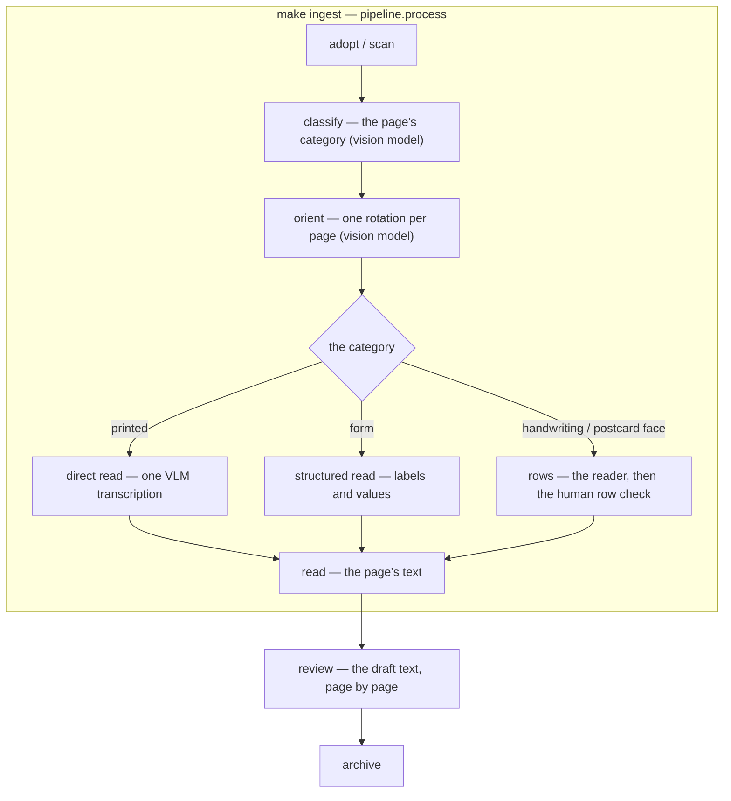

<!-- Component of docs/TECHSPEC.md. See the index for the status. -->

Status: **current for §16.1–§16.17** (the capture pipeline, the reading path and the review surface).

## 16. Import flow (capture → archive → app)


**Status:** draft — PLAN/PLAN.md Phase 1 deliverable. The flow is specified in `docs/PRD/IMPORT-PRD.md` (rules A–N, questions Q1–Q7, the staged review, the landed model additions); this section stays the normative home and the private worked-example review remains the real-import baseline. Family-instance facts live in the private interview records, referenced here.

### 16.1 The loop

```
boxes → the user's scan area (their folders — adopted by hash, §16.13)
      → the live store (classify → orient → read → review)
      → the human archive (nightly export: the dated document tree + the scan image leg)
      → the published read model (the R2 release) → the phone
```

- **Curator mode (phone, Slice 2):** 3 fields + story line; `draft` → `catalogued`; dates refined with date+7 suggestions. Import never catalogues — **the curation gate** is: a human selected the originals (scanning *is* the selection), import catalogs them as `draft`, and they appear only when the phone session confirms. Digital photos from younger members are human-curated before import, never bulk-imported (PRD §7).
- **The app never reads the scan area at runtime** — all reading rides the live store. Adoption and upload are the only writers of new bytes.

### 16.2 Scanner conventions (resolved, user)

- **Operator:** the reviewer alone, at home, own pace.
- **Gear:** an **Epson FastFoto FF-680W** — sheet-fed ADF for letters *and* photos, duplex, 600 dpi optical, WiFi (eSCL) + USB; no flatbed, so 35 mm slides remain uncovered; Android phone scan app for odd sizes.

| Requirement | Why |
|---|---|
| Sheet-fed: duplex ADF | letters are written on both sides |
| Sheet-fed: 300 DPI optical, colour | quality floor (PRD §7); colour chosen over grayscale |
| Sheet-fed: scan-to-folder | the output shape (per-job PDF or image set) is irrelevant — separators mark letters |
| Sheet-fed: ADF ≥ 12 pages, duplex, WiFi (eSCL) + USB | 3–5-page letters, duplex → up to 10 pages, laptop connection |
| Prints: photo ADF, 300+ DPI | hundreds of prints feed the FF-680W's photo ADF; 35 mm slides uncovered (no flatbed) |
| Phone app: per-page JPEG export | odd sizes (airmail, cards) — PRD §7 no-camera amendment (user) |

- **Sheet flow:** the letters are in **stacks** and feed continuously — one letter is not one scan job, and there are **no separator sheets**. The letters carry their own structure: a letter's first page holds the address block, the date and the salutation ("as from: 31 Pinewood Court… Wed 12th Jan. '77… Chère mamie"), and continuation pages are often numbered. Boundaries are therefore a **review pass, not a detection problem**: import concatenates every job in the inbox into one ordered page sequence, walks it letter by letter, and the worksheet prompt confirms where each letter ends — the reviewer has the physical letter in hand, and the structure makes the pass easy. Duplex; sheet order = reading order (page-01 = sheet 1 front, page-02 = sheet 1 back, …). The 50-sheet ADF caps a single feed at ~10–12 letters, so a stack feeds as several sub-jobs — job boundaries are irrelevant. A vision-read boundary *proposal* can join later via the ML seam (Slice 4); the review pass is the Slice 1 mechanism. **No envelopes** in this collection — the letter carries its own address and date (`INTERVIEW.md` addendum) — so envelope-first does not apply here; the ritual still supports it for other families.
- **Image spec:** 300 DPI colour, JPEG quality ~88. Calibrated on real scans (§16.8): handwritten ink on white compresses to ~1 MB/page — colour is ~3× grayscale and still fits the disk; the view image is budgeted against R2's 10 GB.
- **Scan command:** `make scan-docs ARGS="--label …"` / `make scan-photos ARGS="--label …"` → the user's scan area (`tools/loft_paths.py` `USER_SCAN_AREA` — `<…>/scans/<batch-id>/<batch-id>-NN.jpg`, 300 DPI colour, JPEG q88, label in the `batches` row) via `tools/scan.py`; the FF-680W is added to the user SANE config (`~/.config/sane/airscan.conf`) by IP because mDNS discovery on the BT Smart Hub is unreliable, and the airscan backend is enabled in the user `dll.conf` (the Ubuntu package ships it disabled). The scanner answers direct eSCL jobs even when discovery/status checks fail — the phone app's "Not Ready but scans work" is that behaviour.
- **Odd sizes:** phone scan app → export per-letter page JPEGs into a job folder → the same pipeline.

### 16.3 The scan, adopt and pipeline commands

- `make scan-docs ARGS="--label 'Box 1 — Letters 1977'"` / `make scan-photos`
  — the scanner writes a labelled folder into the user's scan area;
  `make adopt ARGS="<folder>"` registers an existing folder in place. The
  batch and its scans become `batches`/`scans` rows.
- `make pipeline ARGS="process <batch>"` runs classify → orient → read →
  group; `review <batch>` is the confirmation gate.
- The date, precision, page count and run defaults are asked in the review
  surface, once per document, while the letter is in hand:

| Prompt field | Behaviour |
|---|---|
| date | pre-filled from the box year, or date+7 from the previous letter **in the same stack**; one Enter accepts, or correct — unordered stacks (Dad's boat letters) get manual dates |
| date type | a date, a period (from/to) or a range (before/after/between); the qualifier (about/estimated/calculated); the display (`date_text`) — never force a fake exact date |
| page count | a sanity check against the duplex expectation; odd counts flagged |
| run defaults | sender + recipient, asked **once per stack**; one Enter accepts |

- **IDs** are assigned from the date (`letter-1977-01-12-01`, `-02` on a
  same-date collision) and never renamed; a precision refinement updates the
  date metadata only.
- **The output is rows:** `batches`, `scans`, `pages`, `readings`,
  `page_rows`, `documents`. The scan original stays in the user's scan area.

### 16.4 The resolution seam (import doing real work)

- **The identity tables are the live store's.** `people`, `places`, `orgs`, `themes` and `relationships` are the source; the projection and the export write `people.json`, `places.json` and `relationships.json`; `app/people.js` renders their aliases, and the shared engine (`tools/projection.py`) carries the matcher. `tools/resolve-mentions` runs the same matcher over transcriptions and address lines and writes proposed refs through the service — one alias source, three consumers (reader links, import proposals, publish regeneration).
- **Place records carry `aliases` too**; the reader hyperlinks place mentions exactly like people mentions — a mention without a record stays plain text (F7).
- Mentions without a record stay verbatim text (PRD F7): nothing is linked, the suggestion sits in the queue.
- **Worked-example finding:** the real letter salutes "Chère mamie" — Fern's aliases lack `mamie`; alias content is the reviewer's call (the dataset), flagged in the private worked-example review. Initialisms ("BF") are deliberately not auto-resolved — too noisy; they go to the queue as manual proposals.

### 16.5 The propose/confirm queue

- **The queue is a view over `claims`.** A claim is an item carrying proposed
  refs, a draft reading or proposed alt text. Confirming writes a decision
  through the seam; the projection catches up.
- **Place-mention candidates** sit in the queue. The criterion is not
  recurrence — it is *is it an actual place the family engaged with?*
  ("Easthaven" because Dad went to the Mayor's knees-up; "a turkey" is
  dinner). Adding the record later lights every link.
- **The import-time shape is the curation worksheet (§16.9).**
- **Status:** refs are `confirmed | estimated | proposed`; a draft reading is
  `page_rows.trust='guess'`, a confirmed one `confirmed`. There is no
  separate `transcription_status` field.

### 16.6 Publish and the phone path

- **Publish:** `loft publish` regenerates the local `app/data` projection for
  `loft serve`. The remote read model is the dated R2 release (`00` §The read
  model; `04` §17.6); only confirmed text is published.
- **Phone:** the remote app signs in with Google (D1 accounts), writes
  commands and uploads; the laptop applies and republishes. No Drive; the
  browser writes commands, never files.
- **PWA** caches what the API's collections serve; the browse cache warms by
  walking the cursors.

### 16.7 The reading draft

- The VLM is the only reader: a printed page in one call, a form as
  structure, handwriting in per-row bands (§16.17). No scanner OCR, no second
  backend, no calibration gate.
- Drafts are `page_rows.trust='guess'`; the reviewer corrects; confirmation
  writes `trust='confirmed'` and the item content.
- Drafts are searchable with a draft flag.
- The read pre-fills the date, address and salutation proposals;
  `resolve-mentions` adds proposed refs.
- Machine output never asserts.

### 16.8 Storage math (colour letters — user)

Calibration from real captures: a 3.1 MP colour handwriting page = 402 KB; a 1.5 MP page = 147 KB. Scaled to 300 DPI letter (2480×3508, 8.7 MP) → **~1.0–1.3 MB per page**.

| Layer | Volume | Est. size |
|---|---|---|
| Letters (830 × 3–5 pp) | ~3,300 pp | 3–4.5 GB |
| Slides (~100–600) | — | 0.3–1.8 GB |
| Prints (~200–600) | — | 0.2–0.6 GB |
| Business ledgers (9 y) | ~200–800 pp | 0.2–0.9 GB |
| Memoirs (handwritten) | ~100–500 pp | 0.1–0.6 GB |
| Documents / ephemera | ~100s | 0.1–0.5 GB |
| Objects (4–8 shots each) | ~40 | ~0.3 GB |
| Thumbs + index (derived) | — | < 0.1 GB |
| **Total** | | **~4–9 GB (mid ~6.5 GB)** |

- **The estimate is a floor.** The user reports at least this much again in miscellaneous letters, accounts and photos — realistic total **8–18 GB (mid ~13 GB)**.
- **Decision (user): an external hard drive is bought** — the annual 3-2-1 export target (PRD §18.6) and the overflow store.
- **The originals live on the big disk; the view images are budgeted against
  R2's 10 GB (`00` §Images).** The export's document leg is small.

### 16.9 The curation worksheet — connecting a letter

Linking is a *process*, not a batch step. Import classifies every mention into one of four buckets; the reviewer works the worksheet once, at import, while the letter is in hand; every answer teaches the standing knowledge so the next letter starts smarter. Extends §16.3's minimal prompt and shapes the queue (§16.5).

**The four buckets** (applied to every mention — people, places, themes, relationships, text links):

| Bucket | What it is | Decided by | Action |
|---|---|---|---|
| **Identified** | named in the text and unambiguous against the standing cast/places (writer, recipient, "Mrs Hartley" in the salutation) | import, from run defaults + the alias table | link `confirmed` — zero taps |
| **Proposed** | an inference worth one tap (BF→Owen, a place mention that might be a record, a theme the letter belongs to) | import, from heuristics (referential density, alias matches) | link `proposed` — one tap |
| **Question** | needs the reviewer's knowledge, not a tap (Harper's surname, who the Marlock people are, what "Lex" means, is the date right) | the reviewer | a bounded per-letter question list, asked at import while the letter is in hand |
| **Unresolved** | stays text (F7) — no record, no link | the machine, by absence | recorded as a known-unknown; recurrence is the trigger to revisit |

**Cross-checks against standing knowledge** (the machine's job, run before the questions):

- **Chronology check.** Place the letter on the known timeline (marriages, moves, births, the letters' era). A theme that contradicts confirmed chronology is a *flag*, not a proposal — the 1977 "courtship" failure was a chronology error, not a tagging error.
- **Standing cast.** Named-without-introduction = long-established actor (referential density) → `proposed`, plus a question when the identity itself is unknown.
- **Precision.** Prefer the specific over the general: Dunmoor Primary School over Dunmoor; Harrowgate over Tynefield. Ask for precision when the text is ambiguous (the house in Marlock, address unknown).
- **Broader place identification.** Informal or referential names are place candidates, not just proper names — "the old ford" is a place (PRD §19, requirement 6).
- **Actuality, not recurrence.** A mention becomes a place record when it is an actual place the family engaged with ("a turkey" is dinner; "Tornia" is where Dale and Harper lived). Recurrence decides later re-checks, never admission.
- **Co-occurrence ≠ relationship.** A person written about from a place is not *at* the place (Harper and Pinewood Court). Connections render co-mention, never implication. **Requirement:** a comment mentioning both a person and a place does not link them — a comment's `places[]` must belong to the comment's own claim.
- **Presence attribution — person ↔ place.** The co-occurrence rule is the general case of a family of bugs this session shipped and fixed; the machine must run all of them when proposing `people[]`/`places[]` links (this is what the per-place `people` list on a `places[]` entry is for — §4):
  - **In-the-item ≠ at-the-place.** A person in `people[]` — writer, recipient, mentioned — is not automatically at the item's places. Attribution is per-place; the item-level fallback (no `people` on the place) applies only to genuinely single-participant items. (Fern, the 1977 letter's recipient, was at none of its six places.)
  - **A letter's geography belongs to its participants, not its recipient.** Default: the writer is at the letter's places; the recipient is at one only when the text puts them there. Role is never itself evidence — in either direction: Fern got everything she shouldn't, and Mrs Hartley lost Dunmoor she should have had ("remembering times spent in your class"). The text decides; the worksheet confirms.
  - **Presence is date-bounded.** A proposed person↔place link must survive the chronology: was the person alive, born, or still living there at the item's date? (Eli "proposed" on the Sunlight photo, 1982 — not born until after the trips stopped.) The machine flags date-contradicting proposals as *questions*, never silently drops them — the chronology check's rule. This is why `dob` is a schema seam (§4) and interviews politely discover it (PRD §19, req 9).
  - **Geography ≠ presence.** A route, region, or proximity does not put a person at a place: the Grand Union passes through Marlock, but Halfway is evidenced at Innisfree. Nearby/on-route/same-region matches are *questions*, not proposals.
  - **Family membership ≠ presence.** Named in a family story, sharing a surname, or related to someone at a place is not being there — the Hale-family story places Harper, Miles and Vera at Marlock ("the people who Harper saw in Marlock"), and Owen and Dale are only reference points.
  - **Unattested links are removed, not annotated.** A place the text doesn't support is dropped from the item (Marlock from the Aldgate-addresses story), never kept "with a note" — the note becomes a claim the text never made.
  - **Ask, don't guess.** When presence is genuinely ambiguous — a group photo, an event spanning years, several plausible people — the worksheet's **Question** bucket is the answer, not a `proposed` link: "who was actually there?" is a bounded per-item question (PRD §19, req 8). `proposed` is for a confident inference worth one tap; ambiguous presence is a question.

**The learn step.** Every review answer updates the standing knowledge the next letter resolves against: aliases (Lex, mamie, BF), relationships (Miles–Wilma), place precision (Marlock = the Hales' house), chronology (long married by 1977). The worksheet is how the archive gets smarter as it is curated — the identity tables are content, and curation is their author. No new schema: the buckets map onto the existing `confirmed`/`proposed` statuses plus a queue question type (Slice 2). **Regeneration (requirement):** the derived tables — including the relationships — must be regenerable programmatically from the artifacts: the family structure is stated verbatim in the dated, attributed interview answers ("Mum was Nora…", "Wilma is Miles's sister", "Owen's parents Miles and Vera") and the letters, so the shared engine runs extraction + the propose/confirm seam over the primary data in the batch path, at import, and at capture — never hand-maintained, never hardcoded (the tests fail on drift).

**Disputed evidence.** When a new dated, attributed comment conflicts with a generated assertion (Harper's own account, 2026, vs the 1977 letter's "nervous breakdown or similar"), the assertion leaves the generated text (bios, captions); both accounts remain in the archive, each attributed to its source. The app arranges evidence; it never adjudicates (PRD §10).

**Testimony provenance — ask, don't classify.** When a statement's source matters, the elicitation asks the narrator directly ("Did she say that to you personally?" / "What did you see that made you think that?") and records the answer verbatim, attributed, as the statement's provenance (e.g. `Pete: "Mum used to tell us this all the time"`). Provenance is the narrator's own words — never an inferred status (requirement: PRD §19 req 2).

**The elicitation layer (the story flow, `docs/PRD/MEMORIES.md`).** Story
capture shares this worksheet machinery: assessment and elicitation run one
deterministic prompt per stage (temperature 0, JSON out — the books_to_anki
retry/splice discipline). Output contract: `{extractions: [{kind, name,
match: existing-id|null, bucket, reason}], questions: [{text, why,
skippable}]}` plus entity-field proposals (dob, aliases, relationships,
place precision) entering the review. The assessor's production output is
re-checked by a second cheap pass; genuine violations (mentions linked,
impossible matches, redundant questions, missing polite date questions)
are fed back for a bounded redo — never sampling twice and picking. A date
from an age + a known date of birth is computed in deterministic code and
injected as "derived" — the model is never asked to do arithmetic.

### 16.10 Dedupe & integrity hashes

- **Per page**, `scans` stores sha256 and phash (on the oriented form); a
  re-encoded or rescanned page matches. A transcription adds a content hash,
  so a re-typed duplicate matches too.
- **Letter fingerprints** — the sorted page hashes identify the whole letter;
  dedupe works at both page and letter level.
- **Policy:** exact sha → skip silently (first wins); phash above threshold →
  both scans to the reviewer with their observable properties; never
  auto-delete or merge. Dedupe runs at adoption, at catalog and in
  `make verify`; the export manifest carries the hashes.
- **Deps:** pillow + imagehash (dev-only).

### 16.11 The review surface and resumability

- The reviewer's surface is the app served by `loft serve`; the remote app is
  the same surface for the family. There is no admin-only localhost API and no
  separate import server.
- **Scan-ahead:** the scan area is an append-only drop zone; the worker adopts
  new folders and the pipeline is stage-decoupled.
  - **ingest** — adopt the folder, hash the pages, write `batches`/`scans`;
    never modify the scan area.
  - **worksheet** — the review: boundaries, dates, defaults, dedupe;
    resumable mid-stack.
  - **catalog** — the item and its content through the seam.
  - **read** — the pipeline; no async OCR queue.
  - **publish** — the read model is published after the drain and on a
    schedule.
- **The review session is crash-safe and resumable.** `review_sessions`,
  `review_messages` and `claims` record each decision; re-running resumes at
  the first open claim.
- **The story capture** rides the same service (`docs/PRD/MEMORIES.md`).

### 16.13 The capture pipeline — the two-zone workspace

Requirements: `docs/PRD/MULTI-DOC-IMPORT-PRD.md` (R1–R9). Supersedes the
older §16.1/§16.3 conventions of an "inbox" of our job folders: the user's
scan area is **theirs** (R1) — we adopt its folders by content, never by
path convention.

**The two zones.** The user's scan area (on the big disk: `scans/` — PhotoScan, and whatever the user creates) is read-only to us. Our workspace is the sibling folder **`Loft`** at the disk root (decided — alongside the user's `scans/`, not inside it) holding the live store and the files that are bytes:

```
scans/                            the user's scan area (read-only to us)
Loft/
  loft.db                         the live store — the pipeline's state and the archive
  content/<sha2>/<sha>            path-backed blobs (large readings, large text)
  derivatives/
    oriented/page-NN.jpg          correct way up (Rule J, before any reading)
    view/page-NN.webp             the one view image per page (published to R2)
  archive/                        the human archive's document leg (nightly)
    README.md INDEX.md PEOPLE.md PLACES.md
    documents/<date label>/<item-id>/
      item.json
      transcription.txt
  backup/                         the operational dump + manifest (nightly)
  release/                        the staged R2 release (transient; uploaded then discarded)
```

Paths: `tools/loft_paths.py` — `USER_SCAN_AREA` (`scans/`), `WORKSPACE`
(`Loft/`), `CONTENT_DIR`, `DERIVATIVES_DIR`, `ARCHIVE_DIR` (the export
root), `BACKUP_DIR`, `RELEASE_DIR`. There is no `registry/` and no `work/`:
the batch, its scans, its pages, the readings and the grouping are rows. The
scan originals stay where they are (register-in-place, decided): never
copied into the workspace, so the raw scans remain single-source.

**The batch and its pages are rows.** `batches` carries the id, label,
source, path, status and fingerprint; `scans` carries each page's sha and
path; `pages` carries the category, rotation, revision and status. The
batch's label is the user's folder name. Re-association after a user
reorganisation is the same fingerprint search, against the `scans` rows.

**Re-association after user reorganisation.** Each run re-verifies every
batch's folder: fingerprint found at a new path → re-link (automatic);
fingerprint split/merged across folders → semi-automatic with a manual
fallback; pages added → fingerprint grows, new pages adopted; pages
removed → flag for review; folder not found → flag; reviewer points or
supersedes (archive copies remain). Nothing in the user's area is ever
written.

**Hashes & dedupe (extends §16.10).** Two duplicate kinds, two mechanisms:
duplicate *file* = exact `sha256`; duplicate *scan* (same document
re-captured) = `phash` similarity above threshold. Per page: sha256 +
phash, the phash taken on the **oriented** form so rotation/re-encode does
not defeat it. Per batch and per item: fingerprint = sorted page hashes
(batch identity for re-association; item identity for whole-letter
duplicates). Dedupe runs at adoption and at catalog against the whole
known universe (user area + the live store's pages + the export). Policy
(§16.10): exact match → skip silently, first wins; phash match → both
candidates to the reviewer with observable properties; never auto-delete or
auto-merge.

- **Raw-file naming — recovery from reorganisation.** Every raw page we
  produce is named `<batch-id>-NN.jpg` (e.g. `scan-20260813-1850-01.jpg`) —
  the batch id is embedded in every file name. If the user renames the
  folder, any file still says which batch and position it belongs to, so
  re-association can start from names before hashing (the hash fingerprint
  confirms). The derivative folders (`oriented/`, `view/`) keep plain page
  names — they are ours, never reorganised. External files keep their own
  names; adoption hashes them.

**Write-then-rename everywhere a file is written.** No component publishes
a file a reader could see half-written: every produced file (a derivative,
an export file, a backup file) is written to a temp sibling, flushed,
then renamed — `tools/atomic.py` `atomic_write`, the one helper. The live
store's writes are transactions, not renames; the content store verifies
each blob's sha before it is referenced.

### 16.14 The pipeline components

The capture pipeline is a chain of components, each owning one stage; the
**live store is the interface between them** — a component reads its input
rows (the batch, its pages, the readings) through the service and writes its
output rows, with the scan originals and the derivatives on disk. No
component calls another; no shared in-memory state; each is independently
runnable, resumable, and replaceable.

| Component | Input → Output | Status effect |
|---|---|---|
| `capture` (tools/scan.py) | scanner → pages in the user area + `batches`/`scans` rows (label, hashes) | `pending` |
| `adopt` | an external/preexisting folder → `batches`/`scans` rows (register-in-place) | `pending` |
| `classify` | raw pages → `pages.category` — each page's CATEGORY: photograph, printed, handwriting, postcard face, form, drawing (one vision call per page) | `importing` |
| `orient` | the pages with writing → `pages.rotation` + `derivatives/oriented/` (the vision model names each page's rotation) | `importing` |
| `read` | the pages' text, routed by their category: printed → one direct VLM transcription; a form → a structured read (labels and values, as a markdown table); handwriting and a handwritten postcard face → the row pipeline (auto rows, the human row check, the transcription review) | `readings`, `page_rows`, the page text | `importing` |
| `group` | the documents: the model judges boundaries over the pages' readings, then the scorer weighs duplex sides, paper size, page numbers and those flags | `documents`, `document_pages` |
| `review` | oriented + read → the agreed document as an archive item (its `transcription.txt`) + the grouping (the IMPORT-PRD flow, user-paced) | `review` |
| `catalog` | confirmed pages + transcript → the item and its content (`items`, `item_content`) | `done` |
| `publish` | the live store → the R2 release (`releases/<timestamp>/`, manifest last) | — |

**Parallelism.** Batches are independent; stages within a batch are
sequential (classify before orient; orient before the read). The
driver walks the batches and fans out per-batch stage jobs, so capture
runs while orient/read process earlier batches (scan-ahead, §16.11) and the
user reviews batch *N* while the machine works *N+1*. Each component
re-runs idempotently (its rows are guarded by the page revision; re-running
regenerates them) and never touches the user's area.

**Content routing (requirements R10–R12).** Batches are mixed: handwritten
letters, print, photographs, drawings, postcards, forms. A `classify` stage
runs FIRST (before orientation — a photograph needs neither orientation nor a
read): one vision call per page names its category, and for the two page shapes
that may be either (a postcard face, a form) how its writing was made —
printed or handwritten. The category decides the read
(`docs/PLAN/page-categories.md`): photographs and drawings are not read;
printed pages take one direct VLM transcription; a form is read as structure;
handwriting (and a handwritten postcard face) takes the row pipeline. There is
no second OCR engine: the VLM is the only reader; the row pipeline's geometry
is the ink reader's (§16.17).

**Orientation (Rule J, mechanism).** The `orient` stage asks the vision model
which clockwise rotation makes each page's writing upright
(`pipeline/orient.py`), records it in `pages.rotation`, and writes the
oriented derivative. One small call per
page, thinking off. That is the page's **initial** rotation; the reading runs
on the oriented image. The reviewer's ↻ is authoritative (§16.16): it sets the
page's recorded rotation and the page is re-read on the corrected image. A
re-read always uses the recorded rotation; nothing else re-orients the page.

**The transcription backend (decided).** Every page's text comes from the
**vision-language model** (`pipeline/model/vlm.py`): one call per page for
printed text, one call per band of rows for handwriting, one structured call for a form.
The evidence on the family's own pages: near-perfect pure-cursive and
mixed-layout transcription (page-03's callout box, postmark, address and
salutation all read correctly); ~85% word accuracy on the medal card's hardest
element (handwritten digits in a dense form); ~11K tokens/page. The VLM is the only reader; the ink reader supplies the geometry
(§16.17).

**Scan UX (decided direction).** The capture command takes the run's name
at scan time: `make scan-docs ARGS="--label 'Box 1 — Letters 1977'"`, or a
prompt when no `--label` is given ("Envelope/pile label — what's written
on it?"). The name is the folder the scans land in, and — when the user
enters one — it is also written into the batch row at scan time and rides
through to the review prompts.

### 16.14.1 The pipeline picture

**The pipeline picture.** A scan is classified, oriented, and read by the
path its category calls for: a printed page is read directly by the VLM; a
form is read as labels and values; a handwriting or postcard page goes through
the reading path in §16.17 — the ink reader's rows, the VLM's per-row text,
and the reviewer's row check. The boxes and words the review surface uses are
the reading's; the VLM supplies text and kinds, not boxes.



| Phase | What it does | Output |
|---|---|---|
| adopt / scan | register the pages | `batches`, `scans`, `pages` |
| classify | the page's category and, for a postcard face or a form, its medium (vision model) | `pages.category` |
| orient | the initial rotation that puts the page's writing upright (vision model); the reviewer's ↻ overrides it | `pages.rotation` + the oriented derivative |
| read (direct) | printed text, line for line, in one VLM call | `readings`, `page_rows` |
| read (structured) | a form's labels and values, as a markdown table, in one VLM call | `readings`, `page_rows` |
| read (rows) | handwriting: the reader's rows and words, the human row check, then the transcription review | `readings`, `page_rows` |
| review | the reviewer verifies/corrects the draft | `items`, `item_content` |

**The review surface's boxes.** The boxes and per-word flags the review
surface needs are the reading path's output (§16.17): the ink reader supplies
the line and word geometry; the VLM supplies the text and the self-report
flags. A page that reaches review without a reading is a stage failure.

**The grouping scorer (VR6 — the grouping is part of the review; AC21 —
two-sided item).** The group stage's model groups TEXT pages only by
greeting/sign-off boundaries, so a photo page (the picture side of a
postcard) can never join its document. The grouping scorer
(`pipeline/grouping.py`) replaces the model's text-only
grouping with a full-sequence pass over ALL pages (photos included), in
scan order. The evidence hierarchy, priority-ordered:

1. **Duplex sides (strongest):** a photo/drawing page adjacent to a text
   page of the same paper (normalised aspect within 12%, the phone-scan
   proxy for paper size) is the two sides of one sheet — same document,
   the picture side first. The pairs are greedy (a page never pairs with
   both neighbours), so concurrent [back1, front1, back2, front2] pairs
   disjointly.
2. **Paper size:** different papers are probably not the same document
   (the 12% tolerance is deliberately soft — phone-scan aspect variance
   is the same order as paper differences).
3. **Page numbers:** a page starting "2" continues its document; a fresh
   "1" starts one.
4. **The model's greeting/sign-off flags:** the fallback for text pages.

The transcription review's drafts route (`pipeline/server.py`) filters out
photo-only documents and shows only the TEXT pages of each document
(the picture side stays in the structure for the future people/places
identification flow, but the review never pages through a photo).

**Multi-orientation pages (PRD VR15).** A page whose writing runs in more
than one direction is an open item: the reading path runs on the page's
recorded rotation, and the reviewer's ↻ sets it and re-reads. A per-region
orientation pass is not built.

### 16.14.2 Pipeline reliability — the live row, fail-loud, and surgical recovery

**The live row is the completion marker.** Each stage's completion is its
row, not a file: `pages.category` the classification, `pages.rotation` and
the oriented derivative the orientation, a non-empty `readings` row (with
its `page_rows`) the read, a grouped `documents`/`document_pages` the
grouping. Re-running a stage skips pages whose row is current — that is what
makes re-runs cheap. `04-live-system.md` §17.8.1 maps every stage to its
rows.

**A row without its evidence is not completion.** A reading whose blob is
missing, or whose `page_rows` are empty, is a stale or partial write and is
re-done, not "reused". A direct read is current when its `readings` row and
a non-empty page text exist; the row read is current when its `readings` row
and `page_rows` exist and its `corrected_sha` matches the current
`row_adjustments` row; an empty reading is never a completion.

**Fail-loud over silent no-op.** A stage that cannot do its job for a
requested input fails loudly with the remedy in the message. Never a
geometry-only build, never a "reused" corrupt guess, never an output that
looks done but isn't.

**Surgical recovery.** Fixing one batch must not re-pay model calls for the
whole archive. The pipeline exposes the stage entries:

```bash
make pipeline ARGS="process <batch>"        # the whole chain
make pipeline ARGS="printed <batch>"        # a printed pile: one direct read per page
make pipeline ARGS="review <batch>"         # the confirmation gate
```

`process <batch>` is the whole-chain entry point and the one the worker
sweeps; `printed <batch>` re-reads a printed or structured pile directly
(idempotent per page); `review <batch>` is the human gate.

**The worker owns the machine stages** (`pipeline/worker.py`, `loft work`).
A batch is work while a stage's row is missing — not while its status says
so. `pipeline/stage_table.py` owns the stage order and each stage's gap
check, read through the service: `classify` (`pages.category` absent),
`orient` (the row pages' rotation or derivative absent), `read` (no
non-empty `readings`), `group` (no grouped `documents`).
`pipeline/reconcile.py` (`Reconciler`) runs exactly those, in order, after
re-planning on the new categories once `classify` has run; it journals each
stage's outcome as a `jobs` row and logs the reason and the duration.
Nothing is retried: a failure is journalled and raised, and the batch waits
for the next trigger or resync.

The triggers are a change under the scan area (adopt that folder, then
reconcile its batch) and a short periodic resync (one at startup). A remote
command or a drawn-line correction marks the batch `pending`; the next
resync picks it up — the correction's latency is the resync interval, not a
person. `loft work` is one resync, `loft work --plan` prints each batch's gap
and runs nothing, `loft work --batch <id>` reconciles one.
`pipeline/artefacts.py` is the one place the derivative path layout is
written (guarded by `tests/test_architecture.py`), and
`pipeline/model/config.py` names every model and the Cloudflare AI Gateway
endpoint.

A page's status is the projection of its rows (`pages.status`); it is
derived, never hand-set. Only the batch's queue state is written, through
the chain's one status writer, which stamps the pass (pid, host, time). Two
rules keep the queue honest: a pass that dies half-way writes its record
back to `pending` (a crash in `importing` would strand the batch), and a
scan stages beside the inbox rather than in it (a directory in the scan area
is a finished pile, and the worker adopts every one).

**A corrected page is re-read on the worker's next pass.** The reviewer's
drawn lines persist as the page's `row_adjustments` row, whose JSON blob is
in the content store. The write marks the batch `pending` (the server never
contacts the worker); the read stage rebuilds the page's rows from the
reading's words + those lines, reads each row as itself, and writes them as
the reading's lines with the drawn lines' sha in `corrected_sha`. The
transcript gate then shows the corrected text. Three rules keep it cheap and
honest: a check with no lines ("rows are right") requeues nothing; a reading
whose `corrected_sha` equals the adjustments' sha is skipped (the same lines
are never re-read); and a corrupt adjustments blob fails loudly rather than
reading the page against lines nobody can parse. Only corrected pages
re-read — an unchanged page keeps its draft reading.

**The model-API contract (the client side of the Cloudflare gateway).** The
VLM client must send a User-Agent the gateway's WAF accepts
(`opencode/1.14.20`), and must give reasoning models `max_tokens` headroom
(≥32000 for vision/geometry tasks — a reasoning model with a small budget
returns `finish_reason: "length"` and zero content). HTTP errors surface
with the response body; empty-content and budget-exhaustion failures are
raised as actionable `VlmError`s. See the `cloudflare-ai-gateway` skill for
the route-side configuration.

**One write seam, no file store.** Every pipeline write is a `Change`
through the service; the content store verifies each blob's sha; the event
log is append-only. There is no `PipelineStore` and no per-stage file to
version: the DB's transaction is the unit, and an old blob stays in
`content`.

### 16.16 The transcription-validation review surface

**The reviewer's alignment and flags come from the reading.** The boxes are
the ink reader's; the text is the VLM's; the flags are the model's
self-report on its own numbered text (§16.17). No recognition engine runs
beside the app. The review surface reads each page's rows from the read
model (`04-live-system.md` §17.6); the drafts payload carries each page's
rows: box, text, kind and the self-reported flags. The reviewer edits text
and draws row lines; the boxes stay anchored to the page geometry, not to the
corrected words.

**A bad correction never reaches the review.** The drawn lines are validated
(`Rows.validate`) before they are persisted: a line that caught no writing, a
line off the writing's slope, or a row off the page is refused with its
reason. The reviewer never sees a box the page cannot support.

**The viewer.** The page-image pane is a plain `` inside a
transform-scaled layer (one `translate(...) scale(...) rotate(...)`; the
line boxes are absolutely-positioned children of the same layer, so they
stay pinned through pan/zoom/rotation by construction). The view is a
rectangle in display pixels (the rotated image's axes); drag-pan, pinch and
the Fit/−/+ buttons update it; the initial view is a width-fit band anchored
at the reading's first line box (the scanned top margin is blank), or at the
writing's extent on a page with no reading. The plain `` decodes and paints in any browser, so a
screenshot or a canvas pixel-read can verify the actual pixels — the
perceptual-success standard (ux-standards P15) forbids an unverifiable
render. The deep-zoom pyramid stays a future step (OpenSeadragon 6.1.0:
BSD-3, zero-dependency vanilla, native overlays).
The transcription pane, confidence flags, and confirm/reject controls are
our vanilla code. The full transcription apps from the research
(eScriptorium, FromThePage) are rejected: different stacks (Django+Vue,
Rails+IIIF) contradicting the vanilla decision; Transkribus is proprietary.

**The orientation rule.** The orient stage sets the page's initial rotation
(one small model call, §16.14); its call can be wrong on a cursive page. The
reviewer's ↻ is the authority: the press is a PIPELINE correction, not a view
toggle, and the reading is redone on the corrected image. It is built for the
sync's reality (the front end and back end are different boxes; the backend
may be off; no image travels — it is never uploaded, the backend has it):

- **The press is local first**: the view rotates instantly; the intent is
  the DESIRED rotation from the original in quarter-turns, queued in a
  localStorage outbox (the same offline seam as the confirmations) and
  committed on navigation — multiple presses coalesce (a half-corrected
  first press never triggers a reprocess), and a wrong correction is just
  another intent.
- **The backend compares the desired absolute**: `pages.rotation` is the
  applied orientation relative to the original; the command carries the
  desired one. If they match, the command is a no-op and marked applied; a
  duplicate delivery cannot over-rotate.
- **The apply is one step, as close to atomic as possible**: write the
  rotated derivative (content-addressed; the old one stays), then one
  transaction updates `pages.rotation`, the page image, the row set's
  rotation and the rows' boxes; the text is marked stale. A crash leaves the
  old page and row set; the retry is safe.
- **The fast half is synchronous**: the derivative and the boxes are that
  transaction; the corrected page shows immediately.
- **The slow half is the async job**: the page's text is re-read by the
  vision model on the corrected image (the old row set is stale), the
  self-report re-runs, the row set rebuilds. The drafts payload carries a
  per-page job state; the surface greys the document with a note, blocks
  the confirm, and polls — the reviewer navigates on meanwhile. A server
  restart mid-job demotes the page to "failed" (the stale text stays
  visible WITH the warning — never a silent half-done page). The stale
  local edits for the re-read page are cleared on completion.

**The navigation model.** The review surface shows two nested
sequences — pages inside a document, documents inside the batch — as ONE
compact strip under the top bar: the batch's documents as chips showing
the document's greeting (or a numbered fallback), with ✓ confirmed and ✗
rejected status marks; the current document's pages as numbered chips (the
current page filled; a red dot marks pages with lines still to check). Tap
a chip to navigate. The strip replaces the top-bar subtitle and the
Prev/Next page buttons: the document boundary is visible before the last
page, and a cross-page "Next flagged" jump is visible before it happens
(the flag dot shows where it lands). Numbers and status marks only — no
added words (prior art: spatial page maps — CHI space-filling thumbnails;
per-page review status — FromThePage). Flagged words render with a wavy red
underline (the spell-check convention) at rest, not only in edit.

**The reading order (VR15, AC20 — coherent, not dislocating).** The
transcription presents the text in a coherent order. The reader returns the
page's lines top to bottom in the page's frame; the rows keep that order, and
a row is one line of writing with its words. The reviewer's drawn lines
renumber the rows in reading order (topmost band first). The initial display
shows the page the way the pipeline determined is right-way-up — the printed
writing upright (the oriented image).

**The three outcomes (VR5 — confirm or reject; VR17 — defer; AC30 — no
action is irrevocable).** Every document reaches one of three states, and
none is irrevocable:

- **Confirmed** — the reviewer is confident in the transcription. The
  document is published to the archive and removed from the pending queue
  ("✓ Confirm & Next →" button). The confirm button is always available
  (it is not blocked by unchecked lines, unverified lines, or any other
  pre-condition — the reviewer's own confidence is the only gate; VR5,
  AC27, AC28).
- **Rejected** — the document does not belong in the archive (an
  accidental import such as petrol receipts, an unreadable scan, one too
  embarrassing to keep — user). The rejection is a
  soft-delete: the document moves to a recoverable bin and leaves the
  pending queue; the reviewer can bring it back. Not yet implemented.
- **Deferred** — the document belongs in the archive but the reviewer
  cannot finish it now (needs to ask a family member, come back later).
  It stays in the pending queue, unconfirmed ("Skip →" button,
  implemented).

**The correction interaction (grounded in the prior art).** The
reviewer's correction model follows Trove/Transkribus: **per-line inline
editing anchored to the image**. Selecting a transcription line enters edit
on that line (the text becomes directly editable in place) while the line's
box stays highlighted on the image — the image pane keeps the current line's
region in view (auto-pan/zoom to the box), so the reviewer compares the
line's letters against the original while typing. The flagged low-confidence
words are the entry points (WordCheck-style): the reviewer can jump to the
next flagged word. Trove's per-line +/− (split/merge lines) applies where
the reading merged two lines (the open item below). Corrections change only
the edited line's words; confirming publishes the corrected text (`04-live-system.md` §17.5).

**The phone posture.** The phone review is **landscape-only**:
portrait shows a "turn your phone" prompt. The landscape phone uses a
**horizontal split** — the letter image spans the full landscape width on
top (a phone turned sideways is close to the original document's width, so
the handwriting renders near its real size), the editable transcription
fills the bottom pane, and the action bar is sticky (never clipped). The
tablet keeps the vertical split (image left, text right — it has the
width for both at good size). Rationale: one split-pane design across
tablet and phone-landscape instead of a second stacked mobile layout
(VR8, user).

**The focus model (VR17, walkthrough finding).**

The fake-user walkthrough (Sam) + the UX research (Preview
Panel, Master-Detail, Overview+Detail, Inline Edit patterns) established
the focus model:

*The focused line* is the line at the top of the text pane's viewport.
Scrolling the text changes the focus. The image follows — pans to the
focused line's box, rotates to the line's reading orientation.
Panning/zooming the image does NOT change the focus; the reviewer can
explore the scan freely. A "return" button in the image toolbar
re-centres on the focused line.

*The image is the navigation surface.* The box overlays are touchable
(`pointer-events: auto`). Tapping a box scrolls the text to the
corresponding line and rotates the image to make it readable. The image
pane's click handler that silently edits the text is removed.

*The inline edit* has a visible Done (✓, commits) and Cancel (✕,
discards) — the standard Inline Edit pattern. The Escape key cancels;
the keyboard's Done key commits. The edit row shows the format buttons + Done + Cancel.

*The verification tick* is a toggle: unchecked (○ outline) and checked
(✓ filled). Clicking a checked line unchecks it (the edit is removed,
the line returns to its unchecked state). The line's background turns
cream when checked.

*The image pane's initial view* fits the document's full content area
(all boxes' min/max y, not just the first line) at a readable zoom
level — the reviewer sees the full card and can scroll to the message.

*Returning to a page restores the exact view.* The document and page
are already in the URL (`syncSurfaceUrl`). The image view rectangle
(the pan position and zoom level) and the text scroll position are
persisted to `localStorage` keyed by `{batch}|{page}` — the same store
as the rotation outbox — and restored on return. The focused line, the
scroll position, and the image view are always in sync: the "no
dislocating moves" rule (P18 from the walkthrough) applies
to every re-render, not just within the session (VR9, AC19).

*The page's rotation* is the reading's recorded rotation. The review's ↻ is
the orientation correction above; the reading runs on the corrected image.

**Resource management (VR16 — the app runs lightly on this laptop).**

The transcription call (the VLM) is the only heavy step in the review
pipeline: the ink reader is local arithmetic over per-page arrays, and the
classifier is one small call per page. Two measures bound the footprint:

- *The model call is bounded by its budget.* Every transcription call carries
  its own `max_tokens` and timeout, so a page's cost and duration are capped
  per call rather than growing with the scan's native resolution (VR16 — the
  pipeline's peak is bounded, not the scan's).
- *No engine runs beside the app.* The reader measures ink with numpy in the
  main venv — no recognition engine, no framework arena, no subprocess
  (VR16 — a core stays free for other work while a page is measured).

**Open items:**
- Line-splitting: a reading line can merge two tightly-spaced lines; the
  reviewer's drawn lines split them. A per-box re-split on over-tall boxes is
  an open item.
- Multi-orientation pages: the per-region orientation reading is not built
  (VR15); the reading runs on the page's rotation.
- **Grouping correction (VR6).** The reviewer can see the document grouping
  (the navigation strip) but has no way to correct a wrong page-to-document
  assignment — split a document, merge two, or move a page. The design is
  deferred until a real example of a wrong grouping surfaces in testing
  (user).

---

### 16.17 The reading path

**The chain.** The reading path turns a page image into rows, boxes and text.

1. **Ink.** `reading_for_page(page)` measures the page's ink at the reader's
   scale and returns a `Reading`: the writing **lines** (each a box in page
   pixels, in reading order, text-less) and the **words** (each a `Word` with
   its box, baseline and waistline). No model is involved; the reader measures
   ink.
2. **Rows.** `Rows.from_words(reading.words, PageSize(width, height))` groups
   the words by their reading lines: the draft rows. A row is one line of
   writing; its band is the exact union of its words' boxes.
3. **Text.** `Transcriber` cuts the rows into numbered bands from the review
   surface's own rendering (each row tinted in its hue and numbered), sends
   each band to the VLM, and receives the text for the rows the band carries.
   The model answers for the row numbers; the text is per row, never a
   page-level guess indexed onto the rows. The reader's line carries the text
   of the row that owns its words.
4. **The page's text.** The reading's lines are the page's text in reading
   order. There is no separate page-level transcript; the rows are the grain.
5. **The correction.** The reviewer draws a line along a row. `Rows.adjust`
   applies the lines as an **edit** of the draft: a stroke that runs across a
   reading line and covers at least half of its words replaces that row;
   otherwise it claims only the words it runs along; every unclaimed word
   keeps its reading line's row. A double pass joins the first row; a single
   leftover is apportioned to its neighbours. The corrected rows are read
   again as themselves; the reading carries the drawn lines' sha so a later
   pass does not repeat the work.
6. **The artifacts.** The reading is one content blob (`RowsReading`: page,
   size, rotation, revision, lines with text, and the words); `readings`
   references it by sha and carries the row and word counts. `page_rows` is
   the queryable projection (source, trust, text, box, kind, insertion); the
   page text is the rows' text in order. The reviewer's drawn lines are a
   second blob, referenced by the page's `row_adjustments` row; the reading's
   `corrected_sha` records the lines it was built from. The reviewer's ticks
   are `row_checks` and insertions are `page_row_links`. There are no work
   files: the live store is the state.

**Completion.** A page is read when its `readings` row exists and carries at
least one row. An empty reading is not a completion: the stage writes no
reading row and names the page for a re-run. A correction is current when the
reading's `corrected_sha` equals the `row_adjustments` row's sha; an empty
correction ("rows are right") is not a re-read.

**What the model does and does not do.** The VLM supplies the text, the
page's rotation (through the orient stage) and the row kinds; it does not
supply the line or word boxes. The line and word geometry is the ink reader's.
The self-report (`tools/selfreport.py`) marks the words the model is least
sure of; no flag is not a claim of certainty.

**The gold reference.** Page-01 (41 rows over 364 words) is the adjudicated
reference. The correction path (`Rows.adjust`) is tested against it; the
reader's draft is measured against it, never asserted equal. `Rows.validate`
checks the row invariants on every correction: a row's band is its words'
union; a line that caught no writing; a line that merges reading lines; a
line off the writing's slope; a row off the page.

**Vocabulary.** The page's artifact is its **row set** (rows + words), not a
"reading". The code's `RowsReading`, `readings` and `reading_for_page` are
the old names; the target names are the row set, and `page_rows` is its query
view.

**Where it lives.** `pipeline/detect/reader.py` (`reading_for_page`),
`pipeline/rows/rows.py` (`Rows.from_words`, `Rows.adjust`, `Rows.validate`),
`pipeline/transcribe/transcripts.py` (`Transcriber`), `pipeline/chain.py`
(`read_pages`, `_read_corrected`). The review surface reads the reading; the
API's row-adjustments route applies the same builder.
