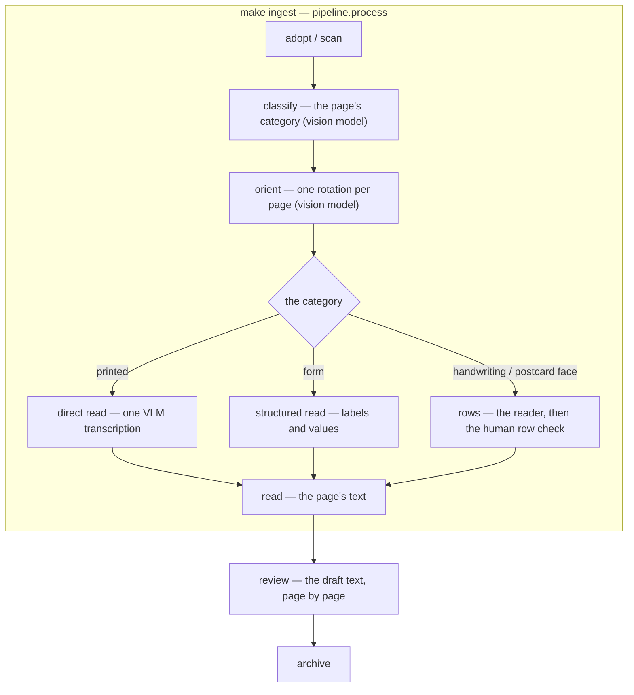

<!-- Component of docs/TECHSPEC.md. See the index for the status. -->

Status: **current for §16.13–§16.17** (the capture pipeline, the reading path and the review surface). §16.1–§16.11 is the import-flow record, not the live architecture.

## 16. Import flow (capture → archive → app)


**Status:** draft — PLAN/PLAN.md Phase 1 deliverable. The flow is specified in `docs/PRD/IMPORT-PRD.md` (rules A–N, questions Q1–Q7, the staged review, the landed model additions); this section stays the normative home and the private worked-example review remains the real-import baseline. Family-instance facts live in the private interview records, referenced here.

### 16.1 The loop

```
boxes → the user's scan area (their folders — adopted by hash, §16.13)
      → workspace/work/<batch>/ (oriented → read → confirmed)
      → tools/import  [prompt: date] → archive/assets/<id>/ (sidecars + JPEGs + thumbs)
      → tools/upload-drive            → Google Drive (the archive's home)
      → loft publish                 → app/data projection → static host → phone
```

- **Curator mode (phone, Slice 2):** 3 fields + story line; `draft` → `catalogued`; dates refined with date+7 suggestions. Import never catalogues — **the curation gate** is: a human selected the originals (scanning *is* the selection), import catalogs them as `draft`, and they appear only when the phone session confirms. Digital photos from younger members are human-curated before import, never bulk-imported (PRD §7).
- **The app never reads Drive at runtime** — all reading rides the projection (§5). Import and upload are the only writers to the archive.

### 16.2 Scanner conventions (resolved, user)

- **Operator:** the reviewer alone, at home, own pace. Supersedes PLAN/PLAN.md's brother-scanner-day assumption.
- **Gear:** an **Epson FastFoto FF-680W** — sheet-fed ADF for letters *and* photos, duplex, 600 dpi optical, WiFi (eSCL) + USB; no flatbed, so 35 mm slides remain uncovered; Android phone scan app for odd sizes.

| Requirement | Why |
|---|---|
| Sheet-fed: duplex ADF | letters are written on both sides |
| Sheet-fed: 300 DPI optical, colour | quality floor (PRD §7); colour chosen over grayscale |
| Sheet-fed: scan-to-folder | the output shape (per-job PDF or image set) is irrelevant — separators mark letters |
| Sheet-fed: ADF ≥ 12 pages, duplex, WiFi (eSCL) + USB | 3–5-page letters, duplex → up to 10 pages, laptop connection |
| Prints: photo ADF, 300+ DPI | hundreds of prints feed the FF-680W's photo ADF; 35 mm slides uncovered (no flatbed) |
| Phone app: per-page JPEG export | odd sizes (airmail, cards) — PRD §7 no-camera amendment (user) |

- **Sheet flow:** the letters are in **stacks** and feed continuously — one letter is not one scan job, and there are **no separator sheets**. The letters carry their own structure: a letter's first page holds the address block, the date and the salutation ("as from: 31 Pinewood Court… Wed 12th Jan. '77… Chère mamie"), and continuation pages are often numbered. Boundaries are therefore a **review pass, not a detection problem**: import concatenates every job in the inbox into one ordered page sequence, walks it letter by letter, and the worksheet prompt confirms where each letter ends — the reviewer has the physical letter in hand, and the structure makes the pass easy. Duplex; sheet order = reading order (page-01 = sheet 1 front, page-02 = sheet 1 back, …). The 50-sheet ADF caps a single feed at ~10–12 letters, so a stack feeds as several sub-jobs — job boundaries are irrelevant. A vision-read boundary *proposal* can join later via the ML seam (Slice 4); the review pass is the Slice 1 mechanism. **No envelopes** in this collection — the letter carries its own address and date (`INTERVIEW.md` addendum) — so envelope-first does not apply here; the ritual still supports it for other families.
- **Image spec:** 300 DPI colour, JPEG quality ~88. Calibrated on real scans (§16.8): handwritten ink on white compresses to ~1 MB/page — colour is ~3× grayscale and still fits the free tier.
- **Scan command:** `make scan-docs ARGS="--label …"` / `make scan-photos ARGS="--label …"` → the user's scan area (`tools/loft_paths.py` `USER_SCAN_AREA` — `<…>/scans/<batch-id>/<batch-id>-NN.jpg`, 300 DPI colour, JPEG q88, label in the registry record) via `tools/scan.py`; the FF-680W is added to the user SANE config (`~/.config/sane/airscan.conf`) by IP because mDNS discovery on the BT Smart Hub is unreliable, and the airscan backend is enabled in the user `dll.conf` (the Ubuntu package ships it disabled). The scanner answers direct eSCL jobs even when discovery/status checks fail — the phone app's "Not Ready but scans work" is that behaviour.
- **Odd sizes:** phone scan app → export per-letter page JPEGs into a job folder → the same `tools/import` pipeline.

### 16.3 tools/import (Python CLI, reviewer-operated)

- `tools/import <inbox> --box "Box — Letters 1977" --type letter` — one box at a time; `--box` becomes `source` and pre-fills the year.
- **Stages:** ingest → prompt → catalog → **read (machine transcription draft + prompt pre-fills, §16.7)** → thumbs → index. Resumable: processed folders are marked in their sidecars — the inbox folders are never moved (MULTI-DOC-IMPORT-PRD §3.5); a crash re-runs cleanly. Fail-fast on unreadable images, duplicate IDs, page-count anomalies.
- **The minimal prompt** (per item). The plan's "filename / EXIF / minimal prompt" question resolves to the prompt: filenames carry no dates, and scanner EXIF stamps scan-time, not letter dates — the date is handwritten.

| Prompt field | Behaviour |
|---|---|
| date | pre-filled from box year, or date+7 from the previous letter **in the same stack** (stacks are chronological within themselves); one Enter accepts, or correct — unordered stacks (e.g. Dad's boat letters) get manual dates |
| precision | `exact / month / year / approx` — never force a fake exact date (PRD §6) |
| page count | sanity check vs duplex expectation; odd counts flagged |
| run defaults | sender + recipient, asked **once per stack** (Nora → Fern for the main run; Dad's boat letters differ); one Enter accepts |

- **IDs:** assigned at import from the prompt date (`letter-1977-01-12-01`, `-02` on same-date collision) or box year alone (`letter-1977-01`); **never renamed afterwards** — later precision refinement updates metadata only (§3, "IDs are stable forever").
- **Output:** `archive/assets/<id>/item.json` (sidecar, status `draft`) + `page-NN.jpg` + `thumbs/`; `index.json`/`transcripts.json` rebuilt; `check-archive` passes. The local archive lives **outside the repo** (AGENTS.md — scans are never committed), in our workspace on the 3.7 TB Seagate — the workspace sibling holds registry, work stages, archive and projection (§16.13); the user's scan area (`scans/`) stays theirs.

### 16.4 The resolution seam (import doing real work)

- **The identity tables are archive content.** `archive/people.json` (people + relationships), `archive/places.json` and `archive/themes.json` are the single source; `app/people.js` renders their aliases and the shared engine (`tools/projection.py`) carries the matcher. `tools/resolve-mentions` runs the same matcher over transcriptions and address lines, writing `people[]`/`places[]` entries as `proposed` into sidecars — one alias source, three consumers (reader links, import proposals, publish regeneration). No second convention.
- **Place records carry `aliases` too**; the reader hyperlinks place mentions exactly like people mentions — a mention without a record stays plain text (F7).
- Mentions without a record stay verbatim text (PRD F7): nothing is linked, the suggestion sits in the queue.
- **Worked-example finding:** the real letter salutes "Chère mamie" — Fern's aliases lack `mamie`; alias content is the reviewer's call (the dataset), flagged in the private worked-example review. Initialisms ("BF") are deliberately not auto-resolved — too noisy; they go to the queue as manual proposals.

### 16.5 The propose/confirm queue

- **No new derived file.** The queue is a review-mode view (Slice 2) over sidecar state: items carrying `proposed` refs, a draft transcription, or proposed alt text. Confirm = supersede the sidecar with the flipped status + re-publish. One tap.
- **Place-mention candidates sit in the queue.** The criterion for a place record is not recurrence — it is *is it an actual place the family engaged with?* (Easthaven because Dad went to the Mayor's knees-up, not because it recurs; "a turkey" the dinner is not a place, "Tornia" where Dale and Harper lived is). "Hyperlink later" costs nothing: the render follows the record, so adding the record later lights every link.
- **The queue's import-time shape is the curation worksheet (§16.9):** proposals and open questions in one list, answered once while the letter is in hand.
- **Schema extension** (for OCR drafts): `transcription_status: none | draft | confirmed` alongside `transcription`. Drafts render with a visible "draft" marker and search with a draft flag; promotion is correction + status flip.

### 16.6 Publish and the phone path

- **Sync:** `tools/upload-drive` mirrors the local archive to the dedicated family account (exists — user). Split from import (which §5 bundled) so a dropped connection never loses catalog work.
- **Publish:** `loft publish` regenerates `app/data` from the local archive (identity tables + sidecars + primary content files — metadata, thumbnails, stories, transcriptions); the static host serves it. Drafts appear in the projection (the owner's drafts surface reads them) and are filtered from the archival views by `catalogued()`; tombstoned items never publish. **Hard gate (review):** the publish path refuses (non-zero exit) to target a public host until F6 accounts exist — the release gate in PLAN/PLAN.md — so the projection's transcriptions can never leak to a public deployment by accident; the only override is an explicit flag for a family-only host. The gate guards the deploy path; the current `loft publish` targets the local projection only.
- **Phone (Slice 2):** Google Identity Services PKCE against the archive account; `files.create/update` for sidecars, `media` upload for captures; the phone writes byte-compatible sidecars (same schema, same fields). Full-res read only when authenticated (§5).
- **PWA** caches the projection (Slice 6); the whole browsable archive is cacheable.

### 16.7 Transcription draft loop

- **Machine-read only — the reviewer does not type letters.** Transcriptions enter as machine drafts from two backends behind a quality gate:
  - **Scanner-bundled OCR** (the Epson's software, ABBYY-class) — free and local, print-oriented: ledgers, typeset documents, typed memoirs.
  - **Vision model** (env-configured `LOFT_OCR_*` endpoint) — token-costing, handwriting-capable: the letters themselves (proven in the worked example — it read the 1977 page's date, address, salutation and content).
  - **Calibration gate (Slice 1):** one real letter read both ways; the better backend wins per document type. Expect the vision path to carry handwritten letters.
- Drafts enter with `transcription_status: draft` (the lens already renders the marker); correct → confirmed → searchable (correction lands on Slice 2's review surface, §16.6). Drafts are searchable from day one (pattern discovery, PRD §6) with a draft flag.
- The same machine reading pre-fills the prompt (date/address/salutation — proposed) and, once the draft exists, `resolve-mentions` (§16.4) populates proposed people/places — the resolution seam does its first real work in Slice 1.
- The propose/confirm seam (P4) is unchanged: machine output never asserts.

### 16.8 Storage math (colour letters — user)

Calibration from real captures: a 3.1 MP colour handwriting page = 402 KB; a 1.5 MP page = 147 KB. Scaled to 300 DPI letter (2480×3508, 8.7 MP) → **~1.0–1.3 MB per page**.

| Layer | Volume | Est. size |
|---|---|---|
| Letters (830 × 3–5 pp) | ~3,300 pp | 3–4.5 GB |
| Slides (~100–600) | — | 0.3–1.8 GB |
| Prints (~200–600) | — | 0.2–0.6 GB |
| Business ledgers (9 y) | ~200–800 pp | 0.2–0.9 GB |
| Memoirs (handwritten) | ~100–500 pp | 0.1–0.6 GB |
| Documents / ephemera | ~100s | 0.1–0.5 GB |
| Objects (4–8 shots each) | ~40 | ~0.3 GB |
| Thumbs + index (derived) | — | < 0.1 GB |
| **Total** | | **~4–9 GB (mid ~6.5 GB)** |

- **The estimate is a floor.** The user reports at least this much again in miscellaneous letters, accounts and photos — realistic total **8–18 GB (mid ~13 GB)**.
- **Decision (user): an external hard drive is bought** — the annual 3-2-1 export target (PRD §18.6) and the overflow store.
- **Open decision:** the archive's home is Drive (PRD §7) and the free tier caps at 15 GB — at ~13 GB mid-estimate it may not hold. Options: Google One 100 GB (~£1.6/mo, keeps the architecture) or the hard drive becoming the primary home with Drive as a partial mirror (breaks the "Drive is the home" principle). Recommendation: Google One; not pre-empted until the real volume is known.

### 16.9 The curation worksheet — connecting a letter

Linking is a *process*, not a batch step. Import classifies every mention into one of four buckets; the reviewer works the worksheet once, at import, while the letter is in hand; every answer teaches the standing knowledge so the next letter starts smarter. Extends §16.3's minimal prompt and shapes the queue (§16.5).

**The four buckets** (applied to every mention — people, places, themes, relationships, text links):

| Bucket | What it is | Decided by | Action |
|---|---|---|---|
| **Identified** | named in the text and unambiguous against the standing cast/places (writer, recipient, "Mrs Hartley" in the salutation) | import, from run defaults + the alias table | link `confirmed` — zero taps |
| **Proposed** | an inference worth one tap (BF→Owen, a place mention that might be a record, a theme the letter belongs to) | import, from heuristics (referential density, alias matches) | link `proposed` — one tap |
| **Question** | needs the reviewer's knowledge, not a tap (Harper's surname, who the Marlock people are, what "Lex" means, is the date right) | the reviewer | a bounded per-letter question list, asked at import while the letter is in hand |
| **Unresolved** | stays text (F7) — no record, no link | the machine, by absence | recorded as a known-unknown; recurrence is the trigger to revisit |

**Cross-checks against standing knowledge** (the machine's job, run before the questions):

- **Chronology check.** Place the letter on the known timeline (marriages, moves, births, the letters' era). A theme that contradicts confirmed chronology is a *flag*, not a proposal — the 1977 "courtship" failure was a chronology error, not a tagging error.
- **Standing cast.** Named-without-introduction = long-established actor (referential density) → `proposed`, plus a question when the identity itself is unknown.
- **Precision.** Prefer the specific over the general: Dunmoor Primary School over Dunmoor; Harrowgate over Tynefield. Ask for precision when the text is ambiguous (the house in Marlock, address unknown).
- **Broader place identification.** Informal or referential names are place candidates, not just proper names — "the old ford" is a place (PRD §19, requirement 6).
- **Actuality, not recurrence.** A mention becomes a place record when it is an actual place the family engaged with ("a turkey" is dinner; "Tornia" is where Dale and Harper lived). Recurrence decides later re-checks, never admission.
- **Co-occurrence ≠ relationship.** A person written about from a place is not *at* the place (Harper and Pinewood Court). Connections render co-mention, never implication. **Requirement:** a comment mentioning both a person and a place does not link them — a comment's `places[]` must belong to the comment's own claim.
- **Presence attribution — person ↔ place.** The co-occurrence rule is the general case of a family of bugs this session shipped and fixed; the machine must run all of them when proposing `people[]`/`places[]` links (this is what the per-place `people` list on a `places[]` entry is for — §4):
  - **In-the-item ≠ at-the-place.** A person in `people[]` — writer, recipient, mentioned — is not automatically at the item's places. Attribution is per-place; the item-level fallback (no `people` on the place) applies only to genuinely single-participant items. (Fern, the 1977 letter's recipient, was at none of its six places.)
  - **A letter's geography belongs to its participants, not its recipient.** Default: the writer is at the letter's places; the recipient is at one only when the text puts them there. Role is never itself evidence — in either direction: Fern got everything she shouldn't, and Mrs Hartley lost Dunmoor she should have had ("remembering times spent in your class"). The text decides; the worksheet confirms.
  - **Presence is date-bounded.** A proposed person↔place link must survive the chronology: was the person alive, born, or still living there at the item's date? (Eli "proposed" on the Sunlight photo, 1982 — not born until after the trips stopped.) The machine flags date-contradicting proposals as *questions*, never silently drops them — the chronology check's rule. This is why `dob` is a schema seam (§4) and interviews politely discover it (PRD §19, req 9).
  - **Geography ≠ presence.** A route, region, or proximity does not put a person at a place: the Grand Union passes through Marlock, but Halfway is evidenced at Innisfree. Nearby/on-route/same-region matches are *questions*, not proposals.
  - **Family membership ≠ presence.** Named in a family story, sharing a surname, or related to someone at a place is not being there — the Hale-family story places Harper, Miles and Vera at Marlock ("the people who Harper saw in Marlock"), and Owen and Dale are only reference points.
  - **Unattested links are removed, not annotated.** A place the text doesn't support is dropped from the item (Marlock from the Aldgate-addresses story), never kept "with a note" — the note becomes a claim the text never made.
  - **Ask, don't guess.** When presence is genuinely ambiguous — a group photo, an event spanning years, several plausible people — the worksheet's **Question** bucket is the answer, not a `proposed` link: "who was actually there?" is a bounded per-item question (PRD §19, req 8). `proposed` is for a confident inference worth one tap; ambiguous presence is a question.

**The learn step.** Every review answer updates the standing knowledge the next letter resolves against: aliases (Lex, mamie, BF), relationships (Miles–Wilma), place precision (Marlock = the Hales' house), chronology (long married by 1977). The worksheet is how the archive gets smarter as it is curated — the identity tables are content, and curation is their author. No new schema: the buckets map onto the existing `confirmed`/`proposed` statuses plus a queue question type (Slice 2). **Regeneration (requirement):** the derived tables — including the relationships — must be regenerable programmatically from the artifacts: the family structure is stated verbatim in the dated, attributed interview answers ("Mum was Nora…", "Wilma is Miles's sister", "Owen's parents Miles and Vera") and the letters, so the shared engine runs extraction + the propose/confirm seam over the primary data in the batch path, at import, and at capture — never hand-maintained, never hardcoded (the tests fail on drift).

**Disputed evidence.** When a new dated, attributed comment conflicts with a generated assertion (Harper's own account, 2026, vs the 1977 letter's "nervous breakdown or similar"), the assertion leaves the generated text (bios, captions); both accounts remain in the archive, each attributed to its source. The app arranges evidence; it never adjudicates (PRD §10).

**Testimony provenance — RESOLVED (user ruling): ask, don't classify.** The five-way epistemic taxonomy (evidenced / first-hand / commentary / guess / second- or third-hand) was considered and dropped. When a statement's source matters, the elicitation asks the narrator directly ("Did she say that to you personally?" / "What did you see that made you think that?") and records the answer verbatim, attributed, as the statement's provenance (e.g. `Pete: "Mum used to tell us this all the time"`). Provenance is the narrator's own words — never an inferred status (requirement: PRD §19 req 2).

**The elicitation layer (the story flow, `docs/PRD/MEMORIES.md`).** Story
capture shares this worksheet machinery: assessment and elicitation run one
deterministic prompt per stage (temperature 0, JSON out — the books_to_anki
retry/splice discipline). Output contract: `{extractions: [{kind, name,
match: existing-id|null, bucket, reason}], questions: [{text, why,
skippable}]}` plus entity-field proposals (dob, aliases, relationships,
place precision) entering the review. The assessor's production output is
re-checked by a second cheap pass; genuine violations (mentions linked,
impossible matches, redundant questions, missing polite date questions)
are fed back for a bounded redo — never sampling twice and picking. A date
from an age + a known date of birth is computed in deterministic code and
injected as "derived" — the model is never asked to do arithmetic.

### 16.10 Dedupe & integrity hashes

- **Per asset**, the sidecar stores `hash` (SHA-256 of the file bytes) and `phash` (perceptual hash — a rescan at different settings or a slight crop still matches). Transcription text, when it exists, adds `content_hash` (SHA-256 of the text) — a re-typed duplicate letter matches on content.
- **Derived `hashes.json`** — regenerable from sidecars, maps asset path → `{sha256, phash}`; the fast path for archive-wide scans and the 2060 integrity check (a reader in 2060 can verify every file).
- **Letter-level fingerprints** — the sorted list of a letter's page hashes identifies the whole letter, so dedupe works at both the page and letter level (an accidental rescan of one page vs a re-imported whole letter).
- **Policy:** exact sha256 match → the file is byte-identical → skip silently and report (first import wins; nothing deleted). Perceptual match above threshold → show both scans to the reviewer with their observable properties (resolution, blur, crop, lighting) and let them pick: if one is clearly better it is the one imported (the rejected scan never enters the archive, so nothing is deleted); if they are equivalent, keep the first without asking; if the comparison is genuinely ambiguous, ask. Dedupe runs (a) within the batch, (b) against the archive at ingest, (c) as a standing report in `tools/check-archive`.
- **Deps:** pillow + imagehash (dev-only, uv-managed).

### 16.11 Import admin & resumability

**The reviewer's import surface is the web app, not a terminal.** `tools/import serve` runs a localhost API; the existing app gains an admin view (`#/import`) that drives the worksheet, dedupe and OCR review with the same logic the CLI uses — one core, two clients. The API listens on localhost only; the deployed app has no API, so the admin view renders a "import server not reachable" card — the admin surface is laptop-local by construction, never part of the static host.

**Scan-ahead: the inbox is an append-only drop zone.** Scanning (possibly by someone else) outpaces processing by design. The pipeline is stage-decoupled so nothing blocks the scanner:

- **ingest** — fast, idempotent: normalize pages, hash them, detect new jobs; never modifies the inbox — catalogued batches are marked in their sidecars (MULTI-DOC-IMPORT-PRD §3.5).
- **worksheet** — human-paced: boundaries, dates, defaults, dedupe; resumable mid-stack.
- **catalog** — atomic sidecar writes (temp + rename).
- **read** — an async OCR queue: items pending reading sit in the queue and fill in as the backend processes them (batch/rate-aware); status per item `pending → reading → draft`.
- **publish** — lags; runs on demand.

**The session journal** makes the worksheet crash-safe and resumable: per-batch `state.json` in a work dir records which pages are seen, which boundaries/dates/defaults are decided, and each letter's status; written atomically after every confirmed letter. Re-running resumes exactly where the session stopped — new scans append, never re-prompt. Processing order is arrival order.

**The story-capture server rides the same localhost shape** (MEMORIES):
the contributions endpoint receives the narrator's account, runs assess +
elicit through the AI client (env key, never in the browser), and returns
the review screen's data. The deployed static site renders the affordance
and shows the same "server not reachable" card when the laptop's server is
off.

### 16.13 The capture pipeline — the two-zone workspace

Requirements: `docs/PRD/MULTI-DOC-IMPORT-PRD.md` (R1–R9). Supersedes the
older §16.1/§16.3 conventions of an "inbox" of our job folders: the user's
scan area is **theirs** (R1) — we adopt its folders by content, never by
path convention.

**The two zones.** The user's scan area (on the big disk: `scans/` — PhotoScan, and whatever the user creates) is read-only to us. Our workspace is the sibling folder **`Loft`** at the disk root (decided — alongside the user's `scans/`, not inside it) holding everything we produce:

```
Loft/
  registry/<batch-id>.json         one record per adopted user folder
  work/<batch-id>/                 derived stages, in trust order
    oriented/page-NN.jpg           correct way up (Rule J, before any reading)
    ocr-guess/page-NN.txt          the page's text, read by the vision model (transcription_status: draft)
  archive/                         the durable knowledge (confirmed only)
    assets/<item-id>/              item.json + page-NN.jpg + transcription.txt + thumbs
    people.json places.json orgs.json themes.json items.json ...
  projection/                      deployable: reduced-res images + derived JSON
```

Paths: `tools/loft_paths.py` — `USER_SCAN_AREA` (`scans/`), `WORKSPACE`
(`Loft/`), `REGISTRY_DIR`, `WORK_DIR`, `ARCHIVE_DIR`, `PROJECTION_DIR`. The
archive at `Loft/archive/` holds 558 files (size-verified). Register-in-place
(decided): adopted
external folders are hashed where they sit — never copied into the
workspace; the raw scans stay single-source.

**Registry records.** `registry/<batch-id>.json` (batch id is ours and
stable): `path_last_known`, `fingerprint`
(sorted page hashes), `label` (the user's name for the scan folder,
recorded only when they enter one), `status`
(`pending → importing → done | superseded`), `boundaries` (item/page
mapping once decided). The label is the user's folder name.

**Re-association after user reorganisation.** Each run re-verifies every
registered folder: fingerprint found at a new path → re-link (automatic);
fingerprint split/merged across folders → semi-automatic with a manual
fallback; pages added → fingerprint grows, new pages adopted; pages
removed → flag for review; folder not found → flag; reviewer points or
supersedes (archive copies remain). Nothing in the user's area is ever
written.

**Hashes & dedupe (extends §16.10).** Two duplicate kinds, two mechanisms:
duplicate *file* = exact `sha256`; duplicate *scan* (same document
re-captured) = `phash` similarity above threshold. Per page: sha256 +
phash, the phash taken on the **oriented** form so rotation/re-encode does
not defeat it. Per batch and per item: fingerprint = sorted page hashes
(batch identity for re-association; item identity for whole-letter
duplicates). Dedupe runs at adoption and at catalog against the whole
known universe (user area + work stages + archive). Policy (§16.10):
exact match → skip silently, first wins; phash match → both candidates to
the reviewer with observable properties; never auto-delete or auto-merge.

- **Raw-file naming — recovery from reorganisation.** Every raw
page we produce is named `<batch-id>-NN.jpg` (e.g. `scan-20260813-1850-01.jpg`)
— the batch id is embedded in every file name. If the user renames the
folder, any file still says which batch and position it belongs to, so
re-association can start from names before hashing (the hash fingerprint
confirms). The work stages (`oriented/page-NN.jpg`, …) keep plain page
names — they are ours, never reorganised. External files keep their own
names; adoption hashes them.

**Write-then-rename everywhere.** No component publishes a file a reader
could see half-written: every produced file (registry records, stage
outputs, archive sidecars) is written to a temp sibling, flushed, then
renamed — `tools/atomic.py` `atomic_write`, the one helper, used by the
store's `write_new` and by every component. The batch folder
itself appears atomically (staging dir rename).

### 16.14 The pipeline components

The capture pipeline is a chain of components, each owning one stage; the
**workspace filesystem is the interface between them** — a component reads
its input stage (the user's folder or a `work/<batch>/` stage dir + the
registry record) and writes its output stage + the registry status. No
component calls another; no shared in-memory state; each is independently
runnable, resumable, and replaceable.

| Component | Input → Output | Status effect |
|---|---|---|
| `capture` (tools/scan.py) | scanner → pages in the user area + registry record (label, hashes) | `pending` |
| `adopt` | an external/preexisting folder → registry record (register-in-place) | `pending` |
| `classify` | raw pages → `work/<batch>/classify.json` — each page's CATEGORY: photograph, printed, handwriting, postcard face, form, drawing (one vision call per page) | `importing` |
| `orient` | the pages with writing → `work/<batch>/oriented/` (the vision model names each page's rotation) | `importing` |
| `read` | the pages' text, routed by their category: printed → one direct VLM transcription; a form → a structured read (labels and values, as a markdown table); handwriting and a handwritten postcard face → the row pipeline (auto rows, the human row check, the transcription review) | `importing` |
| `group` | the documents: the model judges boundaries over the pages' readings, then the scorer weighs duplex sides, paper size, page numbers and those flags | `boundaries.json` |
| `review` | oriented + read → the agreed document as an archive item (its `transcription.txt`) + `boundaries` (the IMPORT-PRD flow, user-paced) | `review` |
| `catalog` | confirmed pages + transcript → `archive/assets/<id>/` (draft items) | `done` |
| `publish` | archive → `projection/` (reduced-res) | — |

**Parallelism.** Batches are independent; stages within a batch are
sequential (classify before orient; orient before the read). The
driver walks the registry and fans out per-batch stage jobs, so capture
runs while orient/read process earlier batches (scan-ahead, §16.11) and the
user reviews batch *N* while the machine works *N+1*. Each component
re-runs idempotently (its output stage is a cache; re-running regenerates
it) and never touches the user's area.

**Content routing (requirements R10–R12).** Batches are mixed: handwritten
letters, print, photographs, drawings, postcards, forms. A `classify` stage
runs FIRST (before orientation — a photograph needs neither orientation nor a
read): one vision call per page names its category, and for the two page shapes
that may be either (a postcard face, a form) how its writing was made —
printed or handwritten. The category decides the read
(`docs/PLAN/page-categories.md`): photographs and drawings are not read;
printed pages take one direct VLM transcription; a form is read as structure;
handwriting (and a handwritten postcard face) takes the row pipeline. There is
no second OCR engine: the VLM is the only reader; the row pipeline's geometry
is the ink reader's (§16.17).

**Orientation (Rule J, mechanism).** The `orient` stage asks the vision model
which clockwise rotation makes each page's writing upright
(`pipeline/orient.py`) and turns the page into `oriented/`. One small call per
page, thinking off. The page's rotation is the orient stage's output; the
reading runs on the oriented image.

**The transcription backend (decided).** Every page's text comes from the
**vision-language model** (`pipeline/model/vlm.py`): one call per page for
printed text, one call per band of rows for handwriting, one structured call for a form.
The evidence on the family's own pages: near-perfect pure-cursive and
mixed-layout transcription (page-03's callout box, postmark, address and
salutation all read correctly); ~85% word accuracy on the medal card's hardest
element (handwritten digits in a dense form); ~11K tokens/page. The VLM is the only reader; the ink reader supplies the geometry
(§16.17).

**Scan UX (decided direction).** The capture command takes the run's name
at scan time: `make scan-docs ARGS="--label 'Box 1 — Letters 1977'"`, or a
prompt when no `--label` is given ("Envelope/pile label — what's written
on it?"). The name is the folder the scans land in, and — when the user
enters one — it is also written into the registry record at scan time and
rides through to the review prompts.

### 16.14.1 The pipeline picture

**The pipeline picture.** A scan is classified, oriented, and read by the
path its category calls for: a printed page is read directly by the VLM; a
form is read as labels and values; a handwriting or postcard page goes through
the reading path in §16.17 — the ink reader's rows, the VLM's per-row text,
and the reviewer's row check. The boxes and words the review surface uses are
the reading's; the VLM supplies text and kinds, not boxes.



| Phase | What it does | Output |
|---|---|---|
| adopt / scan | register the pages | registry record + `pages` |
| classify | the page's category and, for a postcard face or a form, its medium (vision model) | `classify.json` |
| orient | the rotation that puts the page's writing upright (vision model) | `oriented/` |
| read (direct) | printed text, line for line, in one VLM call | `ocr-guess/*.txt` |
| read (structured) | a form's labels and values, as a markdown table, in one VLM call | `ocr-guess/*.txt` |
| read (rows) | handwriting: the reader's rows and words, the human row check, then the transcription review | `ocr-guess/*.rows.json`, `*.words.json`, `*.txt` |
| review | the reviewer verifies/corrects the draft | confirmed text |

**The review surface's boxes.** The boxes and per-word flags the review
surface needs are the reading path's output (§16.17): the ink reader supplies
the line and word geometry; the VLM supplies the text and the self-report
flags. A page that reaches review without a reading is a stage failure.

**The grouping scorer (VR6 — the grouping is part of the review; AC21 —
two-sided item).** The guess stage's model groups TEXT pages only by
greeting/sign-off boundaries, so a photo page (the picture side of a
postcard) can never join its document. The grouping scorer
(`pipeline/grouping.py`) replaces the model's text-only
grouping with a full-sequence pass over ALL pages (photos included), in
scan order. The evidence hierarchy, priority-ordered:

1. **Duplex sides (strongest):** a photo/drawing page adjacent to a text
   page of the same paper (normalised aspect within 12%, the phone-scan
   proxy for paper size) is the two sides of one sheet — same document,
   the picture side first. The pairs are greedy (a page never pairs with
   both neighbours), so concurrent [back1, front1, back2, front2] pairs
   disjointly.
2. **Paper size:** different papers are probably not the same document
   (the 12% tolerance is deliberately soft — phone-scan aspect variance
   is the same order as paper differences).
3. **Page numbers:** a page starting "2" continues its document; a fresh
   "1" starts one.
4. **The model's greeting/sign-off flags:** the fallback for text pages.

The transcription review's drafts route (`pipeline/server.py`) filters out
photo-only documents and shows only the TEXT pages of each document
(the picture side stays in the structure for the future people/places
identification flow, but the review never pages through a photo).

**Multi-orientation pages (PRD VR15).** A page whose writing runs in more
than one direction is an open item: the reading path runs on the page's
rotation, and the reviewer's rotate sets it and re-reads. A per-region
orientation pass is not built.
---

### 16.17 The reading path

**The chain.** The reading path turns a page image into rows, boxes and text.

1. **Ink.** `reading_for_page(page)` measures the page's ink at the reader's
   scale and returns a `Reading`: the writing **lines** (each a box in page
   pixels, in reading order, text-less) and the **words** (each a `Word` with
   its box, baseline and waistline). No model is involved; the reader measures
   ink.
2. **Rows.** `Rows.from_words(reading.words, PageSize(width, height))` groups
   the words by their reading lines: the draft rows. A row is one line of
   writing; its band is the exact union of its words' boxes.
3. **Text.** `Transcriber` cuts the rows into numbered bands from the review
   surface's own rendering (each row tinted in its hue and numbered), sends
   each band to the VLM, and receives the text for the rows the band carries.
   The model answers for the row numbers; the text is per row, never a
   page-level guess indexed onto the rows. The reader's line carries the text
   of the row that owns its words.
4. **The page's text.** The reading's lines are the page's text in reading
   order. There is no separate page-level transcript; the rows are the grain.
5. **The correction.** The reviewer draws a line along a row. `Rows.adjust`
   applies the lines as an **edit** of the draft: a stroke that runs across a
   reading line and covers at least half of its words replaces that row;
   otherwise it claims only the words it runs along; every unclaimed word
   keeps its reading line's row. A double pass joins the first row; a single
   leftover is apportioned to its neighbours. The corrected rows are read
   again as themselves; the reading carries the drawn lines' sha so a later
   pass does not repeat the work.
6. **The artifacts.** The reading is `rows.json` (`RowsReading`: page, size,
   rotation, revision, lines with text) and `words.json` (the words); the page
   `.txt` is the rows' text in order. The live DB projects the reading into
   `pages` (revision), `page_rows` (source, trust, text, box, kind, insertion)
   and `readings` (the reading sha); the reviewer's ticks are `row_checks` and
   insertions are `page_row_links`. The work files are the pipeline's cache;
   the DB is the live store.

**Completion.** A page is read when its `rows.json` exists and carries at
least one row. An empty reading is not a completion: the stage leaves the
marker unwritten and names the page for a re-run. A correction is current when
the reading's `corrected` sha equals the drawn-lines file's sha; an empty
correction ("rows are right") is not a re-read.

**What the model does and does not do.** The VLM supplies the text, the
page's rotation (through the orient stage) and the row kinds; it does not
supply the line or word boxes. The line and word geometry is the ink reader's.
The self-report (`tools/selfreport.py`) marks the words the model is least
sure of; no flag is not a claim of certainty.

**The gold reference.** Page-01 (41 rows over 364 words) is the adjudicated
reference. The correction path (`Rows.adjust`) is tested against it; the
reader's draft is measured against it, never asserted equal. `Rows.validate`
checks the row invariants on every correction: a row's band is its words'
union; a line that caught no writing; a line that merges reading lines; a
line off the writing's slope; a row off the page.

**Where it lives.** `pipeline/detect/reader.py` (`reading_for_page`),
`pipeline/rows/rows.py` (`Rows.from_words`, `Rows.adjust`, `Rows.validate`),
`pipeline/transcribe/transcripts.py` (`Transcriber`), `pipeline/chain.py`
(`read_pages`, `_read_corrected`). The review surface reads the reading; the
API's row-adjustments route applies the same builder.
