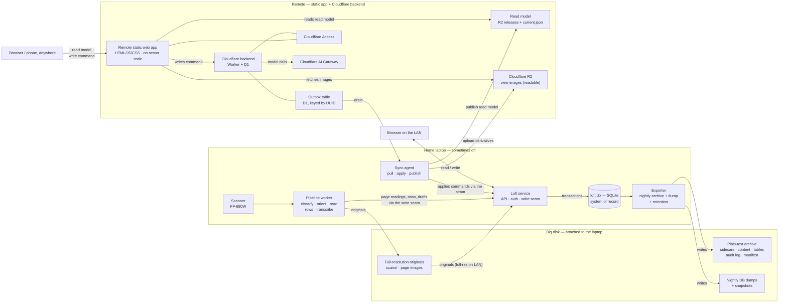

<!-- Component of docs/TECHSPEC.md. See the index for the status. -->

§17.9 is in `07-exports.md`; §17.12 is in `10-spikes.md`; §17.13 is in `09-decisions.md`.

The deployment shape is **normative** in `00-deployments.md`; the rest of this component is proposed.

## 17. The live system — database, remote site, and sync

Status: **the deployment shape is normative** (`00-deployments.md`); the
mechanism in this component is proposed. Nothing is implemented. It changes
the storage authority: the database becomes the system of record and the
plain-text archive becomes the nightly export.
The archive's longevity guarantees are unchanged — it is still the thing a
reader opens in 2046 — but it is no longer the only copy the software
writes.

### 17.1 The forces, and what exists today

**As built today.** One FastAPI process serves the app, the API and the
gated projection, and reads the archive disk directly for the review APIs.
A separate worker process runs the pipeline. The browser reads
`app/data` JSON for browsing and live APIs for review. Writes are
archive-first, then `publish` rebuilds the whole projection. There is no
database. Concurrency is a process-local `RLock` plus a check-then-write
store, with the server, the worker and the CLI all writing the same trees.
The `Outbox` exists but has no production caller, and per-line transcript
edits live only in browser `localStorage`. The result: no remote write
path, no cross-process safety, and review state split between files and
browsers.

**The forces the new architecture must satisfy:**

- The archive must remain readable, greppable and diffable without this
  software. That is the product's soul and the no-PII guard's layer.
- The family needs structured behaviour that files do badly: concurrent
  edits, review state, relations, queries, a queue.
- The scanner, the full-resolution originals and the big disk live on one
  laptop, which is sometimes off.
- The remote website must keep working while that laptop is off,
  including accepting edits.
- An edit made remotely must reach the plain-text archive without a
  bidirectional merge.
- **View images** may leave the house; full-resolution originals may not. A thumbnail-only remote site is not acceptable.
- Backup and export run nightly, with retention — not continuously.

### 17.2 The shape

One writer, two read surfaces, one export.



The rule in one sentence: **the laptop writes the database and publishes a
read model to R2; the remote is a static app that reads it
and writes commands to the backend's outbox; the big disk receives the
nightly human archive and operational backup.** The full deployment table is
`00-deployments.md`.

### 17.3 The components

| Component | Lives on | Owns | Never does |
|---|---|---|---|
| **Loft service** | laptop | the HTTP API, auth, the write seam, DB transactions | write off-site |
| **LiveStore** (`loft.db`) | laptop internal disk | the system of record: domain records, review state, pipeline state, asset catalog, audit log | hold image bytes |
| **Worker** | laptop | scanner pickup, classify, orient, read, rows, transcribe; writes results through the seam and originals to the disk | serve HTTP |
| **Sync agent** | laptop | pulls the outbox, applies commands through the write seam, publishes the read model and derivatives | write the archive or open the DB directly |
| **Exporter** | laptop | nightly operational backup, human archive, verification, retention | serve reads |
| **Archive disk** | big disk | full-resolution originals; the human archive; the operational backup | be written by the app |
| **Remote static app** | Cloudflare Pages | the static UI; reads the R2 read model; writes commands to the backend; fetches images from R2 | run server code |
| **Cloudflare backend** | Worker + D1 | chat/identify/re-read calls, the outbox, auth validation, accounts | write the archive |
| **Snapshot** | R2 | the current release and the `current.json` pointer | be the only copy |
| **Outbox** | D1 | immutable commands keyed by UUID | be edited or deleted |
| **Derivative store** | R2 | the view images (readable, row-checkable) | hold originals |
| **Browser** | LAN or anywhere | reads; writes; optimistic pending state; a local outbox while the backend is down | be the source of truth |

**Object model.** The domain nouns do not change: `Item`, `Person`,
`Place`, `Org`, `Theme`, `Relationship`, `Document`, `Page`, `Row`,
`Word`, `Transcript`, `Memory`, `ReviewChat`. The infrastructure nouns are
`LiveStore` (the SQLite store), `Command` (one immutable remote intent),
`Outbox` (the durable queue of commands), `Snapshot` (the published read
model), `SyncAgent` (pull–apply–publish), `Exporter` (the archive
materialiser and backup), `ArchiveImport` (the rebuild), `Derivative` (one
view image), `Asset` (the catalogued original or derivative),
`RemoteApp` (the static UI) and `Backend` (the managed dependency).
`Archive` keeps its name but changes job: it is the plain-text
materialisation, not the live store. The noun ownership is
`00-deployments.md`.

### 17.4 What lives where

| Capability | Laptop | Cloudflare backend / static app | Big disk |
|---|---|---|---|
| Authoritative writes | ✓ (only) | — | — |
| Browse / search (LAN) | ✓ | — | — |
| Browse / search (remote) | — | ✓ static app reads the R2 release | — |
| Transcript edit / confirm | applies | static app writes a command to the Worker | confirmed text only |
| Row drawing | applies and re-reads | static app writes a command | working state (not archived) |
| Add story / memory | applies | static app writes a command | confirmed text only |
| Identity decisions | applies | static app writes a command | confirmed/estimated only |
| Photo upload | pulls original | browser uploads to R2; the laptop pulls | keeps original |
| Scan · classify · orient · read · rows · transcribe | ✓ | — | reads originals |
| Full-resolution images | serves on LAN | — (never stored) | stores |
| View images | generates | served from R2 (readable and row-checkable) | — |
| Read model | produces | R2 publishes a release + pointer | — |
| Remote re-read | — | Worker transcribes corrected rows from the view image | — |
| Remote command queue | drains | D1 outbox | — |
| Operational backup | produces | — | stores |
| Human archive | produces | — | stores |
| Retention / trim | ✓ | — | ✓ |
| Auth | LAN session | Cloudflare Access (Google) | — |

The two deliberate omissions: **no pipeline work off-site** (it needs the
scanner and the originals), and **no full-resolution originals off-site**.
The second line needs stating precisely. The scan pixels stay home except
while an upload is in flight. The *text* — transcripts, stories, memories,
the review chat — is the intimate content, and it does live in the managed
backend behind family auth. There is one view image per page. It must be legible enough to read and to
check rows on; the row check sets the resolution. There is no separate
higher-resolution review copy and no thumbnail-only tier; the app's
card/list preview is a rendering detail.

### 17.5 Write paths

**Normative for the remote command flow.** The transaction that applies a
command is `05-schema.md` §18.5; this section does not restate it.

**W1 — at home, on the LAN.** Browser → Loft service → one SQLite
transaction → one change (one or more events) → read model marked dirty. The
response is sent after the commit, never after a projection rebuild. A
background publisher coalesces the dirty marks, uploads a new release to R2 and
flips `current.json` off the request path. This is the fast path and the only path that writes
domain state directly.

**W2 — the scanner and pipeline.** Scanner → big disk → worker → write
seam → SQLite (batch, page reading, rows, draft transcript), with
derivatives on the disk. Originals are never copied off-site. The worker is the only
producer of machine state; it owns the draft fields and humans own the
confirmation fields, which is what keeps them from fighting. The split is
enforced in the schema, not by convention: a re-read refuses to replace
a human row set newer than its input (`page_rows.source`, `pages.revision`),
instead of deleting the reviewer's corrections as the as-built path does.

**W3 — remote.** Browser → the static app → the Cloudflare backend's D1
outbox (one immutable `Command`) → `202` with the command id. The author
sees the edit immediately as pending; everyone else sees the published read
model.

Commands are classified, because they are not one kind of thing:

| Class | Examples | Apply |
|---|---|---|
| **State** | transcript edit, story save, row lines | one `BEGIN IMMEDIATE` transaction; the guard is the typed table's UPSERT with `WHERE version IS :base`; zero rows means stale |
| **Append-only decision** | identity attest/estimate/pending/delete, review decisions | append the decision and apply it (last wins); no version predicate, per the 2026-10-21 user ruling. The four words are the review's; the record status they write is the one mapping in `05-schema.md` §18.2 |
| **State + machine work** | "re-read this page", "identify this document", an import-review message that calls a model | the transaction records the intent and inserts a `jobs` row; the worker runs outside the lock; its result is a second transaction |
| **Bytes** | photo upload | the staged object is recorded as an `Asset`; the laptop pulls, re-hashes, writes and derives |

**No transaction spans a model call, a file write, or a network hop.**
That is what keeps the write lock from being held for a page read.

The laptop's sync agent pulls the outbox and applies each command
**through the service's write seam** — never by opening the DB itself —
so validation cannot be bypassed. It advances one
`sync_state.applied_through` cursor, and it uses the `command/applied`
event as the idempotency marker. The marker is not redundant with the
cursor: a decision has no version predicate, so a crash after the decision
append and before the cursor advance would otherwise apply it twice. The
outbox is a permanent append-only log, not a queue that is consumed.

```mermaid
sequenceDiagram
  autonumber
  actor R as Remote reviewer
  participant C as Remote static app
  participant B as Cloudflare backend
  participant P as R2
  participant O as Outbox table
  participant L as Laptop sync agent
  participant S as Loft service
  participant D as SQLite
  participant X as Exporter

  R->>C: edit transcript (base entity_version 12)
  C->>B: insert command (Worker API)
  B->>O: store {uuid, base 12}
  B-->>C: stored
  C-->>R: 202 accepted (pending)
  Note over R,B: the author sees it as pending; others see entity_version 12

  L->>B: pull outbox since applied_through
  B-->>L: commands
  L->>S: apply command
  S->>D: BEGIN IMMEDIATE · UPSERT items WHERE version IS 12
  alt one row changed
    D-->>S: commit + event(s)
    S-->>L: applied
    L->>L: advance applied_through
    L->>P: upload release + flip current.json
  else no row changed
    S-->>L: stale
    S->>D: command/rejected (retryable)
    Note over P: the next read model carries needs_attention
  end

  X->>D: nightly read of changed records
  X->>X: next sidecar and content versions + manifest
```

**W4 — uploads.** Browser → the static app → R2 (staging) plus an outbox
command referencing the object and its sha256. The laptop pulls
the object, re-hashes it, writes the original to the big disk, generates
derivatives, and records the asset. The staged object is deleted after the
laptop confirms. This is the only path by which a new original can enter the
house from outside; the staged copy is encrypted at rest and has a short
lifetime.

The invariants:

- **One host writes.** Every write goes through the Loft service on the
  laptop, inside a `BEGIN IMMEDIATE` transaction. The worker and the sync
  agent are clients of that seam, not second writers.
- **Idempotent.** A command whose UUID already has a `command/applied`
  event is a no-op. The event log is exported and restored, so replay
  after a restore is safe.
- **Version-checked atomically.** The guard is the typed table's
  conditional UPSERT with `WHERE version IS :base`; a zero-row result is a
  stale command, never a Python read-check-write. A stale command is parked
  as `needs_attention`.
- **One entity version, one export cursor.** `entity_version` moves only
  on a state change and is the command base; `exported_through` is the
  global event seq the archive has materialised. Exporting never touches
  `entity_version`, so it cannot staleify a command.
- **No lock across slow work.** No transaction spans a model call, a file
  write, or a network hop.
- **Audited.** Every applied command writes one change — one or more
  `events` rows — carrying its `command_id`.
- **One direction.** Remote → laptop is the outbox; laptop → remote is the
  published read model.

### 17.6 Read paths

- **LAN.** Loft service → `LiveStore`. Always current.
- **Remote.** The static app reads the release through the Worker, which reads
  `current.json` and the release from R2, plus an overlay of the caller's own
  pending commands, so an author
  sees their edit before it is applied. The read model is republished after
  each drain and on a schedule; it carries `published_at`, and the UI shows
  its age and the count of pending commands.
- **Review payload.** The release's review half is the open claims:
  `review/index.json` plus one payload per open document. A confirmed
  document is read from browse; a reopen command creates a claim and the next
  release carries its payload.
- **Parked commands.** A command that cannot apply is listed in the remote
  UI under its author, with its payload and the newer version it collided
  with. It is not reduced to an anonymous count.
- **Media.** The Worker serves the view images at `/img/<sha>` on the app's
  own origin (content-addressed, immutable-cached; no CORS, no signed URL). A
  request for an original on the remote site is refused with the honest
  answer: the original is in the house. The LAN serves originals normally.
- **Search.** SQLite FTS5 in the live DB; the index is part of the published
  read model, so remote search works on the published state.

### 17.6.1 The remote model work

The Worker runs the model-driven flows while the laptop is off:

| Flow | Context | Result |
|---|---|---|
| **Import-review chat** | the conversation + the published facts (objects, transcripts, identity tables); a read-only tool set (get person/place/item, search, get document/transcript) | messages and decisions, queued as commands |
| **Memory-capture chat** | the narrator's page, the current draft, the published facts | messages and the memory draft/save, queued |
| **Identify** | the document's transcript + the published identity tables; no scan | proposed people/places, queued |
| **Remote re-read** | the reviewer's drawn lines + the published words; the view image; the row boxes | the corrected rows' text, queued |

**Identify reads the transcript.** The scan is not sent; the transcript is
the evidence.

**The remote re-read.** The app sends the drawn lines and the published
words; the shared TS row-adjust module (the same rules as `Rows.adjust`)
builds the corrected rows; the app crops the row bands from the view image;
the Worker calls the VLM for the rows; the result queues for the laptop. The
initial row generation and transcription stay on the laptop; only the re-read
of an already-published page runs on the Worker.

**The facts are the last published release.** The Worker sees the
`current.json` release, not the live DB; the UI shows `published_at`. The
laptop re-validates every applied result and is the only writer.

**The image.** The remote re-read uses the view image — the same image the
reviewer checks rows on. The one-page comparison (view vs original, per-row
text) is the gate; if the view is not good enough, the page waits for the
laptop. There is no second, higher-resolution review tier.

**The prompts.** The Python review/memory/identify prompts and the verdict
loop are ported to TS; the published facts and the prompt templates are the
contract; a parity test runs the PRD's review cases against both.

### 17.7 The sync pattern, and the alternatives

The pattern is **single writer + immutable command outbox + materialised
read replica** — a CQRS shape without making the domain event-sourced.
It is the generalisation of the existing "frontend proposes, backend
records" rule, applied to a backend that is sometimes unreachable.

| Alternative | Why it lost |
|---|---|
| **Bidirectional replication** (Postgres logical, two-way Litestream, SQLite sync) | Two writers, conflict resolution, ordering and schema drift. The project's stated bar is that a future maintainer should not have to think hard about whether a race is possible; this fails it. |
| **Folder sync** (Syncthing, Dropbox, Drive) | Moves the append-only discipline to sync-time reconciliation. The `imports-27` collision is the cautionary tale: two writers computed the same next version and one user's words were lost. |
| **CRDT / local-first merge** (Automerge, Yjs) | Good for concurrent text, but the domain needs validation, identity and one audit order; a CRDT still needs a server-side validator, so the complexity is added without removing the writer. Possible later for the transcript text field alone. |
| **Cloud-authoritative database** (Postgres/Supabase live) | The simplest live UX, but the truth moves off-site and the laptop becomes a materialiser; "sync back to the local disk" becomes a replication problem. It is the clean upgrade path if remote freshness ever outweighs local truth. |
| **Remote app server** (the old two-app shape) | A server off-site would only serve the static app's reads and accept its writes — a second deployment, a live attack surface and a second writer, for no domain capability the Cloudflare backend does not already provide. |
| **Remote static app + Cloudflare backend (chosen)** | The static app reads R2 and writes commands to a Worker; D1 holds the outbox and chat state; Access gates the family; AI Gateway holds the model. No server we operate runs off-site. It cannot validate domain writes itself, so the laptop re-validates every command on apply. That is the cost of no server, and it is the shape in `00-deployments.md`. |

The chosen pattern's cost is freshness, and the architecture makes it
visible rather than hiding it: the read model's age and the pending count
are part of the UI, the author's own edits are never hidden from them, and
the laptop's apply is the validation the static app cannot perform.

### 17.8 The data model

The schema concepts are `05-schema.md`; the DDL is `06-schema-ddl.md`. At
the architecture level:

**One truth.** `events` is the append-only log; every other table is a
projection rebuilt from it (`05-schema.md` §18.1). A bad release can add
events but cannot erase the good ones.

**One entity version, one export cursor.** `entity_version` is the
optimistic token a remote command carries. `exported_through` is the global
event seq the archive has materialised. Exporting never touches
`entity_version`, so a nightly export cannot staleify an in-flight command.

**Ownership where the writers overlap.** `pages.revision` and
`page_rows.source` (`machine` | `human`) make the draft/confirmed split a
constraint rather than a convention: the seam refuses a re-read that would
replace a human row set newer than its input, and the projection carries
the check, instead of deleting the reviewer's corrections.

**What moves into the DB** is the whole live state: items, identities,
documents, pages, readings, review state, the asset catalog and the job
queue. What stays on disk is the originals, the human archive, the
operational backup and the nightly dumps (`07-exports.md`).
### 17.8.1 The pipeline stages in the live store

The work files are the pipeline's cache; the live store is the projection. The
reconciler reads the projection, not the markers.

| Stage | Work artifact (cache) | Live projection | Completion predicate |
|---|---|---|---|
| adopt / scan | `registry/<batch>.json`, the scan folder | `batches`, `scans`, `pages` | the batch exists and every scan has a page |
| classify | `classify.json` | `pages`/the reading's category | the page's category is recorded |
| orient | `oriented/<page>` | `pages.rotation` | the oriented image exists |
| read | `rows.json`, `words.json`, `.txt` | `pages`, `readings`, `page_rows` | the page has a non-empty reading |
| transcribe | the reading's per-row text | `page_rows.text` | every row has text |
| row check | `row-adjustments.json`, `rows-adjusted.json` | `page_rows`, `row_checks`, `page_row_links` | the correction's sha matches the reading |
| group | `boundaries.json` | `documents`, `document_pages` | a document with pages |
| confirm | the item sidecar | `items`, `item_content`, `item_refs` | the item exists and is catalogued |
| identify | the item's refs | `item_refs`, `people`, `places` | the proposals/decisions are recorded |
| review | the import session | `review_sessions`, `claims` | no open claim for the origin |

A page's status is derived from these rows; the projection may carry the
derived status for query speed, but the rows are the evidence and the
projection is rebuildable.

### 17.10 Failure modes

| Failure | Still works | At risk | Recovery |
|---|---|---|---|
| Laptop off | The remote reads the last published read model; remote edits queue; the author sees their own pending edit | No scans, no new derivatives, no export; the read model ages | Nothing lost; the outbox drains on the next run |
| Cloudflare backend down | LAN reads and writes; the static read model and images still load; the browser's local outbox holds the edit | Remote chat and writes | The outbox is durable; the browser retries on reconnect |
| Cloudflare backend lost | LAN works; the static read model and images still load; the laptop's DB remains | Commands not yet pulled | The outbox is exported; the read model and images are rebuilt from the laptop |
| Laptop lost | The big disk and the off-site dump survive | Up to one night of DB writes; originals if the disk is lost | Restore the newest dump, then replay the outbox from the restored cursor; copy originals from backup |
| Big disk lost | The DB and the off-site dump survive | Full-resolution originals unless backed up | 3-2-1 backup is still a separate requirement; the DB does not save the originals |
| Nightly failed or missed | LAN and remote keep working | The archive and its off-site copy age; the DB is still the live truth | Catch-up run on the next start; `last_verified_export_at` and a banner after N missed nights |
| Restore to before the cursor | — | Replaying events | The event log is exported and restored, so replay is idempotent; the log records no duplicate |
| Outbox grows for weeks | Everything | Storage only; the log is tiny | The cursor catches up; the outbox is never trimmed |
| Stale command | — | The author's edit | Parked as `needs_attention`; the author sees it in the remote pending list and resolves against the newer version |
| Partial read-model publish | The previous read model stays current | — | The pointer flips only after the new read model and manifest are complete |
| Ordering | — | Which command wins | Commands apply in pull order; per-record conflicts are decided by `entity_version`, not wall-clock time. There is no global order, and the UI does not claim one |

### 17.11 Technology choices and security posture

- **SQLite (WAL) for the live store.** A single file, in the Python
  stdlib, no server to babysit, easy to snapshot and copy. Postgres at
  home buys concurrency the family does not need and adds a daemon;
  DuckDB is analytics, not OLTP. The DB lives on the laptop's internal
  disk so unplugging the archive does not break the service. Pragmas are
  part of the decision: `journal_mode=WAL`, `synchronous=FULL` (this is a
  family archive, not a social feed), `busy_timeout=5000`,
  `wal_autocheckpoint=1000`, `recursive_triggers=ON`. No foreign keys; the
  write seam is the integrity check.
- **The remote is a static web app plus a small Cloudflare backend.** The
  static app reads R2; the Worker runs the chat/identify/re-read calls,
  the outbox and auth validation; D1 holds the working state; Access gates the
  family; AI Gateway holds the model. There is no server we operate: the
  laptop's apply is the domain validation the static app cannot perform.
- **The outbox is a D1 table, keyed by UUID.** D1 is durable and managed;
  we run no queue service. The command row
  is immutable, and the laptop's `applied_through` cursor is the progress
  state. It is never trimmed: it is the replay source after a restore, and
  it is small.
- **The published read model is an R2 release plus a pointer.** The laptop
  uploads the release's JSON and images under `releases/<seq>/`, then flips
  `current.json`; the app reads the pointer. The pointer flips only when every
  referenced part is present. The laptop uses an **R2 API token** for the
  upload; the outbox pull uses a **Cloudflare Access service token**.
- **Derivatives are generated on the laptop and uploaded.** On-the-fly
  resizing at the edge would add a service and put the original one hop
  from the internet.
- **Auth is Google on both surfaces, with the same family allowlist.**
  Remote: Cloudflare Access in front of Pages and the Worker; the Worker reads
  the Access JWT. Home: the local service's Google OAuth (web/device flow),
  HTTPS, `HttpOnly`/`Secure`/`SameSite=Strict` cookies, CSRF, short sessions
  with server-side revocation, body caps and rate limits. The home service is
  reachable on the LAN and the tailnet; **Tailscale is the remote network
  boundary, not the app auth** — every request still signs in with Google. The
  LAN is not trusted. D1 is the login authority; SQLite mirrors the accounts
  for LAN auth and backup. The static app never sees the client secret.
- **Search is SQLite FTS5 in the live DB**; the published read model
  carries a client-searchable index. The service probes FTS5 at startup and
  fails loudly rather than silently degrading to no search.

**Security posture.** The Cloudflare backend, D1 and R2 hold the words and
images, so they are treated as trusted-but-limited surfaces, not public:

- Object-storage buckets are private; reads go through the Worker's `/img`
  and `/model` routes behind Access; writes use a server-side credential the
  browser never sees.
- Cloudflare Access and the Worker gate access; the laptop validates a
  command's schema, actor and role again before applying. A compromised backend credential cannot inject an arbitrary
  domain write.
- Staged uploads have a quota, an allowed MIME set, a sha256 check and a
  short lifetime; the laptop deletes the staged object after the pull.
- The LAN service binds to the tailnet/LAN, never a port-forward; the static
  site and the Worker are the only public surfaces.
- The laptop's disk is encrypted at rest (the whole corpus now lives on
  it); the nightly off-site copy is encrypted with a family-held key
  recorded with the media, never a vendor key.
- Every write API has a body cap (the existing `MAX_BODY_BYTES` is
  defined but unused); the backend's outbox writes are rate-limited per
  actor.
- `events.actor_id` is a person id (or a reserved system id), resolved
  server-side, not a client-sent string; an account maps an optional login
  to that person.
### 17.14 What this changes in the existing design

**Status: normative.** These supersessions are decisions; the rest of §17 is
proposed.

| Existing decision | Status | Why |
|---|---|---|
| **P2 — "no database"** | Superseded | The browser still has no DB; the laptop now has one, because the structured features are worth it. |
| **§3 — "no server database"** | Superseded | The folder is no longer the live store; it is the export. |
| **§12 — SQLite rejected as "database lock-in"** | Superseded | SQLite is in the stdlib, carries one of the strongest documented longevity commitments of any format, and the plain-text export remains the hedge. |
| **§16.15 — backend owns the write seam; frontend proposes** | Retained in shape, inverted in direction | The laptop is still the write seam; the Cloudflare backend is now the read model and outbox, not a live proposer to a reachable backend. |
| **§16.12 — Supabase as the live multi-user store** | Not adopted | It puts the truth off-site; the same structured features are served by SQLite at home. |
| **PRD §3/§11 — version chains on disk; the prior version survives** | Satisfied by the DB, not the disk tree | `events` + `content` are the append-only chain: every prior version is an event row plus an immutable blob, and a withdrawal is a new event. The human archive is confirmed current state; the operational backup carries the full history and content. The PRD's disk-chain *format* is superseded; its durability *requirement* is met in the DB. |
| **`docs/sqlite-projection-plan.md`** | Superseded | It made the archive the system of record and the DB a projection. This section makes the DB the record and the archive the export. The document is retained as history. |
| **`Outbox` (unwired)** | Replaced, not extended | The existing class is a consumption queue (reads every file, unlinks on receipt); the new outbox is a permanent append-only log with a laptop cursor. |
| **No-PII guard and weekly evals** | Read the DB when the export is absent | `tests/test_no_pii_in_repo.py` currently skips when `archive/people.json` is missing, so a stalled export would make the guard pass vacuously; the guard must fail hard if neither source exists, and the evals run against the DB and the export separately. |
| **`Archive`** | Becomes the exporter/importer | `LiveStore` owns the live data; `Archive` owns the plain-text materialisation and rebuild. |
| **Registry and work tree as files** | Become events and projections | The review surface must work remotely, so the drafts and rows must be in the published read model, not only on the laptop. Files remain a cache. |
| **Browser `localStorage` edits** | Become commands plus UI state | The edits that matter are durable commands; scroll position and similar UI state stay local. |
| **`publish`** | Splits into read-model publish, human archive and operational backup | They are different jobs with different cadences and different guarantees. |
| **`publish` on the request path** | Moves off it | The server currently republishes synchronously after several writes; the read model is published asynchronously, and the response waits only for the commit. |
| **Process-local locks** | SQLite transactions | One writer plus real transactions replaces the RLock and the check-then-write CAS. |
| **`tools/store.py` check-then-write** | Replaced by a `link()` create-if-absent primitive | The exporter cannot be append-only on a primitive that can silently overwrite a version. |
| **CLI review gate and `record_confirmation` write the archive directly** | Cut over to the DB | The exporter is the only archive writer; the CLI becomes a client of the same seam. |
| **Identity decisions are version-gated** | Exempt | The 2026-10-21 user decision: a determination is always applied and recorded, last wins, with no staleness to detect. |
| **Date-partitioned document storage (`docs/object-model.md` Phase 5)** | Resolved: flat `items/<id>/` plus a generated index | `07-exports.md` §18.8: stable paths and `INDEX.md` give chronology without moving folders. |
| **`edits.jsonl` and `audit.jsonl`** | One log: `events` | The event log is the audit; the operational backup carries it as `events/`. |

---
