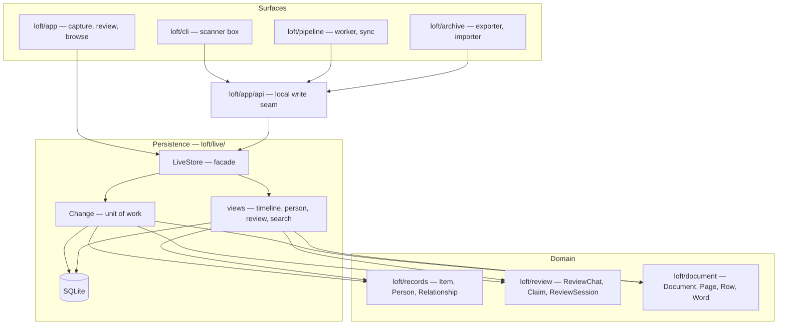

<!-- Component of docs/TECHSPEC.md. See the index for the status. -->

§19.9 is in `09-decisions.md`; §19.10 is in `10-spikes.md`.

The deployment shape is `00-deployments.md`; this component is the code boundary.

## 19. Code organisation and the persistence boundary

Status: **normative.** §17 says where the system runs, §18 what it
stores. This section says how the code is arranged, and — the part that
matters most for the people who will extend it — what the database layer
looks like from above.

### 19.1 The layers



Arrows point down. **The domain packages never import persistence**: an
`Item` does not know SQLite exists, and `Document.confirm()` returns a
document, not a row. The persistence package imports the domain types; the
service imports the persistence facade, and the daemon imports its local API
client and the domain types.

### 19.2 One package speaks SQL

- **`loft/live/` is the only package that imports `sqlite3`, and the
  service is the only process that hosts it.** The server calls `LiveStore`
  in process; the worker, sync agent, exporter and CLI call the service's
  local API and never open the database.
- The service's public surface is deliberately small: `LiveStore`, `Change`,
  the view records (`TimelineEntry`, `PersonPage`, `ItemDetail`,
  `ReviewQueueEntry`, `SearchHit`, `ExportView`, `Snapshot`), and the error
  types. The event log, the projection modules, the content store and the SQL
  helpers are private.
- `loft/archive/export.py` (the exporter) and `loft/pipeline/sync.py` (the
  sync agent) call the service's local API for reads and writes; they never
  import `LiveStore`, `loft.live.sqlite`, or write SQL.
- A test enforces the rule: `sqlite3` appears only under `loft/live/`; no
  module outside it imports the private modules.

### 19.3 The interface's UX

The interface is judged by the five minutes a developer spends adding a
feature, not by its SQL. The rules:

1. **Types, not rows.** Signatures use `Item`, `Person`, `Document`, `Page`,
   `Claim`, `PersonId`; never `dict`, `sqlite3.Row`, table names or column
   names. The type is the documentation.
2. **One write path.** `with store.change(...)` is the only way to write.
   The store writes the event, the projection, the audit row and the
   idempotency marker; the caller supplies the domain change and the actor.
3. **The change is the transaction.** Commit on exit, roll back on an
   exception, read your writes inside, and no nested changes. A batch import
   is one change with many saves, not a save per transaction.
4. **The event is derived.** `save` derives `created`/`superseded`/`deleted`
   from the object and whether it exists; `merge`, `resolve`, `withdraw` and
   `confirm` are named verbs. The caller never builds an event payload.
5. **Stale is an exception with the current value.**
   `StaleVersion(current=item, base=12)` — the caller can re-read, merge or
   show the conflict; there is no silent last-write-wins.
6. **Queries are explicit and paginated.** `store.timeline(query)` returns a
   `Page[TimelineEntry]` with a cursor, not an unbounded list. There is no
   lazy loading and no N+1.
7. **Views are product-shaped.** `TimelineEntry`, `PersonPage`,
   `ItemDetail`, `ReviewQueueEntry`, `SearchHit` carry what the surface
   renders; the UI does not join.
8. **No SQLite errors escape.** `sqlite3.IntegrityError`,
   `OperationalError` and a busy lock become `StaleVersion`, `Conflict`,
   `Busy`, `NotFound` — errors a caller can act on.
9. **Test without SQL.** A `MemoryLiveStore` implements the same protocol;
   the contract suite runs against both. Domain and pipeline tests use the
   memory store; only the SQL store's own tests know about SQLite.
10. **The facade is the documentation.** A short usage example in the module
    docstring and this section; a new developer reads one file, not the
    schema.

### 19.4 A change, in practice

```python
from loft.archive.live import LiveStore
from loft.archive import Item

with store.change(actor=person_id, note="confirm the letter") as change:
    document = change.documents.require(document_id)
    item = document.confirm(by=person_id)
    change.items.save(item, base=item.version)
    change.claims.resolve(claim_id, decision="confirmed", basis=basis)
# commit: one change_id, the events, the projection updates, the audit
```

- **Create:** `change.items.save(item)` — `base=None`; the store writes
  `created`.
- **Delete:** `item = item.tombstone(reason=...); change.items.save(item,
  base=item.version)` — the store writes `deleted`.
- **Merge:** `change.people.merge(loser=..., survivor=..., by=person_id)` —
  the store writes `merged` and updates `aliases`.
- **Review:** `change.reviews.append(session_id, message)` and
  `change.claims.resolve(...)`.
- **Batch:** one `with` block, many `change.pages.save(...)`; one
  transaction, one `change_id`, one export-visible change.

The repositories on `Change` are `items`, `people`, `places`, `orgs`,
`themes`, `relationships`, `documents`, `pages`, `readings`, `claims`,
`reviews`, `assets`, `jobs`, `accounts` and `content`. Each is one class in
one file, named after the collection; each owns its domain type's mapping.

### 19.5 Queries and read models

```python
store.items.get(item_id)                 # Item | None
store.items.require(item_id)             # Item, raises NotFound
store.timeline(TimelineQuery(decade="1960", person=person_id))
store.person_page(person_id)             # PersonPage
store.item_detail(item_id)               # ItemDetail
store.review.queue(kind="import")        # tuple[ReviewQueueEntry, ...]
store.search("house hunt")               # Page[SearchHit]
store.export_view()                      # ExportView — the exporter's read side
store.snapshot()                         # Snapshot — the publisher's read side
```

- **Cursor pagination.** `Page[T]` carries `items`, `next_cursor` and
  `total | None`; the cursor is a `(date, id)` or `seq` token, never an
  offset. The timeline is the hot path.
- **No policy in the store.** Sensitivity, draft visibility and the hosted
  browse's filters belong to the surface; the store returns what the caller
  asks for, so the human archive and the remote can apply different rules
  without two queries.
- **`ExportView` and `Snapshot` are read-only protocols.** They expose the
  confirmed records, the content stream and the event log; they do not expose
  a connection.

### 19.6 The domain class and its row

The domain class owns three things: its wire shape (`to_dict`/`from_dict`),
its invariants (`Item.from_dict` validates; `Document.confirm` returns the
confirmed document), and its projection row (`Item.write_row`/`read_row`).
The persistence layer calls the row mapping; the class never imports SQLite.
A round-trip test pins `to_dict` → event payload → `read_row` → `to_dict`.

A new entity kind means: a class, a projection table, a repository on
`Change`, a vocabulary entry, an export mapping. The architecture test fails
until all five exist; adding a kind is a deliberate migration, not a JSON
blob.

### 19.7 Testing the boundary

- **The contract suite.** One suite runs against `SqliteLiveStore` and
  `MemoryLiveStore`: save/read, stale, rollback, claim closure, merge,
  content-addressing, pagination.
- **SQL-only tests.** DDL, triggers, `INSERT OR REPLACE`, the hash chain,
  `VACUUM INTO`, rebuild equality and export. They are the only tests that
  import `sqlite3`.
- **Domain tests.** No database at all; `Item`, `Person`, `Document` and
  `Page` are pure.
- **The architecture test.** The repo already enforces layers with
  ArchUnitPython in `tests/test_architecture_layers.py` (foundation,
  pipeline, server, evals). When the `loft/` layout lands, the same file
  gains `domain`, `persistence` and `surfaces`: `persistence` may depend
  only on `domain`, and `domain` may not depend on `persistence` or
  `surfaces`. `sqlite3` appears only under `loft/live/`; no surface
  imports the private modules. The new rule lands with the package, never as
  a skipped placeholder.

### 19.8 What moves in the current code

| Today | Target |
|---|---|
| `tools/archive.py` (the file store's facade) | `loft/records/` — the entities and the `Records` aggregate; `loft/archive/` — the exporter and importer |
| `tools/store.py`, `tools/atomic.py` | `loft/live/content.py` (content-addressed blobs) and the exporter's atomic writes |
| `pipeline/api/server.py` | `loft/app/` surfaces; they call `LiveStore`, never SQL |
| `pipeline/api/sync.py` | `loft/pipeline/sync.py` — the sync agent; it applies commands through the service's local API |
| `pipeline/worker.py` | `loft/pipeline/worker.py`; it writes through the service's local API |
| `pipeline/registry.py`, `pipeline/store.py` | the `batches`/`scans` projections and the content store (`loft/live/`); the old work files are read once by the migration, then gone |
| `pipeline/artefacts.py` | `loft/pipeline/artefacts.py` — the derivative path layout (oriented image, view image); not state |
| `tools/records.py` | `loft/records/` entities (one class per file) |
| `tools/review.py` | `loft/review/` — `ReviewChat`, `ReviewDecision`, `ReviewSession`, `Claim` |
| `document/` | `loft/document/` |
| `tests/test_architecture.py` | the new import rules above |
